> **نسخه پاسخ‌دار L01 — محرمانه.** این فایل برای مدرس یا خودآموزی است. آن را به چت‌بات تدریس نده و در گیت عمومی نگذار.
> تمام پاسخ‌ها و نقشه‌ی نموداری مینی‌پروژه‌ها بعد از هر مورد آمده‌اند.

# آموزش جامع سیسکو سی‌سی‌ان‌ای

## درس L01 — اجزای شبکه، توپولوژی و معماری

- **حوزه آزمون:** حوزه ۱ (اصول شبکه)
- **فاز:** فاز یک — اصول شبکه و زبان خط فرمان
- **مدرس:** محمد مهدی گنجی
- **سطح آزمایشگاه:** سطح ۲ (یک سوییچ و سه دستگاه پایانی)
- **نسخه نقشه راه:** ۱.۰

---

## ۱. خوشامدگویی

سلام و خسته نباشی! توی درس صفر پکت تریسر رو نصب کردی، دو تا رایانه رو به یه سوییچ وصل کردی و بینشون پینگ گرفتی. حالا وقتشه یه قدم عقب بایستیم و کل «زمین بازی» رو ببینیم.

فرض کن می‌خوای وارد یه شهر بشی. قبل از اینکه کوچه‌ها رو یاد بگیری، باید بدونی توی شهر چه جور ساختمون‌هایی هست (بیمارستان، پست، میدون) و خیابون‌ها چطور به هم وصل شدن (حلقه‌ای، شعاعی، شطرنجی). این درس همون نقشه شهره: اجزای شبکه، شکل اتصالشون و معماری‌های رایج.

توی این درس **هیچ دستور سیسکویی** نمی‌نویسیم و **با آدرس‌دهی کاری نداریم**. فقط می‌شناسیم، می‌کشیم، می‌سازیم و اسم می‌گذاریم.

---

## ۲. اهداف قابل سنجش

در پایان این درس باید بتوانی:

1. تفاوت روتر، سوییچ لایه دو، سوییچ لایه سه، فایروال نسل بعد، سامانه جلوگیری از نفوذ، اکسس پوینت، کنترلر وایرلس، نقطه پایانی و سرور را بدون نگاه به جزوه توضیح بدهی؛
2. مفهوم «برق از طریق کابل شبکه» و «تلفن اینترنتی» را با یک مثال بگویی؛
3. توپولوژی‌های ستاره، مش کامل، مش جزئی، درخت و گذرگاه را بشناسی و مزایا و معایبشان را مقایسه کنی؛
4. معماری دو لایه، سه لایه، هسته فشرده و اسپاین-لیف را روی کاغذ بکشی و فرقشان را بگویی؛
5. شبکه گسترده، شبکه کوچک خانگی/اداری، درون‌سازمانی و ابری را از هم تشخیص بدهی؛
6. مدل کارخواه-خدمت‌گزار و همتا به همتا را توضیح بدهی؛
7. جریان ترافیک شمالی-جنوبی و شرقی-غربی را روی یک نقشه نشان بدهی؛
8. یک توپولوژی ستاره‌ای در پکت تریسر بسازی و دستگاه‌ها را با قرارداد نام‌گذاری استاندارد برچسب بزنی.

---

## ۳. پیش‌نیازها و وضعیت احراز

| مفهوم/مهارت موردنیاز | درس معرفی‌کننده | وضعیت آموزش | شواهد تسلط | تصمیم |
|---|---|---|---|---|
| کار با پکت تریسر (چیدن دستگاه) | L00 | آموزش‌داده‌شده | تمرین‌شده و تأییدشده | مجاز |
| کابل راست | L00 | آموزش‌داده‌شده | تمرین‌شده و تأییدشده | مجاز |
| ذخیره فایل لب با شماره نسخه | L00 | آموزش‌داده‌شده | تمرین‌شده و تأییدشده | مجاز |
| آشنایی با گیت و آپلود | L00 | آموزش‌داده‌شده | تأییدشده | مجاز |
| آدرس‌دهی آی‌پی | L00 (فقط سطح پایه) | مقدماتی | — | **ممنوع در این درس** |
| خط فرمان آی‌او‌اس | هنوز آموزش داده نشده | — | — | **ممنوع در این درس** |

شکاف پیش‌نیاز: ندارد.

---

## ۴. مفاهیم مجاز و غیرمجاز در این مرحله

**مجاز:** اجزای شبکه، توپولوژی، معماری، مدل کارخواه-خدمت‌گزار، جریان ترافیک، نام‌گذاری دستگاه‌ها، ساخت نقشه در پکت تریسر.

**غیرمجاز (در این درس):** هر نوع آدرس‌دهی (آی‌پی، ماسک، مک)، هر دستور آی‌او‌اس، وی‌لن، مسیریابی، پروتکل‌های لایه‌های بالاتر.

اگه توی نقشه‌ات جایی دلت خواست آدرس بدی، صبر کن؛ جاش توی درس‌های بعدیه.

---

## ۵. واژه‌نامه درس

| شکل انگلیسی | تلفظ فارسی |
|---|---|
| Router | روتر |
| Switch (Layer 2 / Layer 3) | سوییچ (لایه دو / لایه سه) |
| Next-Generation Firewall (NGFW) | فایروال نسل بعد |
| Intrusion Prevention System (IPS) | سامانه جلوگیری از نفوذ (آی‌پی‌اس) |
| Access Point (AP) | اکسس پوینت |
| Wireless LAN Controller (WLC) | کنترلر وایرلس |
| Endpoint | نقطه پایانی |
| Server | سرور |
| Client | کارخواه (کلاینت) |
| Voice over IP (VoIP) | تلفن اینترنتی |
| Power over Ethernet (PoE) | برق از طریق کابل شبکه (پی‌او‌ای) |
| Topology | توپولوژی |
| Star | ستاره |
| Full mesh / Partial mesh | مش کامل / مش جزئی |
| Tree | درخت |
| Bus | گذرگاه |
| 2-Tier / 3-Tier | دو لایه / سه لایه |
| Collapsed Core | هسته فشرده |
| Spine-Leaf | اسپاین-لیف |
| WAN | شبکه گسترده (وَن) |
| SOHO | شبکه کوچک خانگی/اداری (سوهو) |
| On-premises | درون‌سازمانی |
| Cloud | ابری |
| Client-Server | کارخواه-خدمت‌گزار |
| Peer-to-Peer | همتا به همتا |
| North-South traffic | ترافیک شمالی-جنوبی |
| East-West traffic | ترافیک شرقی-غربی |
| Hostname | اسم دستگاه (دستورش در درس‌های بعد می‌آید) |

---

## ۶. آموزش مفهومی

### ۶.۱ اجزای شبکه

**مثال روزمره:** یه شهر رو در نظر بگیر. ساختمان‌ها (خونه‌ها) همون دستگاه‌های پایانی‌اند، خیابون‌ها کابل‌ها، چهارراه‌ها سوییچ‌ها، و پست مرکزی که نامه‌ها رو بین شهرها جابه‌جا می‌کنه روتره.

#### روتر
**تعریف ساده:** دستگاهی که شبکه‌های مختلف رو به هم وصل می‌کنه و تصمیم می‌گیره بسته از کدوم مسیر بره.
**چرا مهمه:** بدون روتر، شبکه‌ت فقط تو همون اتاق می‌مونه و به اینترنت یا شعبه دیگه نمی‌رسه.
**اگه نباشه:** هر شبکه یه جزیره‌ی بسته می‌مونه.

#### سوییچ لایه دو
دستگاهی که دستگاه‌های **یک شبکه محلی** رو به هم وصل می‌کنه و فقط بر اساس «شناسه سخت‌افزاری کارت شبکه» تصمیم می‌گیره. مثل متصدی یه ساختمان که می‌دونه هر واحد کجاست.

#### سوییچ لایه سه
سوییچی که علاوه بر کار سوییچ، می‌تونه مثل روتر هم تصمیم‌گیری کنه. سرعتش بالاست و معمولاً داخل ساختمان یا مرکز داده استفاده می‌شه.

**تفاوت یک‌خطی:** روتر بیشتر برای اتصال شبکه‌ها به بیرون و شعبه‌هاست؛ سوییچ بیشتر برای اتصال دستگاه‌ها داخل یک شبکه.

#### فایروال نسل بعد
نگهبان ورودی. فقط به آدرس و درگاه نگاه نمی‌کنه؛ برنامه‌ها، کاربرها و محتوای ترافیک رو هم می‌شناسه و تصمیم می‌گیره عبور بده یا نه.

#### سامانه جلوگیری از نفوذ
مثل دوربین مداربسته‌ای که همزمان درِ خودکار هم داره: ترافیک مشکوک رو تشخیص می‌ده و جلوش رو می‌گیره. این سامانه می‌تونه دستگاه جداگانه باشه یا داخل فایروال نسل بعد قرار بگیره.

#### اکسس پوینت
دستگاهی که سیگنال بی‌سیم می‌ده تا گوشی و لپ‌تاپ به شبکه سیمی وصل بشن. مثل یه در که دیوار شیشه‌ای بین دنیای بی‌سیم و سیمی رو باز می‌کنه.

#### کنترلر وایرلس
مدیر چند اکسس پوینت. به جای اینکه هر اکسس پوینت رو جداگانه تنظیم کنی، تنظیمات رو یک‌جا به همه می‌ده. مثل مدیر شعب یه فروشگاه زنجیره‌ای.

#### نقطه پایانی
هر دستگاهی که کاربر یا فرایندی ازش استفاده می‌کنه و ترافیک رو **شروع** یا **تمام** می‌کنه: رایانه، لپ‌تاپ، گوشی، چاپگر، دوربین، تلفن اینترنتی.

#### سرور
رایانه‌ای که **خدمتی** به بقیه می‌ده: صفحه وب، فایل، ایمیل، چاپ.

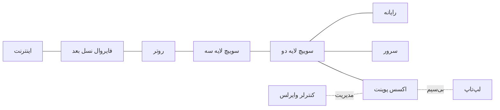

> **نکته:** این نمودار «نمونه» است؛ شبکه‌ها شکل‌های متفاوتی دارند و ترتیب دستگاه‌ها همیشه همین نیست.

**برچسب پشتیبانی پکت تریسر:**
- روتر، سوییچ، رایانه، سرور، اکسس پوینت: **کامل** (مدل دقیق دستگاه در نسخه نصب‌شده: نیازمند راستی‌آزمایی)
- فایروال نسل بعد، سامانه جلوگیری از نفوذ، کنترلر وایرلس: **مفهومی** (اینجا فقط نمودار و تحلیل)

### ۶.۲ تلفن اینترنتی و برق از طریق کابل شبکه (مفهوم)

**تلفن اینترنتی:** به جای سیم تلفن جدا، صدا به بسته‌های دیجیتال تبدیل می‌شه و از همون شبکه رایانه‌ها می‌گذره. یک کابل برای رایانه و تلفن کافیه.

**برق از طریق کابل شبکه:** سوییچ می‌تونه روی همون کابل شبکه، برق کم‌ولتاژ هم بفرسته. نتیجه: تلفن، دوربین و اکسس پوینتِ سقفی بدون آداپتور و بدون پریز کار می‌کنن.

**چرا مهمه:** نصب سقفی ساده‌تر می‌شه و با یک سوییچ می‌شه خاموش و روشن کردن مرکزی داشت.
**اگه نباشه:** برای هر دستگاه سقفی باید پریز یا آداپتور بکشی.

**برچسب پشتیبانی:** **جزئی** (در پکت تریسر بعضی دستگاه‌ها مثل تلفن اینترنتی هستند، اما رفتار برق‌رسانی دقیق شبیه‌سازی نمی‌شه؛ نیازمند راستی‌آزمایی در نسخه نصب‌شده).

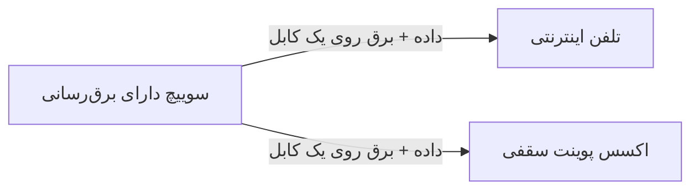

### ۶.۳ توپولوژی (شکل اتصال دستگاه‌ها)

**مثال روزمره:** شکل خیابون‌های یه محله.

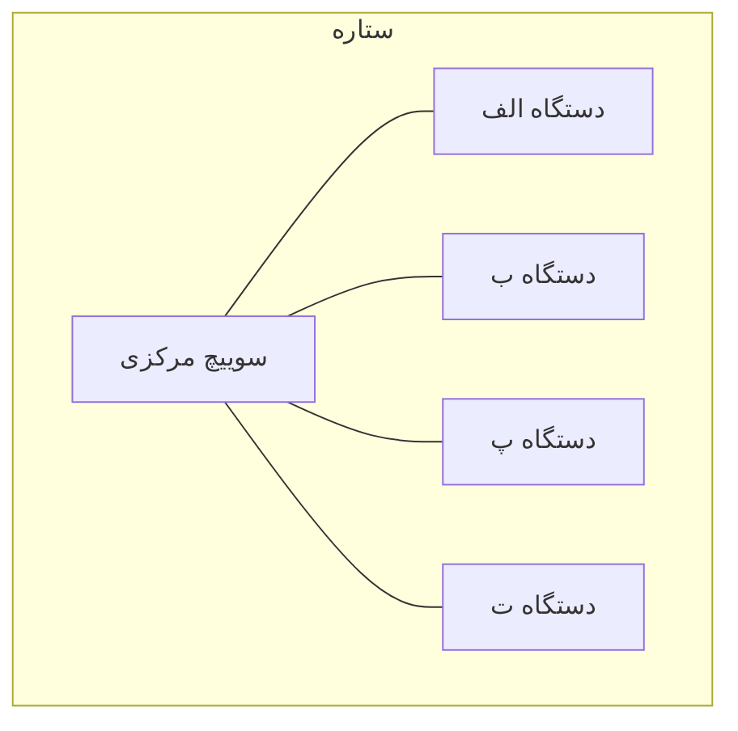

**ستاره:** همه به یک نقطه مرکزی وصل‌اند. ساده، عیب‌یابی راحت؛ ولی اگه مرکز خراب شه، همه قطع می‌شن. این رایج‌ترین شکل در شبکه‌های محلی امروزیه.

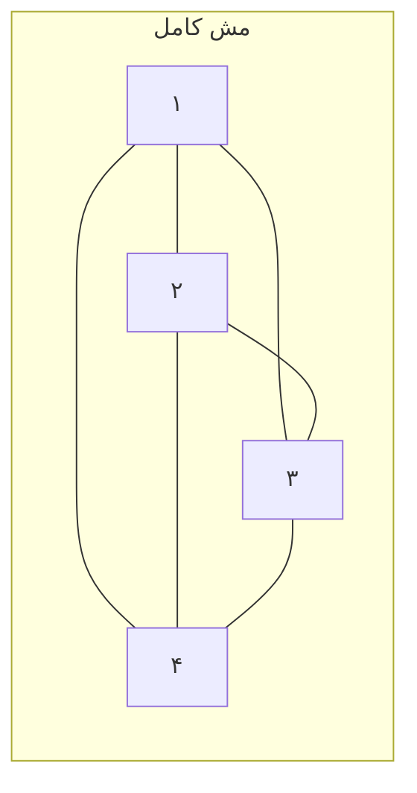

**مش کامل:** هر دستگاه به همه دستگاه‌های دیگه وصله. بسیار مطمئن؛ ولی تعداد کابل‌ها با رشد دستگاه‌ها سریع زیاد می‌شه. قانون شمارش اتصال‌ها بین n دستگاه:

```text
n × (n - 1) ÷ 2
```

**مثال حل‌شده (با عدد متفاوت از تمرین):** برای ۳ دستگاه: ۳ × ۲ ÷ ۲ = ۳ اتصال. برای ۸ دستگاه: ۸ × ۷ ÷ ۲ = ۲۸ اتصال.

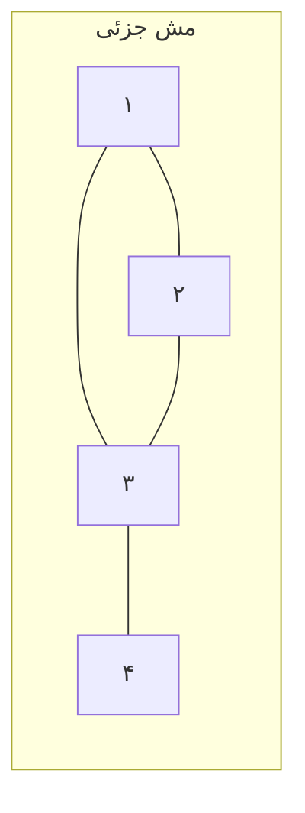

**مش جزئی:** فقط بعضی دستگاه‌ها به هم چند مسیره وصل‌اند. تعادل بین هزینه و اطمینان؛ در شبکه‌های گسترده زیاد دیده می‌شه.

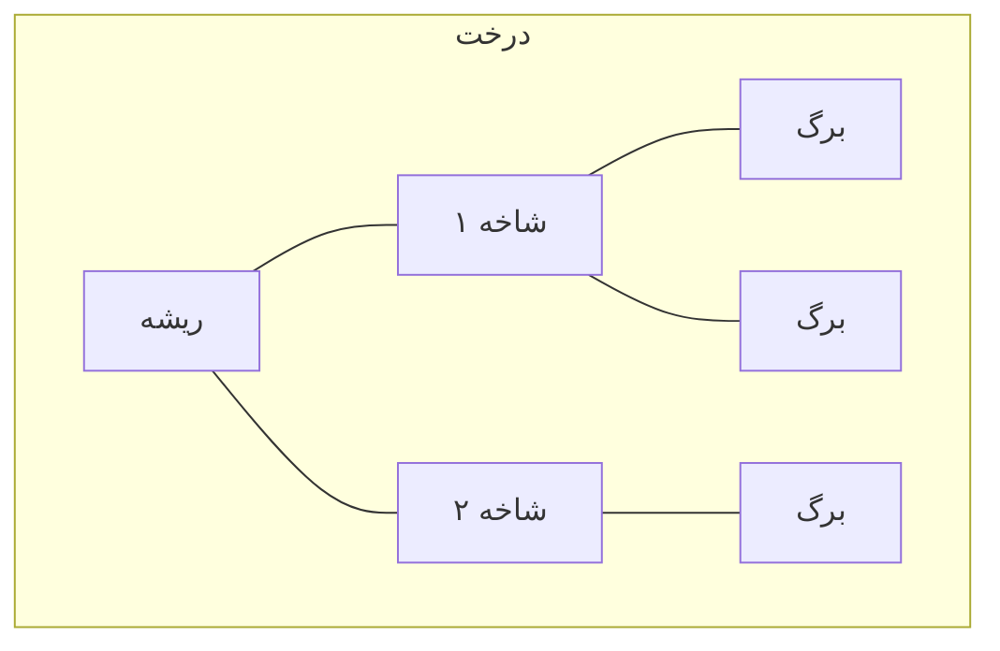

**درخت:** ستاره‌هایی که به هم زنجیر شدن. ساختار سلسله‌مراتبی؛ مثل شبکه‌ی چند طبقه. اگه یه شاخه قطع بشه، همه‌ی زیرمجموعه‌اش قطع می‌شن.

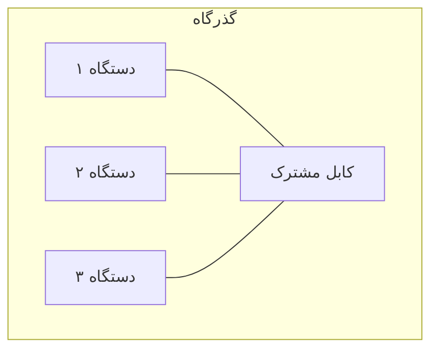

**گذرگاه (تاریخی):** همه روی یک کابل مشترک. امروز تقریباً استفاده نمی‌شه چون یک قطعی کل شبکه رو می‌خوابونه و عیب‌یابیش سخته؛ ولی در سؤال‌ها و کتاب‌ها برای مقایسه می‌آید.

**برچسب پشتیبانی:** ستاره و درخت: **کامل**؛ مش جزئی و مش کامل: **کامل** (برای تعداد کم دستگاه، پورت‌های سوییچ محدودکننده‌ان)؛ گذرگاه: **مفهومی**.

### ۶.۴ معماری‌های رایج

#### دو لایه
دو سطح: لایه دسترسی (اتصال دستگاه‌ها) و لایه توزیع/هسته (اتصال سوییچ‌های دسترسی به هم و به بیرون). مناسب شبکه‌های متوسط.

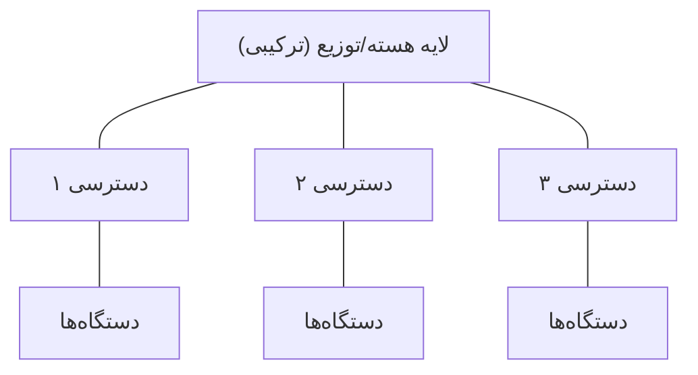

#### هسته فشرده
دقیقاً همین ساختار دو لایه که در آن نقش هسته و توزیع در یک سطح ادغام شده. نام‌گذاری سیسکو برای این حالت «هسته فشرده» است.

#### سه لایه
سه سطح جدا: دسترسی، توزیع و هسته. برای شبکه‌های بزرگ (دانشگاه، چند ساختمان) که لازمه هر کار نقش مشخصی داشته باشه.

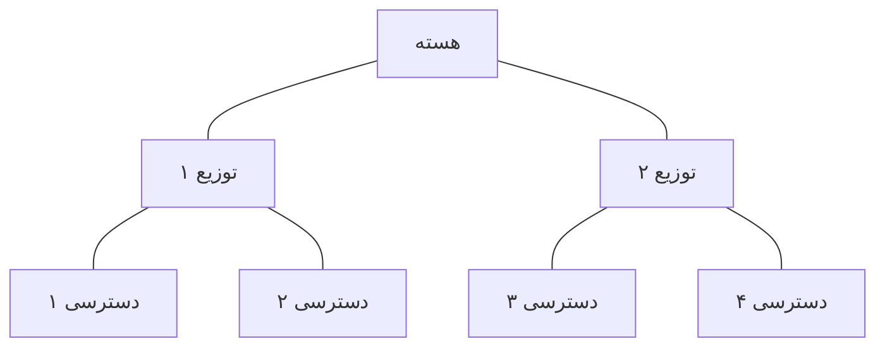

| لایه | وظیفه |
|---|---|
| دسترسی | اتصال دستگاه‌های کاربران و اکسس پوینت‌ها |
| توزیع | جمع‌کردن ترافیک دسترسی، اعمال سیاست‌ها، مرز بین بخش‌ها |
| هسته | عبور سریع ترافیک بین بخش‌های بزرگ؛ بدون کارهای سنگین |

**چه موقع کدام؟** هرچه ساختمان‌ها و تعداد سوییچ‌ها بیشتر باشه، جداسازی لایه‌ها منطقی‌تره؛ در شبکه‌ی کوچک، هسته فشرده از نظر هزینه و سادگی بهتره.

#### اسپاین-لیف (مفهومی)
معماری مرکز داده: هر «لیف» (برگ) به همه‌ی «اسپاین»‌ها (ستون فقرات) وصله، ولی لیف‌ها به هم وصل نیستن. فاصله‌ی هر دو سرور همیشه یکسانه و ترافیک بین سرورها سریع و قابل‌پیش‌بینی می‌ره.

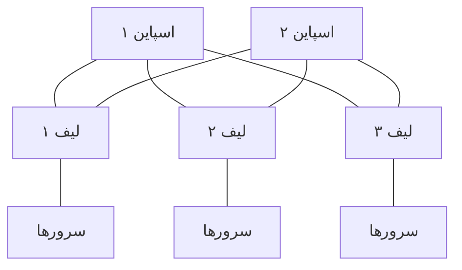

**برچسب پشتیبانی:** دو لایه و سه لایه و هسته فشرده: **کامل** (با تعداد کم دستگاه)؛ اسپاین-لیف: **مفهومی**.

#### شبکه گسترده
شبکه‌ای که شعبه‌ها یا شهرها رو به هم وصل می‌کنه و معمولاً از خطوط یک شرکت ارتباطی اجاره می‌شه. **برچسب:** جزئی (فقط به شکل اتصال روتر به روتر در پکت تریسر).

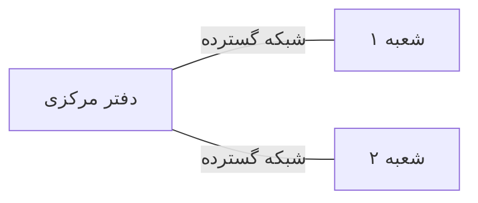

#### شبکه کوچک خانگی/اداری
همه‌چیز در یک دستگاه یا چند دستگاه ساده: یک مودم-روتر-سوییچ-اکسس‌پوینت همه‌کاره. **برچسب:** کامل.

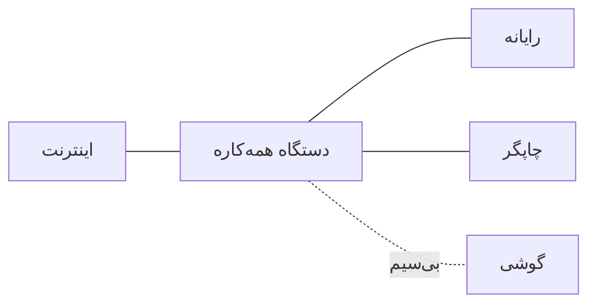

### ۶.۵ درون‌سازمانی در برابر ابری

| | درون‌سازمانی | ابری |
|---|---|---|
| تجهیزات | داخل ساختمان خودت | در مرکز داده‌ی شرکت ارائه‌دهنده |
| هزینه اول | زیاد (خرید دستگاه) | کم (اجاره) |
| کنترل | کامل | محدود به امکانات ارائه‌دهنده |
| مدیریت و نگهداری | با تو | بیشتر با ارائه‌دهنده |
| مناسب | داده‌ی حساس و لازم‌ماندن در محل | رشد سریع و تقاضای متغیر |

**برچسب پشتیبانی:** ابر و مرکز داده: **مفهومی** (در پکت تریسر شبیه‌سازی نمی‌شه؛ فقط نمودار و تحلیل).

### ۶.۶ کارخواه-خدمت‌گزار و همتا به همتا

**کارخواه-خدمت‌گزار:** مثل مشتری و فروشنده. مشتری (کارخواه) درخواست می‌ده؛ فروشنده (سرور) پاسخ می‌ده. سرور همیشه روشنه و منتظر.

**همتا به همتا:** مثل دو دوست که کتاب‌هاشون رو با هم عوض می‌کنن. هر دستگاه هم می‌خواد و هم می‌ده.

```mermaid
flowchart LR
    subgraph کارخواه-خدمت‌گزار
        C1["کارخواه ۱"] -->|درخواست| S["سرور"]
        C2["کارخواه ۲"] -->|درخواست| S
        S -->|پاسخ| C1
        S -->|پاسخ| C2
    end
    subgraph همتا به همتا
        P1["همتا ۱"] <--> P2["همتا ۲"]
        P2 <--> P3["همتا ۳"]
        P1 <--> P3
    end
```

| | کارخواه-خدمت‌گزار | همتا به همتا |
|---|---|---|
| مدیریت | مرکزی | پراکنده |
| امنیت و کنترل | ساده‌تر | سخت‌تر |
| هزینه | سرور لازم است | کم |
| مثال | وب‌سایت بانک | تبادل فایل بین دو همکار |

### ۶.۷ ترافیک شمالی-جنوبی و شرقی-غربی (مفهوم)

**شمالی-جنوبی:** ترافیکی که از شبکه **خارج یا وارد** می‌شه؛ مثلاً از رایانه به اینترنت.
**شرقی-غربی:** ترافیکی که **داخل** شبکه بین دو دستگاه می‌چرخه؛ مثلاً از یک سرور به سرور دیگه در مرکز داده.

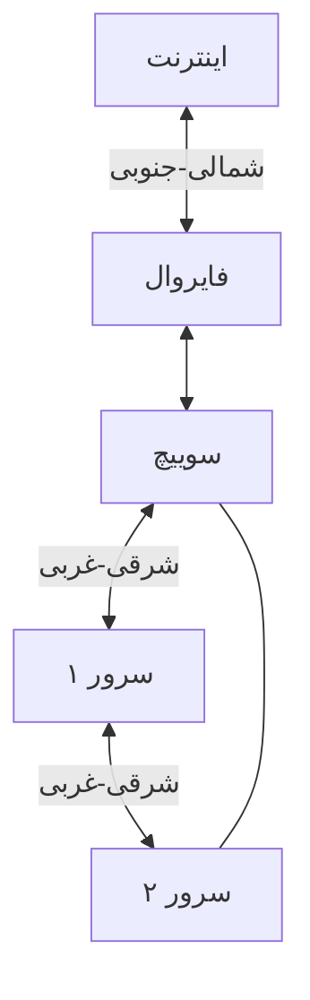

**چرا مهمه:** در مرکز داده‌های امروزی بیشتر ترافیک شرقی-غربیه؛ برای همین معماری اسپاین-لیف ساخته شده.

**جمع‌بندی یک‌دقیقه‌ای:** ابتدا بفهم دستگاه چه کاره است (روتر، سوییچ، فایروال...)، بعد بفهم چطور به هم وصل‌اند (ستاره، مش...)، بعد بدون بزرگ‌شدن آشفتگی، لایه‌ها رو جدا کن (دو لایه، سه لایه...). ترافیک هم یا از شبکه بیرون می‌ره (شمالی-جنوبی) یا داخل می‌چرخه (شرقی-غربی).

---

## ۷. درس زبان فرمان: جمله‌ها، تجزیه و گفتگوی انسانی

**در این درس هیچ دستوری برای دستگاه نمی‌نویسیم.** ولی «زبان» از همین‌جا شروع می‌شه: اسم گذاشتن.

اگه هر کس دستگاهش رو هر اسمی بذاره، نقشه نوشته‌شده مثل دفتر تلفنِ بی‌ترتیب می‌شه. وقتی بعداً بخوای به دستگاه بگی «اسمت رو فلان بذار»، باید بدونی اسم درست چیه.

### ۷.۱ قرارداد نام‌گذاری این دوره

قاعده: **نقش دستگاه + شماره**، بدون فاصله، با حروف لاتین.

```text
R1     = روتر یک
SW1    = سوییچ یک
PC1    = رایانه یک
SRV1   = سرور یک
AP1    = اکسس پوینت یک
FW1    = فایروال یک
WLC1   = کنترلر وایرلس یک
```

اگه چند شعبه یا چند طبقه هست، می‌تونی جلوش محل رو بذاری:

```text
HQ-SW1   = سوییچ یک دفتر مرکزی
BR2-R1   = روتر یک شعبه دو
```

**چرا این قاعده؟** (۱) از اسم، نقش دستگاه معلومه. (۲) شماره‌گذاری ترتیب داره. (۳) بعداً در دستورها و گزارش‌ها همین اسم‌ها تکرار می‌شن.

### ۷.۲ جمله انسانی ← اسم استاندارد

مثال حل‌شده با داده‌ی متفاوت از تمرین:

```text
جمله انسانی:  «سومین چاپگر شعبه چهار»
اسم استاندارد: BR4-PR3
```

```text
BR4   = شعبه چهار
PR3   = چاپگر شماره سه
```

### ۷.۳ گفتگوی انسانی (نمونه)

این گفتگو یه تمرین ذهنیه، نه گفتگوی واقعی با دستگاه:

```text
شما:      این سوییچ وسط نقشه‌ست، دومیه.
نقشه:     باشه؛ پس نقش «سوییچ» و شماره «دو».
          اسمش می‌شه SW2.
شما:      این هم رایانه‌ی آخر ردیف، پنجمین رایانه‌ست.
نقشه:     نقش «رایانه»، شماره «پنج». اسمش می‌شه PC5.
```

نمونه‌ی خطای نام‌گذاری:

```text
شما:      اسمش رو بذارم سوییچ-اتاق-مدیر-جدید-نهایی!
نقشه:     این اسم هم طولانیه، هم نقش و شماره‌ی روشنی نداره.
          اگه فردا یکی دیگه هم اضافه بشه چی؟ SW3 ساده‌تر و منظم‌تره.
```

> دستور واقعی «اسم گذاشتن» در درس‌های بعد (مربوط به خط فرمان سوییچ و روتر) یاد داده می‌شه. فعلاً فقط قرارداد رو یاد می‌گیریم.

---

## ۸. آماده‌سازی لب

### ۸.۱ سناریوی سازمانی

**شرکت فرضی آرمان‌داده — مرحله ۱: یک اتاق کوچک.**
شما کارآموز شبکه هستید. مدیر می‌خواد نقشه‌ی اتاق کوچک شرکت رو بکشید: دو رایانه برای کارمندها و یک سرور فایل، همه به یه سوییچ. نقشه باید استاندارد باشه تا بعداً تیم بتونه توسعه‌اش بده.

### ۸.۲ سطح لب

سطح ۲ — یک سوییچ و سه دستگاه پایانی (چهار دستگاه). توجیه افزودن سرور: تا مدل کارخواه-خدمت‌گزار رو روی نقشه ببینی.

### ۸.۳ جدول دستگاه‌ها

| نام استاندارد | نوع دستگاه | مدل پیشنهادی در پکت تریسر |
|---|---|---|
| `SW1` | سوییچ | 2960 (نیازمند راستی‌آزمایی در نسخه نصب‌شده) |
| `PC1` | رایانه | `PC` |
| `PC2` | رایانه | `PC` |
| `SRV1` | سرور | `Server` |

### ۸.۴ جدول کابل‌ها

| از دستگاه / درگاه | به دستگاه / درگاه | نوع کابل |
|---|---|---|
| `PC1` / `FastEthernet0` | `SW1` / `FastEthernet0/1` | راست |
| `PC2` / `FastEthernet0` | `SW1` / `FastEthernet0/2` | راست |
| `SRV1` / `FastEthernet0` | `SW1` / `FastEthernet0/3` | راست |

اسم درگاه‌ها ممکنه در نسخه‌ی تو کمی فرق داشته باشه؛ همون چیزی رو که روی صفحه می‌بینی ثبت کن. **نیازمند راستی‌آزمایی در نسخه نصب‌شده.**

### ۸.۵ جدول آدرس‌دهی

**ندارد.** آدرس‌دهی در این درس ممنوعه.

### ۸.۶ نقشه هدف

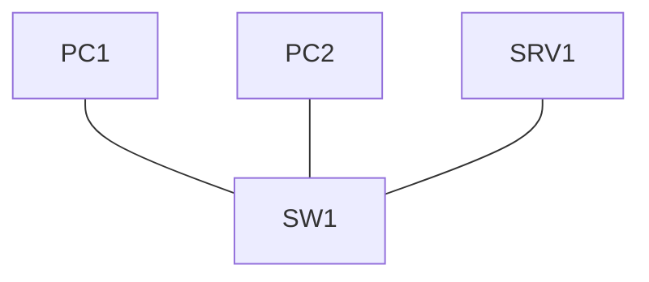

### ۸.۷ شناسنامه لب

- نام فایل: `L01-star-v1.pkt`
- فایل را **از صفر** بساز (در فایل درس صفر آدرس‌های آی‌پی تنظیم شده؛ این‌جا لازم نداریم).
- روش بازگشت به وضعیت اولیه: فایل را ببند بدون ذخیره، یا نسخه‌ی ذخیره‌شده‌ی قبلی را باز کن.

### ۸.۸ برچسب پشتیبانی

ساخت ستاره و نام‌گذاری: **کامل**. ابر و مرکز داده: **مفهومی**. برق‌رسانی از طریق کابل: **جزئی**.

---

## ۹. آزمایش گام‌به‌گام با شبیه‌سازی صفحه

> قبل از شروع: یک نسخه‌ی خالی ذخیره کن (اگه پروژه‌ی قبلی بازه، آن را ببند). تغییر بزرگ می‌خوای بدی؟ همیشه اول ذخیره، بعد شروع.

### گام ۱ — پروژه‌ی جدید

یک پروژه‌ی خالی باز کن و فوراً با این نام ذخیره کن:

```text
L01-star-v1.pkt
```

### گام ۲ — چیدن دستگاه‌ها

گوشه‌ی پایین صفحه، دسته‌های دستگاه‌ها هست. این ترتیب رو برو:

```text
+--------------------------------------------------------+
|  [ Network Devices ]  [ End Devices ]  [ Components ]  |
+--------------------------------------------------------+
|  Switches  ->  2960   (به صفحه بکش)                    |
|  End Devices -> PC    (دو بار بکش)                     |
|  End Devices -> Server (یک بار بکش)                    |
+--------------------------------------------------------+
```

سوییچ را در وسط بذار، دو رایانه را بالای آن و سرور را پایین آن.

**تأیید ۱:** چهار دستگاه روی صفحه هست؟ (سوییچ، دو رایانه، یک سرور)

### گام ۳ — اتصال با کابل راست

دکمه‌ی کابل‌ها را باز کن و کابل راست را انتخاب کن:

```text
+----------------------------------+
|  Connections -> Copper           |
|                 Straight-Through |
+----------------------------------+
```

برای هر اتصال: روی دستگاه اول کلیک کن، درگاه را انتخاب کن، بعد روی سوییچ کلیک کن و درگاه را انتخاب کن (درگاه‌ها طبق جدول کابل‌ها).

**تأیید ۲:** سه کابل وصل شده؟ رنگ نقطه‌های کنار هر کابل رو بگو. (چند ثانیه صبر کن؛ ممکنه اول نارنجی باشه.)

### گام ۴ — اسم‌گذاری استاندارد

برای تغییر اسم نمایشی هر دستگاه:

```text
+---------------------------------------------+
|  روی دستگاه کلیک کن                          |
|  Config tab -> Global Settings               |
|  Display Name: [ PC1 ]                       |
+---------------------------------------------+
```

نام هر دستگاه را مطابق جدول بذار. (محل دقیق فیلد در نسخه نصب‌شده: نیازمند راستی‌آزمایی.)

**تأیید ۳:** اسم‌ها با جدول می‌خونن؟

### گام ۵ — یادداشت روی نقشه

با ابزار یادداشت یک برچسب کنار نقشه بنویس:

```text
+---------------------------------+
|  Place Note  (شکل دکمه: N)      |
+---------------------------------+
```

متن یادداشت را بنویس: «آرمان‌داده — اتاق کوچک — توپولوژی ستاره — نسخه ۱». (فارسی یا انگلیسی؛ ترجیحاً انگلیسی کوتاه تا مشکل نمایش نداشته باشه.)

### گام ۶ — ذخیره

ذخیره کن و فایل را در پوشه‌ی مخصوص آزمایشگاه‌ها در مخزن گیت‌هاب بگذار (همان پوشه‌ای که در درس صفر دیدی؛ اسمش در خط زیر است):

```text
labs
```

---

## ۱۰. سه زاویه و نگاه بسته

### الف) من به دستگاه چی می‌گم؟
در این درس دستوری نمی‌گی. «حرکتت» اینه که دستگاه‌ها رو می‌چینی، وصل می‌کنی و اسم می‌ذاری.

### ب) پشت صحنه چه می‌گذره؟
وقتی کابل راست را بین رایانه و سوییچ وصل می‌کنی، هر دو طرف سیگنال برقی رو حس می‌کنن و «پیوند» برقرار می‌شه. نقطه‌ی سبز یعنی پیوند آماده‌ست. (جزئیات مذاکره‌ی سرعت: نیازمند راستی‌آزمایی در نسخه نصب‌شده.)

### ج) در نهایت چه اتفاقی می‌افته؟
شبکه‌ی ستاره‌ای آماده‌ست. اگه نقطه‌ها سبز باشن، لایه فیزیکی سالمه.

### نگاه بسته (مفهومی)
فرض کن رایانه‌ی یک بخواد چیزی به سرور بفرسته:

```text
PC1  ->  SW1  ->  SRV1
```

بسته از رایانه می‌ره به سوییچ؛ سوییچ می‌فهمه مقصد کدوم درگاهه؛ بسته به سرور می‌رسه. چون آدرس‌دهی نداریم، این‌جا فقط جریان فیزیکی رو می‌بینی نه یه بسته‌ی واقعی. **حالت شبیه‌سازی و دیدن بسته در درس‌های بعد (وقتی آدرس‌دهی بیاد) انجام می‌شه.**

---

## ۱۱. راستی‌آزمایی

بدون هیچ دستوری، با چشم و ابزارهای نمایشی صفحه:

1. هر سه کابل: نقطه‌ی هر دو سر سبز؟
2. اسم هر دستگاه با جدول مطابقه؟
3. روی هر کابل نشانگر ماوس را نگه دار؛ نوع کابل و درگاه‌ها را می‌خونه؟
4. نقشه ستاره‌ایه؟ همه‌ی دستگاه‌ها فقط به سوییچ وصل‌ان و بین خودشون کابل مستقیم ندارن؟

خروجی راستی‌آزمایی را در دفترچه بنویس (بخش ۱۴).

---

## ۱۲. عیب‌یابی و بازگردانی

| نشانه | علت احتمالی | کار پیشنهادی |
|---|---|---|
| نقطه‌ی کابل قرمز است | کابل به درگاه اشتباه، یا دستگاه خاموش | درگاه‌ها و روشن بودن دستگاه را بررسی کن |
| نقطه‌ی کابل نارنجی است | سوییچ هنوز در حال آماده‌شدن | چند ثانیه صبر کن |
| اتصال برقرار نمی‌شه | نوع کابل اشتباه | کابل راست را انتخاب کن |
| یک دستگاه اسمش عوض نمی‌شه | تب اشتباه | به تب تنظیمات برگرد |
| نقشه به هم ریخته | کابل زیاد یا اشتباه | با ابزار پاک‌کردن کابل را بردار |

**بازگشت:** فایل را بدون ذخیره ببند و نسخه‌ی قبلی را باز کن.

---

## ۱۳. نکته امنیتی

این درس امنیتی نیست؛ ولی نام‌گذاری استاندارد خودش یک اقدام امنیتی ساده است: وقتی هر دستگاه اسم روشن داره، دستگاه ناشناس و ناخواسته در نقشه سریع‌تر دیده می‌شه.

**قاعده‌ی ایمنی:** فقط روی دستگاه‌های پکت تریسر خودت کار کن.

---

## ۱۴. دفترچه آزمایش و قالب آن

```text
عنوان آزمایش:
شناسه درس: L01
تاریخ و زمان:
نویسنده:
نقش سازمانی: کارآموز شبکه — آرمان‌داده

1. هدف
2. دستگاه‌ها و نقشه آزمایش
3. جدول آدرس‌دهی (ندارد)
4. پیش‌نیازها و نسخه پکت تریسر
5. تنظیمات انجام‌شده (به تفکیک دستگاه: نام‌گذاری، کابل‌ها)
6. روش راستی‌آزمایی (چه چیزی را با چه روشی اثبات می‌کند)
7. شواهد (تصویر نقشه با توضیح)
8. تحلیل و تفسیر شواهد
9. خطاها و روش رفع آن‌ها
10. نتیجه و محدودیت‌ها
11. ریسک یا نکته امنیتی
12. روش آزمون مجدد
13. وضعیت نهایی
14. پیوست‌ها
```

**امتیازدهی از ۱۰۰:** هدف و نقشه ۱۰ / تنظیمات صحیح ۲۰ / راستی‌آزمایی و شواهد ۲۰ / تحلیل و استدلال ۲۰ / عیب‌یابی و رفع خطا ۱۰ / نکته امنیتی و آزمون مجدد ۱۰ / نگارش و ساختار ۱۰.

**پاسخ (نسخه پاسخ‌دار):**

**نمونه‌ی دفترچه‌ی پرشده (کوتاه):**

```text
عنوان آزمایش: ساخت توپولوژی ستاره
شناسه درس: L01
نقش سازمانی: کارآموز شبکه — آرمان‌داده

1. هدف: ساخت و نام‌گذاری یک شبکه ستاره‌ای چهار دستگاهه.
2. دستگاه‌ها: SW1, PC1, PC2, SRV1 (نقشه در بخش ۸.۶).
3. جدول آدرس‌دهی: ندارد.
4. پیش‌نیازها: درس صفر؛ نسخه پکت تریسر: (خودت بنویس).
5. تنظیمات: سه کابل راست؛ نام‌گذاری استاندارد.
6. راستی‌آزمایی: رنگ نقطه‌ی کابل‌ها، تطبیق نام‌ها، شکل ستاره.
7. شواهد: تصویر نقشه با نقطه‌های سبز + توضیح زیر آن.
8. تحلیل: سبز یعنی پیوند فیزیکی برقرار است؛ هیچ ادعایی درباره ارتباط
   بین دستگاه‌ها نمی‌شود چون آدرس‌دهی نداریم.
9. خطاها: نقطه‌ی نارنجی اولیه؛ بعد از چند ثانیه سبز شد.
10. نتیجه: ستاره ساخته شد. محدودیت: ارتباط بسته‌ها آزموده نشد.
11. نکته امنیتی: نام‌گذاری استاندارد دیدن دستگاه ناخواسته را آسان می‌کند.
12. آزمون مجدد: باز کردن فایل و چک دوباره نقطه‌ها.
13. وضعیت نهایی: قبول.
14. پیوست: L01-star-v1.pkt
```


---

## ۱۵. تمرین‌ها (۱۰ تمرین، از ساده تا سخت)

> دو تمرین (۴ و ۵) و تمرین ۶ مربوط به «زبان» (نام‌گذاری) هستند. برای هر تمرین پاسخ را بنویس و ببین؛ بعد در چت بفرست تا بررسی کنیم.

### تمرین ۱ — این دستگاه چه کاره است؟
برای هر توصیف، نقش دستگاه را بنویس (روتر، سوییچ لایه دو، سوییچ لایه سه، فایروال نسل بعد، سامانه جلوگیری از نفوذ، اکسس پوینت، کنترلر وایرلس، نقطه پایانی یا سرور):

1. دستگاهی که صفحه‌ی وب شرکت را همیشه آماده نگه می‌دارد؛
2. دستگاهی که شبکه‌ی شرکت را به اینترنت وصل می‌کند و مسیر بسته را انتخاب می‌کند؛
3. دستگاهی که تنظیمات ده اکسس پوینت را یک‌جا مدیریت می‌کند؛
4. دستگاهی که چند رایانه‌ی یک اتاق را به هم وصل می‌کند؛
5. دستگاهی که ترافیک مشکوک را تشخیص داده و جلویش را می‌گیرد؛
6. گوشی همراه یک کارمند.

**پاسخ (نسخه پاسخ‌دار):**

**پاسخ:**

1. سرور
2. روتر
3. کنترلر وایرلس
4. سوییچ لایه دو
5. سامانه جلوگیری از نفوذ
6. نقطه پایانی

**چرا:** نقش را از «کاری که دستگاه می‌کند» تشخیص بده. اکسس پوینت سیگنال می‌دهد، ولی کنترلر وایرلس چند اکسس پوینت را یک‌جا مدیریت می‌کند.


### تمرین ۲ — روتر یا سوییچ؟
برای هر موقعیت بگو روتر لازم است یا سوییچ، و چرا:

1. وصل‌کردن بیست رایانه‌ی یک طبقه؛
2. وصل‌کردن شبکه‌ی شرکت به شبکه‌ی شعبه در شهر دیگر؛
3. اضافه‌کردن سه چاپگر به اتاق جلسه.

**پاسخ (نسخه پاسخ‌دار):**

**پاسخ:**

1. سوییچ، چون دستگاه‌ها داخل یک شبکه‌اند.
2. روتر، چون دو شبکه‌ی جدا از هم (شعبه‌ها) را وصل می‌کند.
3. سوییچ، چون فقط درگاه بیشتر لازم است.


### تمرین ۳ — لایه دو یا لایه سه؟
دو سوییچ لایه دو و لایه سه را در سه جمله مقایسه کن و بگو در یک شبکه‌ی ساختمانی هر کدام را کجا می‌گذاری.

**پاسخ (نسخه پاسخ‌دار):**

**پاسخ نمونه:** سوییچ لایه دو فقط داخل یک شبکه محلی ترافیک را بین درگاه‌ها جابه‌جا می‌کند. سوییچ لایه سه علاوه بر آن می‌تواند مثل روتر بین شبکه‌ها تصمیم بگیرد و سریع‌تر است. در ساختمان، لایه دو را در لایه دسترسی (اتصال کاربران) و لایه سه را در توزیع یا هسته (جایی که ترافیک جمع می‌شود) می‌گذارم.


### تمرین ۴ — زبان: جمله انسانی را به اسم تبدیل کن
قرارداد نام‌گذاری این درس را به کار ببر:

1. «اولین روتر دفتر مرکزی»
2. «سوییچ شماره سه شعبه دو»
3. «دومین سرور شعبه یک»
4. «چهارمین رایانه‌ی اتاق»

**پاسخ (نسخه پاسخ‌دار):**

**پاسخ:**

```text
1. HQ-R1
2. BR2-SW3
3. BR1-SRV2
4. PC4
```

**چرا:** قاعده «محل + خط تیره + نقش + شماره» است؛ اگر محل نیست فقط «نقش + شماره».


### تمرین ۵ — زبان: اسم را به جمله انسانی ترجمه کن

1. `HQ-FW1`
2. `BR3-AP2`
3. `SRV5`
4. `BR1-WLC1`

**پاسخ (نسخه پاسخ‌دار):**

**پاسخ:**

1. فایروال شماره یک دفتر مرکزی
2. اکسس پوینت شماره دو شعبه سه
3. سرور شماره پنج
4. کنترلر وایرلس شماره یک شعبه یک


### تمرین ۶ — زبان: اسم بد را پیدا کن و اصلاح کن
هر اسم زیر مشکل دارد. دلیل مشکل را بگو و اسم استاندارد پیشنهاد بده:

1. `سوییچ اصلی جدید`
2. `sw 1`
3. `PC_Ali_Hamed`
4. `ROUTER`

**پاسخ (نسخه پاسخ‌دار):**

**پاسخ:**

1. اسم فارسی است، نقش لاتین و شماره ندارد و «جدید» معنی ثابت ندارد. اسم درست:

```text
SW1
```

2. فاصله وسط اسم دارد. اسم درست:

```text
SW1
```

3. اسم افراد و خط زیر دارد، نقش اول نیست و شماره ندارد. اسم درست (مالک را در یادداشت بنویس):

```text
PC1
```

4. شماره و محل ندارد. اسم درست:

```text
R1
```


### تمرین ۷ — شمارش اتصال‌ها
با فرمول مش کامل، تعداد اتصال لازم بین ۴، ۵ و ۶ دستگاه را حساب کن. بعد برای همین سه عدد، تعداد کابل ستاره (همه به یک سوییچ) را بنویس و نتیجه را در دو جمله مقایسه کن.

**پاسخ (نسخه پاسخ‌دار):**

**پاسخ:**

| تعداد دستگاه | مش کامل | ستاره |
|---|---|---|
| ۴ | ۴×۳÷۲ = ۶ | ۴ کابل |
| ۵ | ۵×۴÷۲ = ۱۰ | ۵ کابل |
| ۶ | ۶×۵÷۲ = ۱۵ | ۶ کابل |

**مقایسه:** تعداد اتصال‌های مش کامل تقریباً با مربع تعداد دستگاه‌ها رشد می‌کند ولی ستاره خطی است. مش اطمینان بیشتری دارد ولی هزینه‌اش با رشد شبکه سریع بالا می‌رود.


### تمرین ۸ — ترافیک چه جهتی دارد؟
هر مورد را شمالی-جنوبی یا شرقی-غربی دسته‌بندی کن:

1. کارمند صفحه‌ای از اینترنت باز می‌کند؛
2. سرور وب از سرور پایگاه داده اطلاعات می‌گیرد؛
3. دو ماشین مجازی در یک مرکز داده نسخه‌ی پشتیبان به هم می‌دهند؛
4. کاربر از خانه به سرور شرکت وصل می‌شود.

**پاسخ (نسخه پاسخ‌دار):**

**پاسخ:**

1. شمالی-جنوبی (از شبکه به اینترنت می‌رود)
2. شرقی-غربی (داخل همان شبکه)
3. شرقی-غربی (هر دو داخل مرکز داده)
4. شمالی-جنوبی (کاربر بیرون از شبکه است)


### تمرین ۹ — کارخواه-خدمت‌گزار یا همتا به همتا؟
برای هر مورد مدل را بنویس و دلیل بیاور:

1. کارمندان از یک سرور فایل مشترک استفاده می‌کنند؛
2. دو همکار فایل‌ها را مستقیم بین رایانه‌هایشان رد و بدل می‌کنند؛
3. گوشی‌ها صفحه‌ی بانک را باز می‌کنند.

**پاسخ (نسخه پاسخ‌دار):**

**پاسخ:**

1. کارخواه-خدمت‌گزار: یک سرور مرکزی و همیشه روشن وجود دارد.
2. همتا به همتا: هر دو رایانه هم می‌دهند و هم می‌گیرند.
3. کارخواه-خدمت‌گزار: سرور بانک خدمت می‌دهد و گوشی‌ها درخواست می‌کنند.


### تمرین ۱۰ — لب: ستاره بساز
طبق بخش ۹ توپولوژی ستاره را بساز، اسم‌گذاری کن، با روش بخش ۱۱ راستی‌آزمایی کن و تصویر نقشه را همراه توضیح ارسال کن.

**پاسخ (نسخه پاسخ‌دار):**

**پاسخ (لب):** معیار قبول:

- چهار دستگاه با این اسم‌ها:

```text
SW1
PC1
PC2
SRV1
```

- سه کابل راست طبق جدول بخش ۸.۴؛
- نقطه‌های هر دو سر هر کابل سبز؛
- هیچ کابل مستقیمی بین رایانه‌ها یا سرور نباشد؛
- هیچ آدرس‌دهی و هیچ دستوری وارد نشود؛
- فایل ذخیره‌شده با این نام:

```text
L01-star-v1.pkt
```


---

## ۱۶. مینی‌پروژه‌ها (۶ پروژه)

### پروژه ۱ (مبتدی) — نقشه‌ی اتاق پذیرش
**نقش:** کارآموز شبکه. **سناریو:** اتاق پذیرش آرمان‌داده یک سوییچ، دو رایانه، یک چاپگر و یک اکسس پوینت دارد.
**مراحل:** نقشه را با نمودار مرمید بکش؛ هر دستگاه را با قرارداد نام‌گذاری برچسب بزن؛ نقش هر دستگاه را در یک جمله بنویس.
**خروجی:** نقشه + جدول نام و نقش.
**معیار موفقیت:** همه‌ی نام‌ها استاندارد و نقش‌ها درست.

**پاسخ (نسخه پاسخ‌دار):**

**نقشه‌ی پاسخ:**

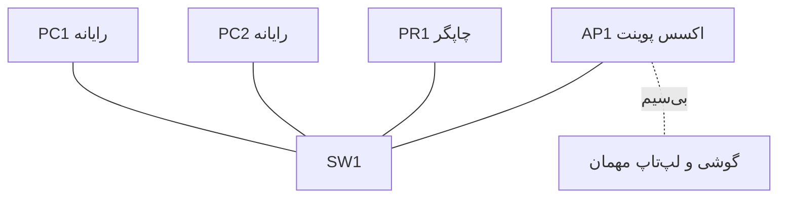

**جدول نام و نقش:**

| نام | نقش |
|---|---|
| `SW1` | سوییچ: مرکز ستاره، همه به آن وصل‌اند |
| `PC1`, `PC2` | نقطه‌ی پایانی کاربران |
| `PR1` | چاپگر (نقطه‌ی پایانی خدمات چاپ) |
| `AP1` | اکسس پوینت: سیگنال بی‌سیم می‌دهد |


### پروژه ۲ (مبتدی، لب خراب) — نقشه‌ی معیوب
**نقش:** تکنسین. **سناریو:** همکارت این نقشه را کشیده:

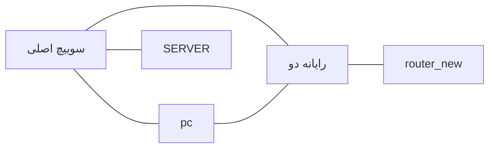

**مراحل:** مشکلات نقشه را فهرست کن (نام‌گذاری، توپولوژی، نقش‌ها)؛ نقشه‌ی اصلاح‌شده را بکش.
**خروجی:** فهرست مشکلات + نقشه‌ی اصلاح‌شده.
**معیار موفقیت:** حداقل چهار مشکل پیدا شود و نقشه‌ی جدید ستاره باشد.

**پاسخ (نسخه پاسخ‌دار):**

**مشکلات نقشه‌ی معیوب:**

1. «سوییچ اصلی» فارسی و بدون شماره است.
2. «pc» شماره ندارد.
3. «رایانه دو» فارسی است.
4. «SERVER» استاندارد نیست.
5. «router_new» خط زیر و واژه‌ی «جدید» دارد.
6. اتصال مستقیم رایانه‌ی یک به رایانه‌ی دو ستاره را می‌شکند.
7. روتر به رایانه وصل شده، نه به سوییچ.

**نقشه‌ی خراب (قبل):**


**نقشه‌ی اصلاح‌شده (بعد):**

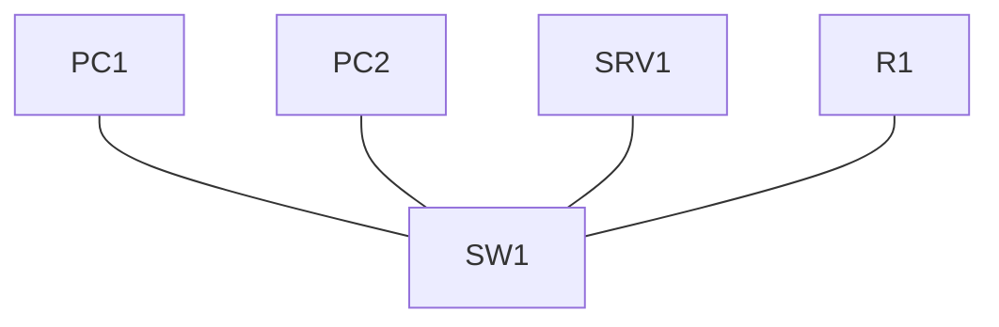


### پروژه ۳ (متوسط) — ساختمان دوطبقه
**نقش:** تکنسین شبکه. **سناریو:** آرمان‌داده یک ساختمان دوطبقه دارد؛ هر طبقه ۱۲ رایانه و یک اکسس پوینت دارد و یک اتاق سرور با دو سرور. اتصال به اینترنت هم لازم است.
**مراحل:** دو معماری (هسته فشرده و سه لایه) را برای این ساختمان بکش؛ مزایا و معایب هر کدام را در چند جمله بنویس؛ یکی را انتخاب و توجیه کن.
**خروجی:** دو نمودار + مقایسه + انتخاب.
**معیار موفقیت:** انتخاب با دلیل متناسب با اندازه‌ی شبکه.

**پاسخ (نسخه پاسخ‌دار):**

**معماری ۱: هسته فشرده** (دو لایه: هسته و توزیع ترکیبی + دسترسی)

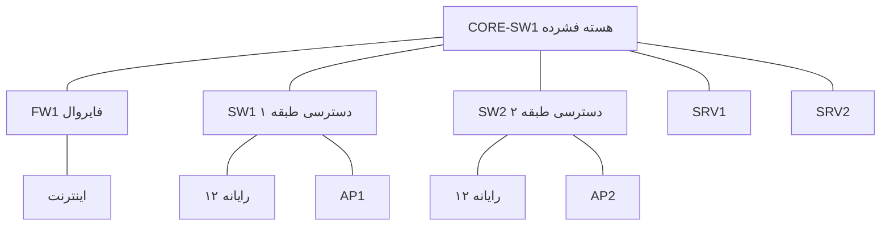

**معماری ۲: سه لایه**

```mermaid
flowchart TD
    FW1["FW1"] --- INT["اینترنت"]
    CORE["هسته"] --- FW1
    CORE --- D1["توزیع ۱"]
    CORE --- D2["توزیع ۲"]
    D1 --- A1["SW1 دسترسی طبقه ۱"]
    D2 --- A2["SW2 دسترسی طبقه ۲"]
    D1 --- SRV1["SRV1"]
    D2 --- SRV2["SRV2"]
    A1 --- F1["۱۲ رایانه + AP1"]
    A2 --- F2["۱۲ رایانه + AP2"]
```

| | هسته فشرده | سه لایه |
|---|---|---|
| مزیت | ساده، ارزان، مدیریت راحت | تفکیک نقش‌ها، مناسب رشد بزرگ |
| عیب | با رشد زیاد پر می‌شود | دستگاه و هزینه‌ی اضافه برای شبکه‌ی کوچک |

**انتخاب:** هسته فشرده؛ چون فقط ۲۴ رایانه و ۲ سرور داریم و سه لایه برای این اندازه اضافی و پرهزینه است. اگر شرکت چند ساختمان بشود، می‌توان به سه لایه رفت.


### پروژه ۴ (متوسط، لب خراب) — درخت پرخطر
**نقش:** مهندس شبکه. **سناریو:** شعبه‌ای که به شکل درخت وصل شده؛ ریشه یک سوییچ است و سه شاخه دارد. گزارش شده با خرابی سوییچ ریشه کل شعبه قطع می‌شود.
**مراحل:** نقطه‌ی ضعف را نشان بده؛ طرح اصلاحی با مش جزئی (یک سوییچ ریشه‌ی دوم و اتصال‌های اضافه) بکش؛ هزینه‌ی تعداد کابل جدید را بگو.
**خروجی:** نمودار قبل و بعد + توضیح.
**معیار موفقیت:** هیچ نقطه‌ی تک‌خطا در طرح جدید نماند.

**پاسخ (نسخه پاسخ‌دار):**

**نقطه‌ی ضعف:** سوییچ ریشه تک‌نقطه‌ی خرابی است؛ اگر خراب شود هر سه شاخه قطع می‌شوند.

**نقشه‌ی قبل (درخت):**

```mermaid
flowchart TD
    ROOT["ROOT-SW1 ریشه"]
    ROOT --- B1["SW1 شاخه ۱"]
    ROOT --- B2["SW2 شاخه ۲"]
    ROOT --- B3["SW3 شاخه ۳"]
    B1 --- E1["دستگاه‌ها"]
    B2 --- E2["دستگاه‌ها"]
    B3 --- E3["دستگاه‌ها"]
```

**نقشه‌ی بعد (مش جزئی با دو ریشه):**

```mermaid
flowchart TD
    ROOT1["ROOT-SW1"] --- ROOT2["ROOT-SW2"]
    ROOT1 --- B1["SW1"]
    ROOT1 --- B2["SW2"]
    ROOT1 --- B3["SW3"]
    ROOT2 --- B1
    ROOT2 --- B2
    ROOT2 --- B3
    B1 --- E1["دستگاه‌ها"]
    B2 --- E2["دستگاه‌ها"]
    B3 --- E3["دستگاه‌ها"]
```

**هزینه:** یک سوییچ ریشه‌ی جدید و ۴ کابل اضافه (سه کابل ریشه‌ی دوم به شاخه‌ها + یک کابل بین دو ریشه). عدد دیگر با توجیه هم قبول است.

**نتیجه:** با خرابی هر یک از دو ریشه، شاخه‌ها همچنان از ریشه‌ی دیگر وصل می‌مانند و تک‌نقطه‌ی خرابی از بین می‌رود.

> نکته: این طرح در شبکه واقعی دردسر دارد (حلقه در لایه دو). راهکارش در فاز دو (اس‌تی‌پی) تدریس می‌شود؛ فعلاً فقط طرح مفهومی را می‌کشی.


### پروژه ۵ (چالشی) — سه شعبه
**نقش:** مهندس شبکه. **سناریو:** آرمان‌داده دفتر مرکزی و دو شعبه دارد. ایمیل شرکت روی ابر است و یک سرور فایل در دفتر مرکزی است. شعبه‌ها باید به سرور فایل و ابر دسترسی داشته باشند.
**مراحل:** معماری کلی را با نمودار بکش (شبکه گسترده، ابر، درون‌سازمانی)؛ برای دسترسی کارمند شعبه به ایمیل و سرور فایل، مسیر ترافیک و دسته‌بندی شمالی-جنوبی/شرقی-غربی را بنویس؛ نام‌گذاری همه‌ی دستگاه‌ها.
**خروجی:** نمودار + جدول جریان ترافیک + جدول نام‌ها.
**معیار موفقیت:** دسته‌بندی ترافیک درست و نام‌گذاری یکدست.

**پاسخ (نسخه پاسخ‌دار):**

**نقشه‌ی کلی:**

```mermaid
flowchart TD
    CLOUD["ابر: سرویس ایمیل"]
    INT["اینترنت"]
    CLOUD --- INT
    INT --- HQFW["HQ-FW1"]
    HQFW --- HQR["HQ-R1"]
    HQR --- HQSW["HQ-SW1"]
    HQSW --- HQSRV["HQ-SRV1 سرور فایل"]
    HQSW --- HQPC["HQ-PC1"]
    HQR ---|شبکه گسترده| B1R["BR1-R1"]
    HQR ---|شبکه گسترده| B2R["BR2-R1"]
    B1R --- B1SW["BR1-SW1"]
    B1SW --- B1PC["BR1-PC1"]
    B2R --- B2SW["BR2-SW1"]
    B2SW --- B2PC["BR2-PC1"]
```

**جدول جریان ترافیک:**

| درخواست | مسیر | دسته |
|---|---|---|
| ایمیل ابری | رایانه شعبه ← سوییچ ← روتر شعبه ← شبکه گسترده ← روتر و فایروال دفتر مرکزی ← اینترنت ← ابر | شمالی-جنوبی (از مرز شرکت بیرون می‌رود) |
| سرور فایل | رایانه شعبه ← سوییچ ← روتر شعبه ← شبکه گسترده ← روتر و سوییچ دفتر مرکزی ← سرور فایل | شرقی-غربی (داخل شرکت می‌ماند) |

**جدول نام‌ها:**

```text
HQ-FW1   HQ-R1   HQ-SW1   HQ-SRV1   HQ-PC1
BR1-R1   BR1-SW1  BR1-PC1
BR2-R1   BR2-SW1  BR2-PC1
```

> مسیر ایمیل را از طریق دفتر مرکزی کشیدیم (رایج و ساده). مسیر مستقیم شعبه به اینترنت هم طراحی مجاز است؛ اگر انتخاب کردی دلیلش را بنویس.


### پروژه ۶ (چالشی) — مرکز داده‌ی کوچک
**نقش:** مهندس شبکه. **سناریو:** اتاق سرور آرمان‌داده قرار است ۲۰ سرور داشته باشد که بیشتر با هم حرف می‌زنند.
**مراحل:** یک طرح سه‌لایه و یک طرح اسپاین-لیف بکش؛ تعداد اتصال سرورها و فاصله‌ی ترافیک شرقی-غربی در هر دو را مقایسه کن؛ بگو کدام بهتر است و در چه شرایطی انتخاب دیگر منطقی می‌شود.
**خروجی:** دو نمودار + مقایسه + توصیه.
**معیار موفقیت:** استدلال بر پایه‌ی ترافیک شرقی-غربی.

**پاسخ (نسخه پاسخ‌دار):**

**طرح سه‌لایه** (بیست سرور؛ در نمودار هر گروه ۵ سرور):

```mermaid
flowchart TD
    CORE["هسته"]
    CORE --- D1["توزیع ۱"]
    CORE --- D2["توزیع ۲"]
    D1 --- A1["دسترسی ۱"]
    D1 --- A2["دسترسی ۲"]
    D2 --- A3["دسترسی ۳"]
    D2 --- A4["دسترسی ۴"]
    A1 --- S1["۵ سرور"]
    A2 --- S2["۵ سرور"]
    A3 --- S3["۵ سرور"]
    A4 --- S4["۵ سرور"]
```

**طرح اسپاین-لیف:**

```mermaid
flowchart TD
    SP1["اسپاین ۱"]
    SP2["اسپاین ۲"]
    L1["لیف ۱"]
    L2["لیف ۲"]
    L3["لیف ۳"]
    L4["لیف ۴"]
    SP1 --- L1
    SP1 --- L2
    SP1 --- L3
    SP1 --- L4
    SP2 --- L1
    SP2 --- L2
    SP2 --- L3
    SP2 --- L4
    L1 --- S1["۵ سرور"]
    L2 --- S2["۵ سرور"]
    L3 --- S3["۵ سرور"]
    L4 --- S4["۵ سرور"]
```

**مقایسه ترافیک شرقی-غربی:**

- سه‌لایه: دو سرور در دو گروه مختلف باید از دسترسی، توزیع، هسته، توزیع و دسترسی بگذرند؛ مسیر بلند است و بسته به محل سرورها فاصله‌ها نابرابر می‌شود.
- اسپاین-لیف: دو سرور روی دو لیف مختلف همیشه از لیف، اسپاین و لیف می‌گذرند؛ فاصله ثابت و قابل پیش‌بینی است.

**توصیه:** اسپاین-لیف، چون بیشتر ترافیک بین سرورهاست. سه‌لایه وقتی بهتر است که ترافیک اصلی شمالی-جنوبی باشد یا شبکه آن‌قدر کوچک که هزینه‌ی اسپاین‌ها نیرزد.


---

## ۱۷. آزمون (۵ سؤال)

### سؤال ۱ (مفهومی)
تفاوت سوییچ لایه دو و روتر را در سه جمله بنویس و یک مثال از شبکه‌ی ساختمان بزن.

**پاسخ (نسخه پاسخ‌دار):**

**پاسخ نمونه:** سوییچ لایه دو دستگاه‌های یک شبکه محلی را به هم وصل می‌کند و فقط داخل همان شبکه ترافیک را به درگاه درست می‌فرستد. روتر شبکه‌های مختلف را به هم وصل می‌کند و تصمیم می‌گیرد بسته از کدام مسیر برود. مثال: در ساختمان، سوییچ هر طبقه رایانه‌ها را وصل می‌کند و روتر ساختمان را به اینترنت.


### سؤال ۲ (پیش‌بینی آنچه روی صفحه می‌بینی)
در لب ستاره‌ای این درس، فرض کن کابل بین رایانه‌ی یک و سوییچ را از کابل راست به کابلی از نوع دیگر عوض می‌کنی. پیش‌بینی کن وضعیت نقطه‌های کابل چه می‌شود و چرا. (در این درس دستور نمایشی نداریم؛ پیش‌بینی بر پایه‌ی چیزی است که در صفحه می‌بینی.)

**پاسخ (نسخه پاسخ‌دار):**

**پاسخ:** طبق نظریه‌ی کلاسیک، با کابل نوع اشتباه پیوند برقرار نمی‌شود و نقطه‌ها قرمز (یا بدون سبز شدن) می‌مانند، چون سیگنال ارسال و دریافت درست به هم نمی‌رسند. دستگاه‌های جدیدتر نوع کابل را خودکار تشخیص می‌دهند و ممکن است سبز شود؛ هر دو پاسخ با استدلال درست قبول است. این موضوع **نیازمند راستی‌آزمایی در نسخه نصب‌شده** است.


### سؤال ۳ (پیدا کردن اشتباه در نقشه)
در نقشه‌ی زیر دو اشتباه نام‌گذاری یا ساختاری پیدا کن و اصلاح کن:

```mermaid
flowchart TD
    SWITCH["سوییچ"] --- P1["PC1"]
    SWITCH --- P1b["pc 1"]
    SWITCH --- S["سرور"]
    P1 --- S
```

**پاسخ (نسخه پاسخ‌دار):**

**پاسخ:**

1. اسم «سوییچ» استاندارد نیست (باید `SW1` باشد).
2. اسم «pc 1» فاصله دارد و شبیه `PC1` تکراری است (باید `PC2` شود).
3. اسم «سرور» استاندارد نیست (باید `SRV1` باشد).
4. کابل مستقیم رایانه به سرور ستاره را می‌شکند و باید حذف شود.

**نقشه‌ی اصلاح‌شده:**

```mermaid
flowchart TD
    SW1["SW1"]
    PC1["PC1"] --- SW1
    PC2["PC2"] --- SW1
    SRV1["SRV1"] --- SW1
```


### سؤال ۴ (تحلیل مسیر)
یک کارمند شعبه ایمیل ابری شرکت را باز می‌کند و بعد فایلی را از سرور فایل دفتر مرکزی می‌خواند. مسیر هر دو درخواست را روی نقشه بنویس و بگو کدام شمالی-جنوبی و کدام شرقی-غربی است (مرز را «کل شبکه‌ی داخلی شرکت» در نظر بگیر: بیرون از آن یعنی اینترنت و ابر).

**پاسخ (نسخه پاسخ‌دار):**

**پاسخ:**

- ایمیل ابری: رایانه شعبه ← سوییچ ← روتر شعبه ← شبکه گسترده ← دفتر مرکزی ← اینترنت ← ابر. دسته: **شمالی-جنوبی**، چون از مرز شبکه‌ی شرکت بیرون می‌رود.
- سرور فایل: رایانه شعبه ← سوییچ ← روتر شعبه ← شبکه گسترده ← دفتر مرکزی ← سرور فایل. دسته: **شرقی-غربی**، چون داخل شبکه‌ی شرکت می‌ماند.


### سؤال ۵ (سناریوی سازمانی در لب)
مدیر آرمان‌داده می‌خواهد دو چاپگر هم به اتاق کوچک اضافه شود. بگو چه چیزی به لب اضافه می‌کنی، چه اسم‌هایی می‌گذاری، چه کابل‌هایی می‌کشی و چطور درستی کار را راستی‌آزمایی می‌کنی.

**پاسخ (نسخه پاسخ‌دار):**

**پاسخ نمونه:**

- اضافه می‌کنم: دو دستگاه چاپگر.
- اسم‌ها:

```text
PR1
PR2
```

- کابل: دو کابل راست از چاپگرها به سوییچ، درگاه‌های `FastEthernet0/4` و `FastEthernet0/5` (نیازمند راستی‌آزمایی در نسخه‌ی نصب‌شده).
- راستی‌آزمایی: نقطه‌ی هر دو سر کابل سبز؛ اسم‌ها استاندارد؛ نقشه هنوز ستاره است.
- فایل جدید برای نسخه‌ی تازه:

```text
L01-star-v2.pkt
```

```mermaid
flowchart TD
    SW1["SW1"]
    PC1["PC1"] --- SW1
    PC2["PC2"] --- SW1
    SRV1["SRV1"] --- SW1
    PR1["PR1"] --- SW1
    PR2["PR2"] --- SW1
```


---

## ۱۸. نکات آزمون رسمی این موضوع

- تفاوت وظیفه‌ی لایه‌های دسترسی، توزیع و هسته را دقیق بدان و بتوانی هر کدام را روی نمودار نشان بدهی.
- بدان هسته فشرده چه وقت منطقی است و چه چیزی را فشرده می‌کند.
- اسپاین-لیف و جریان شرقی-غربی هم‌خانواده‌اند؛ دلیل پیدایش اسپاین-لیف را بتوانی بگویی.
- تفاوت فایروال نسل بعد با سامانه جلوگیری از نفوذ، و اینکه می‌توانند ترکیب شوند.
- نقش کنترلر وایرلس و اکسس پوینت را مقایسه کن (مدیریت مرکزی در برابر پوشش سیگنال).
- مفهوم برق از طریق کابل شبکه و مصرف‌کننده‌های رایجش.
- مقایسه‌ی درون‌سازمانی و ابری از نظر هزینه، کنترل و مسئولیت.
- سؤال‌های آزمون رسمی معمولاً سناریو می‌دهند و از تو «مناسب‌ترین» انتخاب را می‌خواهند؛ پس دلیل انتخاب را یاد بگیر، نه فقط تعریف.

---

## ۱۹. جمع‌بندی

- هر دستگاه یک نقش دارد: روتر شبکه‌ها را وصل می‌کند، سوییچ دستگاه‌ها را، فایروال محافظت می‌کند، اکسس پوینت بی‌سیم می‌دهد، سرور خدمت می‌دهد.
- توپولوژی شکل اتصال است؛ ستاره امروز رایج‌ترین است.
- معماری‌ها (دو لایه، سه لایه، هسته فشرده، اسپاین-لیف) پاسخ به اندازه و نوع ترافیک‌اند.
- ترافیک یا بیرون/داخل می‌رود (شمالی-جنوبی) یا درون شبکه می‌چرخد (شرقی-غربی).
- نام‌گذاری استاندارد اولین قدم زبان دستگاه است.

---

## ۲۰. معیار آمادگی برای درس بعد (L02)

آماده‌ای اگر:

- [ ] بدون نگاه به جزوه تفاوت روتر و سوییچ را توضیح می‌دهی؛
- [ ] معماری دو لایه و سه لایه را می‌کشی و فرقشان را می‌گویی؛
- [ ] نقشه‌ی ستاره را در پکت تریسر ساخته‌ای و نام‌گذاری استاندارد کرده‌ای؛
- [ ] دو تمرین زبان (۴ و ۵) و تمرین ۶ را درست انجام داده‌ای؛
- [ ] دفترچه‌ی آزمایش را نوشته‌ای.

هر وقت آماده بودی، می‌ریم سراغ L02: اولین گفتگو با دستگاه.
