# درس L02 — مدل اواس‌آی و تی‌سی‌پی/آی‌پی، کپسوله‌سازی

| مورد | مقدار |
|---|---|
| حوزه / سطح لب / پشتیبانی | حوزه ۱ / سطح ۲ / کامل (حالت شبیه‌سازی) |
| پیش‌نیاز قطعی | L01 |
| مدت پیشنهادی | حدود ۹۰ دقیقه (۴۰ دقیقه آموزش + ۳۵ دقیقه لب + ۱۵ دقیقه تمرین) |
| ابزار لب | نرم‌افزار شبیه‌ساز (مثل Cisco Packet Tracer) + خط فرمان رایانه |

> **هدف درس:** در پایان، شما می‌توانید مسیر یک بسته را از «برنامه» تا «کابل» و برگشت، با کمک مدل لایه‌ای توضیح بدهید.

> **قاعدهٔ این درس:** اینجا آدرس‌دهی دقیق و زیرشبکه‌بندی تدریس نمی‌شود. آدرس‌هایی که می‌بینید فقط «برچسب» هستند؛ معنای ریز آن‌ها در درس‌های بعدی می‌آید.

---

## فهرست

1. [چرا مدل لایه‌ای لازم است؟](#۱-چرا-مدل-لایه‌ای-لازم-است)
2. [هفت لایه اواس‌آی](#۲-هفت-لایه-اواس‌آی)
3. [مدل تی‌سی‌پی/آی‌پی و نگاشت](#۳-مدل-تی‌سی‌پیآی‌پی-و-نگاشت-به-اواس‌آی)
4. [واحد داده در هر لایه](#۴-واحد-داده-در-هر-لایه)
5. [کپسوله‌سازی و بازکردن](#۵-کپسوله‌سازی-و-بازکردن)
6. [هر پروتکل مهم در کدام لایه است؟](#۶-هر-پروتکل-مهم-در-کدام-لایه-است)
7. [جایگاه سوییچ و روتر](#۷-جایگاه-سوییچ-لایه-۲-و-روتر-لایه-۳)
8. [زبان فرمان: ping، ipconfig، arp](#۸-زبان-فرمان)
9. [لب: دنبال کردن یک بسته در حالت شبیه‌سازی](#۹-لب-دنبال-کردن-یک-بسته-در-حالت-شبیه‌سازی)
10. [عیب‌یابی: سه پرسش از پایین به بالا](#۱۰-عیب‌یابی-سه-پرسش-از-پایین-به-بالا)
11. [پرسش‌ها و پاسخ‌ها](#۱۱-پرسش‌ها-و-پاسخ‌ها)
12. [پروژه‌ها و پاسخ‌ها](#۱۲-پروژه‌ها-و-پاسخ‌ها)
13. [معیار آمادگی و خلاصه](#۱۳-معیار-آمادگی-و-خلاصه)

---

## ۱. چرا مدل لایه‌ای لازم است؟

فرض کنید یک نامه می‌فرستید. شما فقط متن را می‌نویسید، داخل پاکت می‌گذارید و آدرس می‌نویسید. اینکه پست با کامیون ببرد یا هواپیما، چند مرکز تفکیک ردش کند، به کار شما ربطی ندارد. هر مرحله فقط کار خودش را می‌کند.

شبکه هم همین‌طور است. ارسال یک پیام از رایانه‌ای به رایانهٔ دیگر کار بزرگی است. اگر همه را یک‌جا طراحی کنیم، هر تغییر کوچک همه‌چیز را خراب می‌کند. پس کار را **به لایه‌های کوچک تقسیم می‌کنیم**.

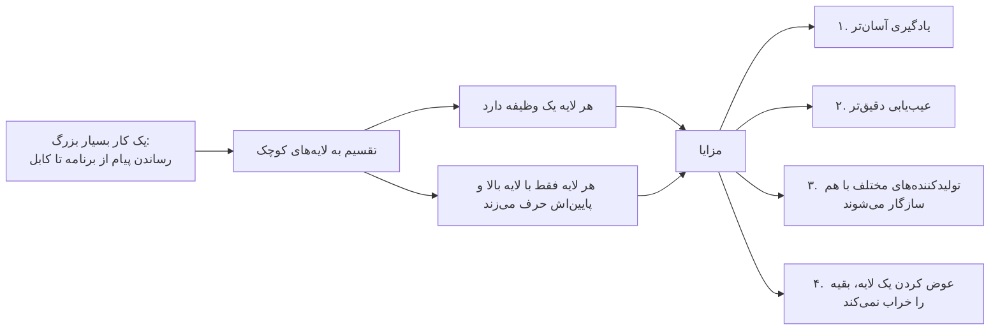

**مثال ساده:** مرورگر شما (برنامه) برایش مهم نیست که اینترنت با کابل مسی است یا فیبر یا وای‌فای. لایهٔ پایین این جزئیات را پنهان می‌کند.

---

## ۲. هفت لایه اواس‌آی

مدل OSI (به معنی «اتصال متقابل سیستم‌های باز») هفت لایه دارد. از **بالا** (نزدیک کاربر) به **پایین** (نزدیک کابل) می‌شماریم.

| شماره | نام لایه | کار اصلی (یک جمله) | تشبیه نامه‌رسانی |
|:-:|---|---|---|
| ۷ | کاربرد (Application) | رابط شبکه برای برنامه‌ها | شما که نامه را می‌نویسید |
| ۶ | نمایش (Presentation) | قالب داده، رمزنگاری، فشرده‌سازی | زبان و خط نامه |
| ۵ | نشست (Session) | شروع، نگه‌داشتن و پایان گفتگو | شروع و پایان مکاتبه |
| ۴ | انتقال (Transport) | تحویل مطمئن یا سریع، شماره پورت | پست سفارشی یا معمولی |
| ۳ | شبکه (Network) | آدرس‌دهی منطقی و مسیریابی | نشانی شهر و کشور |
| ۲ | پیوند داده (Data Link) | تحویل در یک شبکهٔ محلی با آدرس فیزیکی | نشانی دقیق خانه در همان محله |
| ۱ | فیزیکی (Physical) | تبدیل بیت به سیگنال روی کابل | خود جاده و کامیون |

**جملهٔ حفظی انگلیسی (از ۷ به ۱):** **A**ll **P**eople **S**eem **T**o **N**eed **D**ata **P**rocessing

```text
        +---------------------------+
   ۷    |  Application   (کاربرد)   |   ← نزدیک کاربر
        +---------------------------+
   ۶    |  Presentation  (نمایش)    |
        +---------------------------+
   ۵    |  Session       (نشست)     |
        +---------------------------+
   ۴    |  Transport     (انتقال)   |   ← پورت
        +---------------------------+
   ۳    |  Network       (شبکه)     |   ← آی‌پی / روتر
        +---------------------------+
   ۲    |  Data Link     (پیوند)    |   ← مک / سوییچ
        +---------------------------+
   ۱    |  Physical      (فیزیکی)   |   ← کابل، بیت
        +---------------------------+
```

---

## ۳. مدل تی‌سی‌پی/آی‌پی و نگاشت به اواس‌آی

اواس‌آی بیشتر برای **آموزش و گفتگوست**. شبکه‌های واقعی با **تی‌سی‌پی/آی‌پی** کار می‌کنند که لایه‌های کمتری دارد. دو روایت رایج وجود دارد: مدل **چهار لایه** و مدل **پنج لایه**. در آزمون سیسکو و در کار روزمره، مدل پنج‌لایه بیشتر به کار می‌آید.

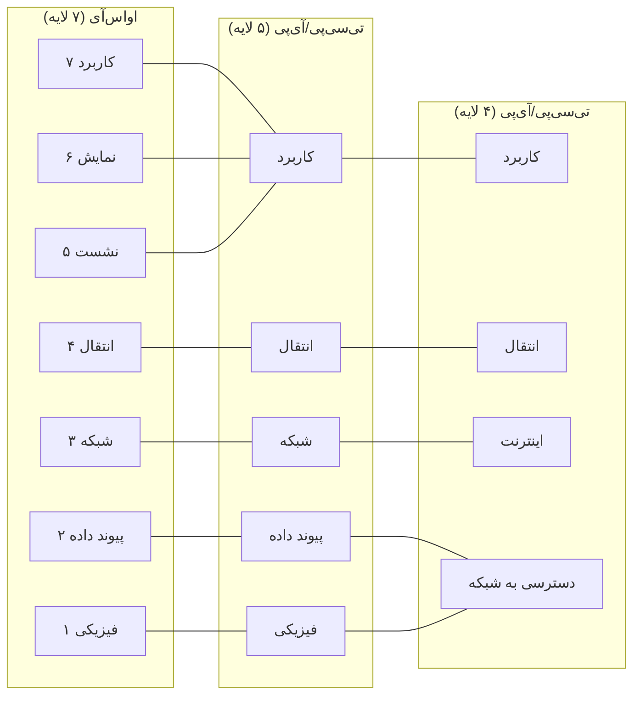

| اواس‌آی | تی‌سی‌پی/آی‌پی پنج‌لایه | تی‌سی‌پی/آی‌پی چهارلایه |
|---|---|---|
| ۷، ۶، ۵ | کاربرد | کاربرد |
| ۴ | انتقال | انتقال |
| ۳ | شبکه | اینترنت |
| ۲ | پیوند داده | دسترسی به شبکه |
| ۱ | فیزیکی | دسترسی به شبکه |

**نکتهٔ مهم:** سه لایهٔ بالای اواس‌آی در تی‌سی‌پی/آی‌پی در یک لایهٔ «کاربرد» ادغام شده‌اند، چون در عمل خود برنامه این کارها را انجام می‌دهد.

---

## ۴. واحد داده در هر لایه

به محتوایی که یک لایه جابه‌جا می‌کند «**واحد داده**» (PDU) می‌گوییم. نام آن در هر لایه فرق می‌کند.

| لایه | نام واحد داده | انگلیسی | چه چیزی به آن اضافه می‌شود |
|---|---|---|---|
| ۷ تا ۵ (کاربرد) | داده | Data | پیام اصلی برنامه |
| ۴ انتقال | قطعه | Segment | سربرگ انتقال (پورت مبدأ و مقصد) |
| ۳ شبکه | بسته | Packet | سربرگ شبکه (آی‌پی مبدأ و مقصد) |
| ۲ پیوند داده | فریم | Frame | سربرگ پیوند (مک مبدأ و مقصد) + انتهای فریم |
| ۱ فیزیکی | بیت | Bits | سیگنال برقی، نوری یا رادیویی |

**جملهٔ حفظی:** «داده → قطعه → بسته → فریم → بیت».

> **هشدار اصطلاحی:** در گفتگوی روزمره همه‌چیز را «بسته» می‌گویند (مثل «پینگ، بسته گم شد»). ولی در امتحان، «بسته» یعنی لایهٔ ۳.

---

## ۵. کپسوله‌سازی و بازکردن

### کپسوله‌سازی (Encapsulation) در فرستنده

هر لایه از بالا به پایین، یک **سربرگ** (Header) به داده می‌چسباند، مثل گذاشتن نامه در پاکت و آن پاکت در پاکتی بزرگ‌تر. لایهٔ پیوند داده علاوه بر سربرگ یک **انتها** (Trailer) هم اضافه می‌کند که برای کشف خطاست.

```text
 فرستنده (PC0)                                           

 برنامه:               [        DATA        ]                      ← داده
                                ↓
 لایه ۴ (انتقال):   [TCP|       DATA        ]                      ← قطعه
                                ↓
 لایه ۳ (شبکه):   [IP|TCP|       DATA        ]                      ← بسته
                                ↓
 لایه ۲ (پیوند): [ETH|IP|TCP|       DATA        |FCS]               ← فریم
                                ↓
 لایه ۱ (فیزیکی): 0101101001110101010110100101...                  ← بیت
```

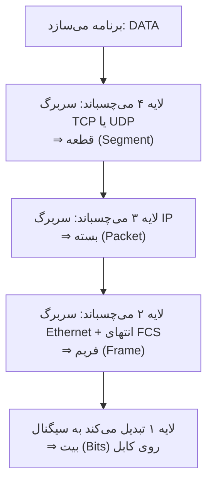

### بازکردن (Decapsulation) در گیرنده

گیرنده برعکس عمل می‌کند. از پایین به بالا، هر لایه سربرگ مربوط به خودش را می‌خواند، بررسی می‌کند و برمی‌دارد و بقیه را به لایهٔ بالاتر می‌دهد.

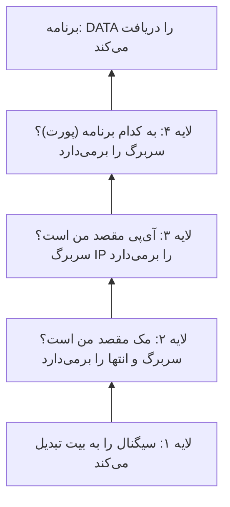

### تصویر کامل: دو رایانه و یک سوییچ

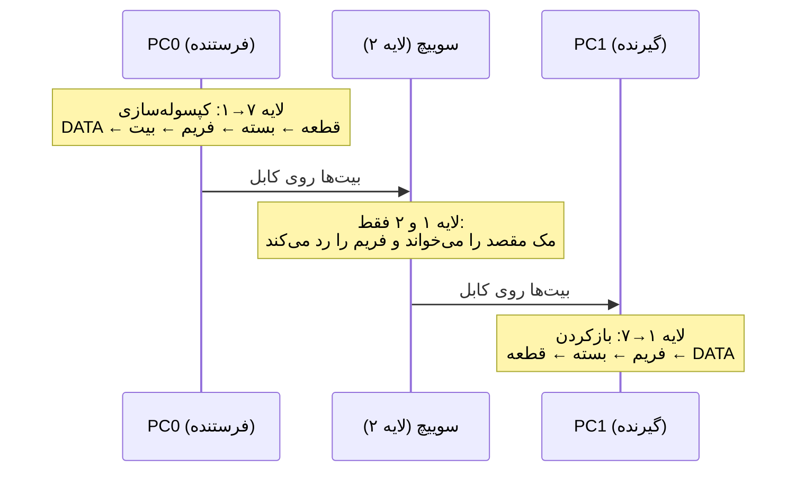

### مثال ملموس: یک وب‌صفحه

| لایه | سربرگ شامل چیست؟ (فقط مفهوم) |
|---|---|
| کاربرد | درخواست «صفحه را بده» (HTTP) |
| انتقال | پورت مبدأ (تصادفی) و پورت مقصد ۸۰ یا ۴۴۳ |
| شبکه | آی‌پی فرستنده و آی‌پی گیرنده |
| پیوند داده | مک فرستنده و مک مقصدِ «گام بعدی» |
| فیزیکی | بیت‌ها |

---

## ۶. هر پروتکل مهم در کدام لایه است؟

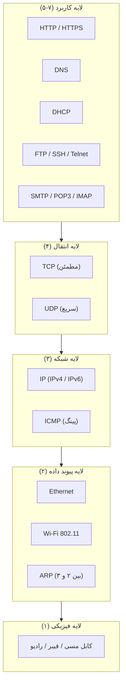

| پروتکل | لایه (اواس‌آی) | کار در یک جمله |
|---|:-:|---|
| HTTP / HTTPS | ۷ | باز کردن صفحات وب |
| DNS | ۷ | تبدیل نام سایت به آدرس |
| DHCP | ۷ | دادن خودکار آدرس به دستگاه |
| SSH / Telnet | ۷ | کنترل دستگاه از راه دور |
| TCP | ۴ | انتقال مطمئن (تأیید، ترتیب) |
| UDP | ۴ | انتقال سریع بدون تأیید |
| IP | ۳ | آدرس‌دهی منطقی و مسیریابی |
| ICMP | ۳ | پیام‌های کنترلی و خطا؛ پینگ از اینجاست |
| ARP | ۲ (گاهی «بین ۲ و ۳») | پیدا کردن مک از روی آی‌پی |
| Ethernet | ۲ و ۱ | استاندارد شبکهٔ سیمی |

**مقایسهٔ سریع TCP و UDP**

| ویژگی | TCP | UDP |
|---|---|---|
| تأیید دریافت | دارد | ندارد |
| ترتیب‌دهی | دارد | ندارد |
| سرعت | کمی کندتر | سریع‌تر |
| مثال | وب، ایمیل | صدا، تصویر زنده، DNS |

---

## ۷. جایگاه سوییچ (لایه ۲) و روتر (لایه ۳)

- **سوییچ** فقط تا **لایهٔ ۲** بسته را باز می‌کند. به **مک مقصد** نگاه می‌کند و فریم را به پورت درست می‌فرستد. سراغ آی‌پی نمی‌رود.
- **روتر** تا **لایهٔ ۳** بالا می‌آید. فریم را باز می‌کند، **آی‌پی مقصد** را می‌خواند، مسیر را انتخاب می‌کند و بسته را در یک **فریم تازه** دوباره می‌پیچد.

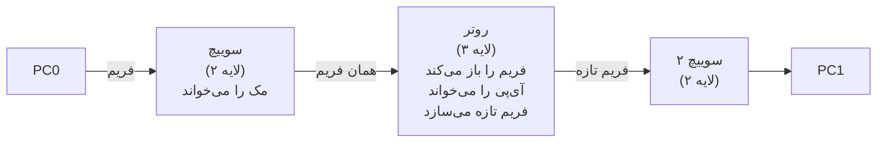

```text
 دستگاه        لایه‌هایی که «باز می‌شود»

 رایانه        ۷ ۶ ۵ ۴ ۳ ۲ ۱   (همه)
 روتر                  ۳ ۲ ۱   (تا شبکه)
 سوییچ                   ۲ ۱   (تا پیوند داده)
 هاب (قدیمی)               ۱   (فقط سیگنال)
```

| سؤال | سوییچ | روتر |
|---|---|---|
| به کدام آدرس نگاه می‌کند؟ | مک | آی‌پی |
| لایه | ۲ | ۳ |
| دو شبکهٔ جدا را وصل می‌کند؟ | خیر | بله |
| فریم را از نو می‌سازد؟ | خیر (همان را می‌فرستد) | بله |

---

## ۸. زبان فرمان

سه دستور اجباری این درس را در **Command Prompt** رایانه (در شبیه‌ساز: *Desktop → Command Prompt*) اجرا می‌کنید.

### ۸-۱. `ipconfig /all` — «من کی هستم؟»

```text
ipconfig /all
```

| بخش دستور | معنی |
|---|---|
| `ipconfig` | پیکربندی آی‌پی را نشان بده |
| `/all` | همهٔ جزئیات را نشان بده |

نمونهٔ خروجی (خلاصه‌شده):

```text
Ethernet adapter FastEthernet0:

   Physical Address.......: 00-1A-2B-3C-4D-01
   IPv4 Address...........: 192.168.1.10
   Subnet Mask............: 255.255.255.0
   Default Gateway........: 192.168.1.1
```

| خط خروجی | معنی ساده | لایه |
|---|---|:-:|
| Physical Address | مک؛ «شمارهٔ شناسنامهٔ کارت شبکه» | ۲ |
| IPv4 Address | آی‌پی؛ «نشانی من در شبکه» | ۳ |
| Default Gateway | دروازه؛ «دری که به بیرون شبکه باز می‌شود» | ۳ |
| Subnet Mask | فعلاً نادیده بگیرید (درس‌های بعد) | — |

### ۸-۲. `ping <IP-address>` — «صدا بزن و ببین جواب می‌دی یا نه»

```text
ping 192.168.1.20
```

**تجزیهٔ دستور مثل یک جمله:**

| تکه | نقش در جمله | معنی |
|---|---|---|
| `ping` | فعل | «صدا بزن و منتظر جواب بمان» |
| `192.168.1.20` | مفعول | «این دستگاه را» |

یعنی: **«به دستگاه 192.168.1.20 صدا بزن و ببین جواب می‌دهد یا نه.»**

ping از پروتکل **ICMP** (لایه ۳) استفاده می‌کند: یک پیام «Echo Request» (درخواست پژواک) می‌فرستد و منتظر «Echo Reply» (پاسخ پژواک) می‌ماند.

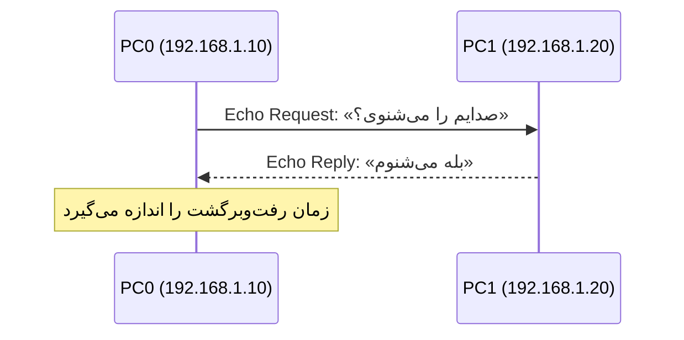

**خواندن خروجی پینگ مثل یک گفتگو:**

```text
Pinging 192.168.1.20 with 32 bytes of data:

Reply from 192.168.1.20: bytes=32 time=1ms TTL=128
Reply from 192.168.1.20: bytes=32 time<1ms TTL=128
Request timed out.
Reply from 192.168.1.20: bytes=32 time<1ms TTL=128

Ping statistics for 192.168.1.20:
    Packets: Sent = 4, Received = 3, Lost = 1 (25% loss)
Approximate round trip times in milli-seconds:
    Minimum = 0ms, Maximum = 1ms, Average = 0ms
```

| خط خروجی | ترجمه به زبان گفتگو |
|---|---|
| `Pinging ... with 32 bytes` | «من ۳۲ بایت پیام فرستادم، صدایم را می‌شنوی؟» |
| `Reply from ...` | «بله شنیدم!» (پاسخ) |
| `time=1ms` | «در یک هزارم ثانیه جواب دادم» (زمان) |
| `TTL=128` | «عمر باقی‌ماندهٔ بسته»؛ فعلاً فقط بدانید وجود دارد |
| `Request timed out.` | «سکوت! جوابی نیامد» (گم شدن بسته) |
| `Destination host unreachable` | «کسی برای رساندن پیام پیدا نکردم» (معمولاً مشکل مسیر یا دروازه) |
| `Sent = 4, Received = 3, Lost = 1` | «۴ بار صدا زدم، ۳ جواب گرفتم، ۱ بار گم شد» |

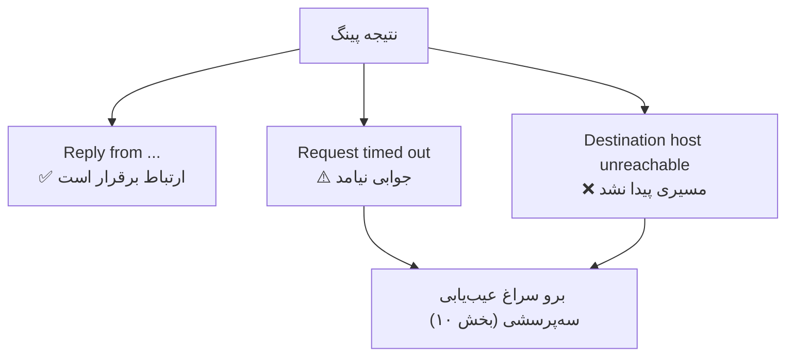

### ۸-۳. `arp -a` — «دفترچهٔ تلفن آدرس‌های اخیر»

```text
arp -a
```

نمایش جدول ARP، یعنی جفت‌های «آی‌پی ⇄ مک» که رایانه تازگی یاد گرفته است.

```text
Interface: 192.168.1.10
  Internet Address      Physical Address      Type
  192.168.1.20          00-1A-2B-3C-4D-02     dynamic
```

**معنی:** «من می‌دانم دستگاهی با آی‌پی 192.168.1.20 در همین شبکه، مکش 00-1A-2B-3C-4D-02 است.»

**چرا ARP لازم است؟** برنامه آی‌پی مقصد را می‌داند، ولی در شبکهٔ محلی فریم‌ها با **مک** تحویل داده می‌شوند. ARP پل بین این دو است.

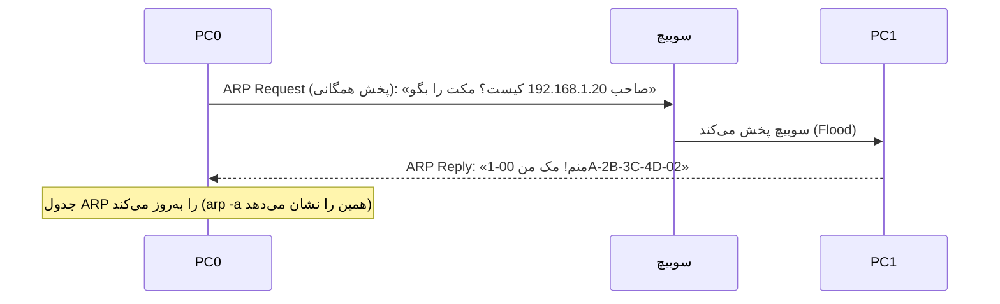

> **ترتیب پیشنهادی در لب:** اول `ipconfig /all`، بعد `ping`، آخر `arp -a` (تا ببینید پینگ باعث پر شدن جدول ARP شد).

---

## ۹. لب: دنبال کردن یک بسته در حالت شبیه‌سازی

### نقشه

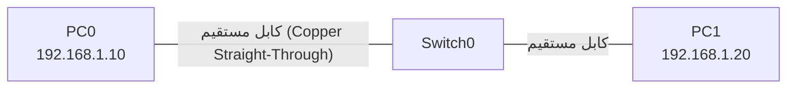

```text
   +--------+          +-----------+          +--------+
   |  PC0   |==========| Switch0   |==========|  PC1   |
   | .1.10  | Fa0   Fa0/1       Fa0/2   Fa0 | .1.20  |
   +--------+          +-----------+          +--------+
```

> آدرس‌ها را فقط همان‌طور که هست وارد کنید (جزئیات معنی‌شان در درس بعد می‌آید). Subnet Mask را در شبیه‌ساز همان مقدار پیش‌فرض بگذارید.

### مراحل

| گام | کار | چه چیزی را بررسی کنید |
|:-:|---|---|
| ۱ | دو رایانه و یک سوییچ را روی صفحه بگذارید و با کابل مستقیم وصل کنید | چراغ‌های لینک سبز شوند |
| ۲ | در *Desktop → IP Configuration* به PC0 مقدار 192.168.1.10 و به PC1 مقدار 192.168.1.20 بدهید | |
| ۳ | در PC0 دستور `ipconfig /all` را بزنید | مک و آی‌پی را یادداشت کنید |
| ۴ | در گوشهٔ پایین‌راست شبیه‌ساز، **Simulation Mode** را انتخاب کنید | |
| ۵ | در *Edit Filters* فقط **ICMP** و **ARP** را روشن بگذارید | فهرست رویداد شلوغ نشود |
| ۶ | با **Add Simple PDU** (آیکن پاکت) از PC0 به PC1 یک بسته بسازید | |
| ۷ | دکمهٔ **Capture / Forward** را مرحله‌به‌مرحله بزنید | رویدادها یکی‌یکی ظاهر می‌شوند |
| ۸ | روی هر پاکت رنگی کلیک کنید تا پنجرهٔ **PDU Information** باز شود | |
| ۹ | تب **OSI Model** را باز کنید | ببینید هر لایه چه کرد |
| ۱۰ | تب‌های **Inbound PDU Details** و **Outbound PDU Details** را هم ببینید | سربرگ‌ها را ببینید |
| ۱۱ | در پایان در PC0 `arp -a` بزنید | جدول ARP پر شده |

### شبیه‌سازی صفحه (آنچه روی صفحه می‌بینید)

**پنجرهٔ فهرست رویدادها (Event List):**

```text
+------+-------------+-------------+------+
| Vis. | Time(sec)   | Last Device | At Device | Type |
+------+-------------+-------------+-----------+------+
|  •   | 0.000       |  --         | PC0       | ICMP |  ← ping تولید شد
|  •   | 0.001       |  PC0        | Switch0   | ARP  |  ← «صاحب .1.20 کیست؟»
|  •   | 0.002       |  Switch0    | PC1       | ARP  |
|  •   | 0.003       |  PC1        | Switch0   | ARP  |  ← «منم!»
|  •   | 0.004       |  Switch0    | PC0       | ARP  |
|  •   | 0.005       |  PC0        | Switch0   | ICMP |  ← Echo Request
|  •   | 0.006       |  Switch0    | PC1       | ICMP |
|  •   | 0.007       |  PC1        | Switch0   | ICMP |  ← Echo Reply
|  •   | 0.008       |  Switch0    | PC0       | ICMP |  ← موفق ✔
+------+-------------+-------------+-----------+------+
```

**پنجرهٔ جزئیات بسته (تب OSI Model) هنگام خروج از PC0:**

```text
+------------------------------------------------------------+
| PDU Information at Device: PC0                  [ Outbound ]|
+------------------------------------------------------------+
| Layer 7 : ICMP Echo Request ساخته شد                       |
| Layer 6 : —                                                |
| Layer 5 : —                                                |
| Layer 4 : — (ICMP در لایه ۳ است، قطعه‌ای ساخته نمی‌شود)    |
| Layer 3 : سربرگ IP:  مبدأ .1.10  →  مقصد .1.20             |
| Layer 2 : سربرگ Ethernet:  مک PC0 → مک PC1                 |
| Layer 1 : بیت‌ها به پورت Fa0 فرستاده شد                    |
+------------------------------------------------------------+
```

**همان بسته هنگام عبور از سوییچ (تب OSI Model):**

```text
+------------------------------------------------------------+
| PDU Information at Device: Switch0                          |
+------------------------------------------------------------+
| Layer 3 : (سوییچ این لایه را باز نمی‌کند)                  |
| Layer 2 : مک مقصد را در جدول MAC پیدا کرد → پورت Fa0/2      |
| Layer 1 : بیت‌ها را از پورت Fa0/2 فرستاد                   |
+------------------------------------------------------------+
```

**همان بسته هنگام رسیدن به PC1:**

```text
+------------------------------------------------------------+
| PDU Information at Device: PC1                  [ Inbound ] |
+------------------------------------------------------------+
| Layer 1 : بیت‌ها را دریافت کرد                             |
| Layer 2 : مک مقصد مال من است ✔ سربرگ برداشته شد           |
| Layer 3 : آی‌پی مقصد مال من است ✔ سربرگ برداشته شد        |
| Layer 7 : Echo Request تحویل برنامه (ICMP) شد → پاسخ بساز  |
+------------------------------------------------------------+
```

> **نکتهٔ مهم:** در Packet Tracer معمولاً **اولین** پینگ ممکن است یک بار `Request timed out` بدهد، چون صرف کارِ ARP می‌شود. پینگ‌های بعدی موفق‌اند. این رفتار عادی است و نشانهٔ خرابی نیست.

### گزارش لب (نمونه)

| پرسش | پاسخ نمونه |
|---|---|
| مک PC0 چیست؟ | 00-1A-2B-3C-4D-01 (در شبیه‌ساز شما متفاوت است) |
| اولین رویداد قبل از ICMP چه بود؟ | ARP Request |
| سوییچ کدام لایه‌ها را باز کرد؟ | فقط لایهٔ ۱ و ۲ |
| پس از پینگ، `arp -a` چه نشان داد؟ | آی‌پی و مک PC1 |

---

## ۱۰. عیب‌یابی: سه پرسش از پایین به بالا

اگر پینگ جواب نداد، از **پایین مدل** شروع کنید، چون اگر پایین خراب باشد بالایی‌ها هیچ‌وقت کار نمی‌کنند.

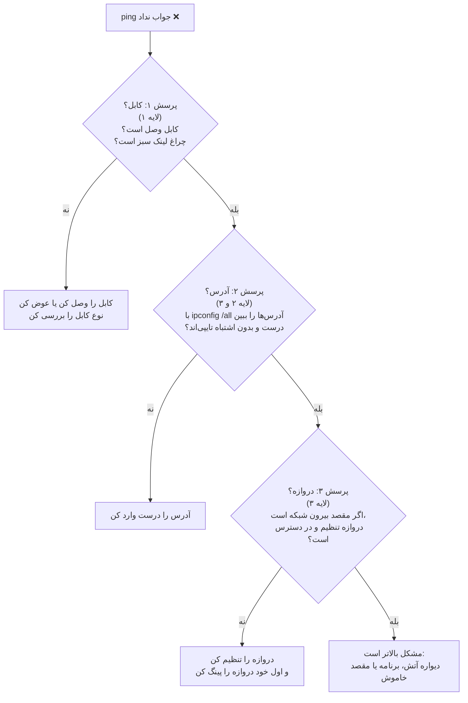

| پرسش | لایه | روش بررسی | نشانهٔ مشکل |
|:-:|:-:|---|---|
| ۱. کابل؟ | ۱ | نگاه به چراغ لینک، آیکن پورت در شبیه‌ساز (سبز/قرمز) | چراغ خاموش یا قرمز |
| ۲. آدرس؟ | ۲ و ۳ | `ipconfig /all` و مقایسه با نقشه | آدرس خالی، اشتباه یا تکراری |
| ۳. دروازه؟ | ۳ | `ping <آدرس دروازه>`؛ اگر جواب داد، مقصد بیرونی را امتحان کن | دروازه خالی یا بی‌پاسخ |

**ترفند:** اول **خودتان** را، بعد **همسایه** را، بعد **دروازه** را، و در آخر **بیرون** را پینگ کنید.

---

## ۱۱. پرسش‌ها و پاسخ‌ها

### پرسش ۱: چرا شبکه به‌جای یک بلوک بزرگ، لایه‌ای طراحی می‌شود؟

**پاسخ:** چون (۱) هر لایه وظیفهٔ مشخص و کوچکی دارد و یادگیری آسان می‌شود، (۲) عیب‌یابی دقیق‌تر می‌شود (می‌دانیم مشکل در کدام لایه است)، (۳) تولیدکنندگان مختلف می‌توانند محصولات سازگار بسازند، و (۴) تغییر یک لایه (مثلاً سیم به وای‌فای) بقیه را تغییر نمی‌دهد.

### پرسش ۲: لایه‌های اواس‌آی را از ۷ تا ۱ بنویسید و با نمودار به تی‌سی‌پی/آی‌پی نگاشت کنید.

**پاسخ:**

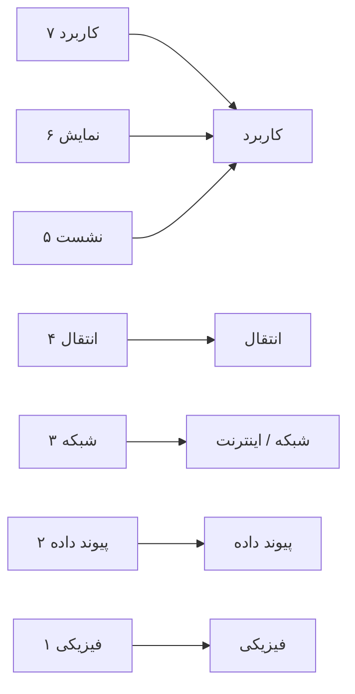

### پرسش ۳: واحد داده در هر لایه چه نام دارد؟

**پاسخ:**

| لایه | نام |
|---|---|
| کاربرد | داده |
| انتقال | قطعه |
| شبکه | بسته |
| پیوند داده | فریم |
| فیزیکی | بیت |

### پرسش ۴: کپسوله‌سازی را با نمودار توضیح دهید.

**پاسخ:** فرستنده از بالا به پایین، در هر لایه سربرگی اضافه می‌کند.

```text
DATA
 └─ + TCP        → قطعه (Segment)
     └─ + IP     → بسته (Packet)
         └─ + ETH + FCS → فریم (Frame)
             └─ تبدیل    → بیت (Bits)
```

### پرسش ۵: هر یک از این پروتکل‌ها در کدام لایه‌اند؟ HTTP، TCP، IP، ICMP، Ethernet، DNS

**پاسخ:**

| پروتکل | لایه |
|---|:-:|
| HTTP | ۷ |
| DNS | ۷ |
| TCP | ۴ |
| IP | ۳ |
| ICMP | ۳ |
| Ethernet | ۲ (و ۱) |

### پرسش ۶: سوییچ و روتر هر کدام تا کدام لایه بسته را باز می‌کنند؟ چه فرقی دارند؟

**پاسخ:** سوییچ تا لایهٔ ۲ (بر پایهٔ مک)، روتر تا لایهٔ ۳ (بر پایهٔ آی‌پی). روتر فریم را باز می‌کند و فریم تازه می‌سازد؛ سوییچ همان فریم را عبور می‌دهد.

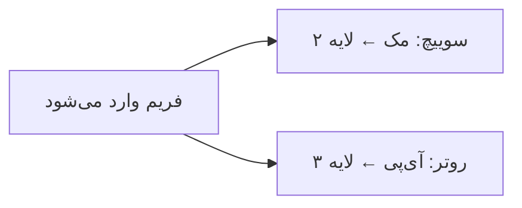

### پرسش ۷: دستور `ping 192.168.1.20` را مثل یک جمله تجزیه کنید.

**پاسخ:** `ping` فعل است («صدا بزن و منتظر جواب بمان») و `192.168.1.20` مفعول («این دستگاه را»). جملهٔ کامل: «به دستگاه 192.168.1.20 صدا بزن و ببین جواب می‌دهد یا نه.»

### پرسش ۸: این خروجی چه می‌گوید؟

```text
Reply from 192.168.1.20: bytes=32 time=2ms TTL=128
Request timed out.
Request timed out.
Reply from 192.168.1.20: bytes=32 time=1ms TTL=128
Packets: Sent = 4, Received = 2, Lost = 2 (50% loss)
```

**پاسخ:** از چهار بار صدا زدن، فقط دو بار جواب آمد (۵۰٪ گم‌شدن). ارتباط «بریده‌بریده» است. دو جواب یعنی مسیر اصلاً قطع نیست؛ مشکل موقتی است (کابل شل، ازدحام یا پورت ناپایدار). از پرسش «کابل؟» شروع کنید.

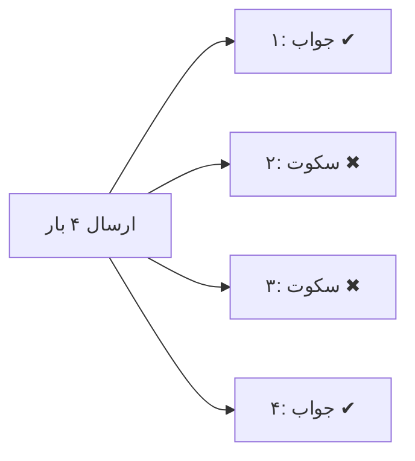

### پرسش ۹: چرا `arp -a` برای ما مهم است؟ بین آی‌پی و مک چه رابطه‌ای هست؟

**پاسخ:** برنامه آی‌پی را می‌شناسد، ولی در شبکهٔ محلی فریم با مک تحویل داده می‌شود. ARP «آی‌پی ⇄ مک» را نگاشت می‌کند و `arp -a` نتیجه را نشان می‌دهد.

### پرسش ۱۰: در ping، چرا اولین رویداد در شبیه‌ساز ARP است نه ICMP؟

**پاسخ:** چون PC0 هنوز مک PC1 را نمی‌داند و بدون آن نمی‌تواند فریم بسازد. ابتدا ARP می‌فرستد، پاسخ را در جدول ذخیره می‌کند و بعد Echo Request را می‌فرستد.

### پرسش ۱۱: بسته‌ای در لایهٔ ۲ دقیقاً چه چیزی دارد که در لایهٔ ۳ نداشت؟

**پاسخ:** سربرگ Ethernet (مک مبدأ و مقصد) و انتهای FCS (برای کشف خطا).

### پرسش ۱۲: تفاوت TCP و UDP چیست؟ دو مثال بزنید.

**پاسخ:** TCP تأیید و ترتیب دارد (وب، ایمیل)؛ UDP سریع و بدون تأیید است (تماس تصویری، DNS).

---

## ۱۲. پروژه‌ها و پاسخ‌ها

### پروژه ۱: دنبال کردن یک پینگ در حالت شبیه‌سازی و نوشتن گزارش لایه‌به‌لایه

**خواسته:** در شبکهٔ «دو رایانه + یک سوییچ»، یک پینگ را در Simulation Mode دنبال کنید و برای هر دستگاه بنویسید در هر لایه چه شد.

**پاسخ (نمونه):**

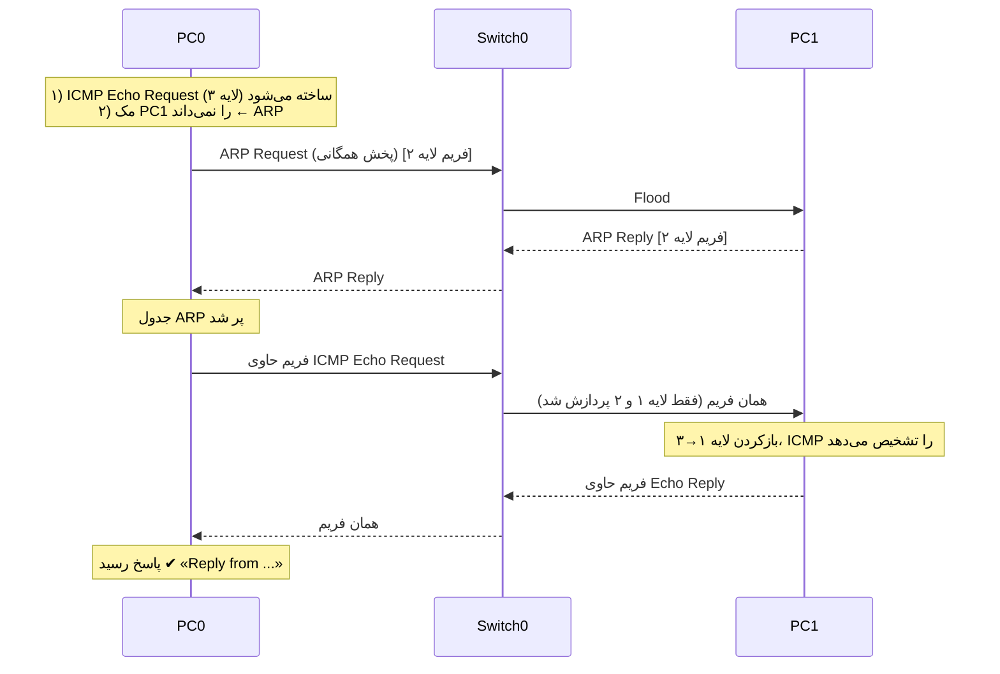

| دستگاه | لایه ۱ | لایه ۲ | لایه ۳ | بالاتر |
|---|---|---|---|---|
| PC0 (ارسال) | بیت روی کابل | مک مبدأ/مقصد می‌چسباند | آی‌پی مبدأ/مقصد می‌چسباند | ICMP Echo Request می‌سازد |
| Switch0 | دریافت و ارسال بیت | جدول مک را نگاه می‌کند | **باز نمی‌کند** | — |
| PC1 (دریافت) | دریافت بیت | مک مقصد را بررسی و سربرگ را برمی‌دارد | آی‌پی مقصد را بررسی و سربرگ را برمی‌دارد | Echo Reply می‌سازد |

### پروژه ۲: عیب‌یابی عمدی — سه خرابی، سه تشخیص

**خواسته:** سه خرابی مصنوعی ایجاد کنید و با روش سه‌پرسشی تشخیص دهید.

| خرابی ایجادشده | نشانه | پرسش مؤثر | رفع |
|---|---|---|---|
| کابل PC1 را جدا کنید | پینگ: Request timed out، پورت قرمز | ۱. کابل؟ | کابل را وصل کنید |
| به PC1 آدرسی اشتباه (مثلاً 192.168.5.20) بدهید | پینگ: Request timed out یا Unreachable | ۲. آدرس؟ | آدرس را اصلاح کنید |
| دروازه را خالی بگذارید و یک مقصد بیرونی پینگ کنید | Destination host unreachable | ۳. دروازه؟ | دروازه را تنظیم کنید |

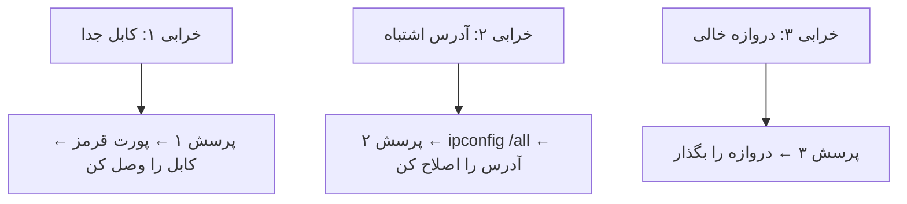

> **یادآوری:** تشخیص «آدرس اشتباه» در این درس فقط در حد «با نقشه نمی‌خواند» است؛ توضیح دقیق چرایی در درس آدرس‌دهی می‌آید.

### پروژه ۳: نمودار کپسوله‌سازی خودتان را بکشید

**خواسته:** نمودار رفت‌وبرگشت را برای یک درخواست وب (HTTP) بکشید و سربرگ‌ها را نام ببرید.

**پاسخ:**

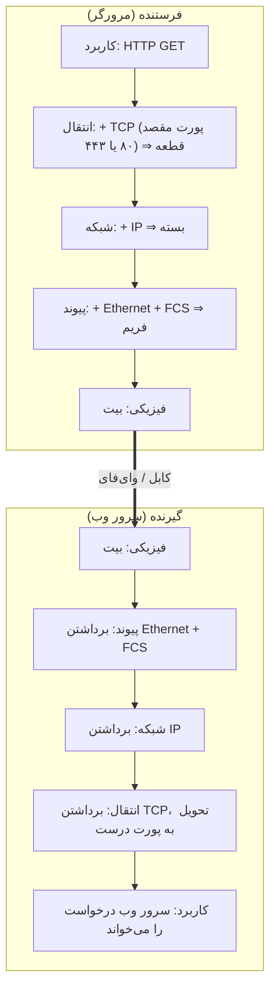

### پروژه ۴: جدول «چه کسی کجاست؟»

**خواسته:** این دستگاه‌ها و پروتکل‌ها را در لایهٔ درست قرار دهید: سوییچ، روتر، کابل، DNS، TCP، ICMP، ARP، فریم.

**پاسخ:**

| لایه | موارد |
|:-:|---|
| ۷ (کاربرد) | DNS |
| ۴ (انتقال) | TCP |
| ۳ (شبکه) | روتر، ICMP، (واحد داده: بسته) |
| ۲ (پیوند) | سوییچ، ARP (بین ۲ و ۳)، (واحد داده: فریم) |
| ۱ (فیزیکی) | کابل، (واحد داده: بیت) |

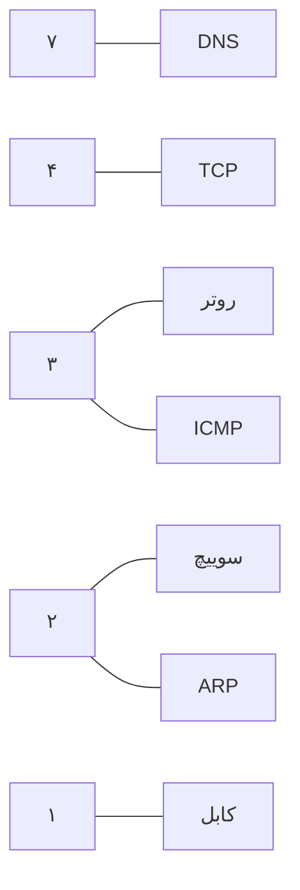

---

## ۱۳. معیار آمادگی و خلاصه

### فهرست بررسی (هنرجو باید بتواند)

- [ ] دلیل لایه‌ای بودن مدل را بگوید.
- [ ] هفت لایهٔ اواس‌آی و نگاشت آن‌ها به تی‌سی‌پی/آی‌پی را بنویسد.
- [ ] واحد داده در هر لایه (داده، قطعه، بسته، فریم، بیت) را بگوید.
- [ ] کپسوله‌سازی و بازکردن را رسم و توضیح دهد.
- [ ] پروتکل‌های مهم را در لایه‌های درست قرار دهد.
- [ ] جایگاه سوییچ (لایه ۲) و روتر (لایه ۳) را توضیح دهد.
- [ ] `ipconfig /all`، `ping` و `arp -a` را اجرا و خروجی را مثل گفتگو بخواند.
- [ ] یک بسته را در حالت شبیه‌سازی دنبال و توضیح دهد در هر لایه چه شد.
- [ ] در صورت جواب ندادن پینگ، سه پرسش (کابل؟ آدرس؟ دروازه؟) را از پایین به بالا بپرسد.

### خلاصه در یک نگاه

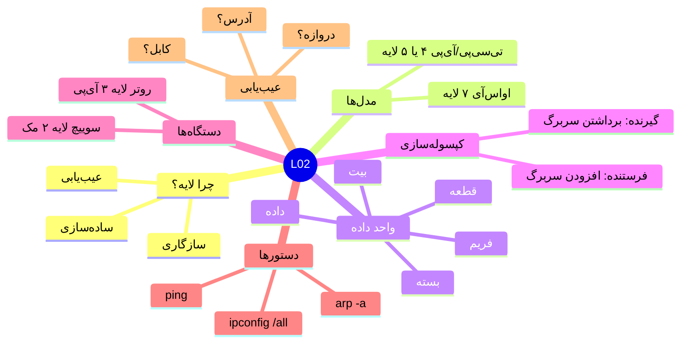

### کارت مرور سریع

| موضوع | یادآوری |
|---|---|
| ترتیب لایه‌ها | ۷ کاربرد، ۶ نمایش، ۵ نشست، ۴ انتقال، ۳ شبکه، ۲ پیوند، ۱ فیزیکی |
| واحدها | داده ← قطعه ← بسته ← فریم ← بیت |
| سوییچ | مک، لایه ۲ |
| روتر | آی‌پی، لایه ۳ |
| ping | ICMP، لایه ۳؛ «صدا بزن و ببین جواب می‌دی» |
| arp -a | جدول «آی‌پی ⇄ مک» |
| ipconfig /all | «من کی‌ام؟» (مک، آی‌پی، دروازه) |
| عیب‌یابی | از پایین: کابل ← آدرس ← دروازه |

**درس بعد:** آدرس‌دهی و زیرشبکه‌بندی، همان چیزهایی که این درس عمداً به‌طور دقیق وارد آن‌ها نشد.
