# آموزش جامع سیسکو سی‌سی‌ان‌ای

# درس L03 — زبان خط فرمان (۱): اتاق‌ها و ناوبری

| | |
|---|---|
| **حوزه آزمون** | پایه زبان فرمان (مقدمه همه حوزه‌ها) |
| **فاز** | فاز یک — اصول شبکه و زبان خط فرمان |
| **سطح آزمایشگاه** | سطح ۱ (یک سوییچ و یک رایانه با کابل کنسول) |
| **برچسب پشتیبانی پکت تریسر** | کامل (جزئیات در بخش ۱۲) |
| **پیش‌نیاز قطعی** | L00 |
| **مدرس** | محمد مهدی گنجی |
| **نسخه نقشه راه** | ۱.۰ |

> **نکته درباره این فایل:** این نسخه «پرسش و پاسخ را کنار هم» دارد. زیر هر تمرین،
> مینی‌پروژه و سؤال آزمون، بلافاصله **پاسخ** آمده است. اگر می‌خواهی خودت را
> درست محک بزنی، اول خودت حل کن و بعد پاسخ را ببین؛ دیدن پاسخ قبل از تلاش،
> یادگیری را نصف می‌کند.
>
> **نکته درباره خروجی‌ها:** تمام خروجی‌های دستگاه در این فایل **نمونه آموزشی**
> هستند، نه خروجی ضبط‌شده از پکت تریسر شما. خروجی دستگاه خودت را با نمونه
> مقایسه کن؛ تفاوت‌های جزئی بین نسخه‌ها طبیعی است. جاهایی که مطمئن نیستم،
> با عبارت **«نیازمند راستی‌آزمایی در نسخه نصب‌شده»** علامت خورده‌اند.

---

## ۵. خوشامدگویی

سلام و خوش آمدی به درس سوم. تا اینجا با ساختمان شبکه آشنا شدی و پکت تریسر را
نصب کردی. حالا وقتش است که **با خود دستگاه حرف بزنی**.

یک راز بزرگ بگویم که کل این دوره روی آن بنا شده: دستورهای سیسکو رمز و ورد
نیستند. هر دستور یک **جمله** است. دستگاه مثل یک کارمند دقیق و کم‌حرف است؛
اگر جمله‌ات را درست و در اتاق درست بگویی، کار را انجام می‌دهد؛ اگر نه،
مؤدبانه می‌گوید چه چیزی را نفهمیده.

در این درس **هیچ تنظیمی را تغییر نمی‌دهیم.** فقط یاد می‌گیریم:

-   دستگاه یک ساختمان با چند اتاق است؛
-   از کجا بفهمیم الان در کدام اتاقیم؛
-   چطور بین اتاق‌ها برویم؛
-   چطور از دستگاه «بپرسیم»؛
-   وقتی دستگاه ایراد گرفت، ایرادش را به فارسی ترجمه کنیم.

هر کسی که این پنج مهارت را داشته باشد، در درس‌های بعد نصف راه را رفته است.

---

## ۶. اهداف قابل سنجش

پس از پایان این درس، تو می‌توانی:

1.  توضیح بدهی خط فرمان چیست و چرا مهندس شبکه به آن نیاز دارد؛
2.  رایانه را با کابل کنسول به سوییچ وصل کنی و پنجره پایانه را باز کنی؛
3.  هر پنج اتاق (کاربر، مدیر، تنظیمات، درگاه، خط) را از روی نشانه جلوی خط تشخیص بدهی؛
4.  بدون راهنما بین اتاق‌ها بروی و برگردی، و تفاوت «یک پله برگرد» و «یکراست برو مدیر» را بدانی؛
5.  با علامت سؤال، کلید تب و فلش‌ها کار کنی؛
6.  هر یک از دوازده دستور این درس را به جمله انسانی ترجمه کنی و برعکس؛
7.  سه پیام خطای اصلی را بخوانی و بگویی دستگاه چه چیزی را نفهمیده؛
8.  چهار دستور نمایشی را اجرا و خروجی‌شان را در حد پایه بخوانی.

---

## ۷. پیش‌نیازها و وضعیت احراز آن‌ها

### ۷.۱ جدول وابستگی درس

| مفهوم / مهارت موردنیاز | درس معرفی‌کننده | وضعیت آموزش | شواهد تسلط لازم | تصمیم |
|---|---|---|---|---|
| نصب پکت تریسر و باز کردن آن | L00 | آموزش‌داده‌شده | نصب موفق | مجاز |
| ساخت فایل آزمایشگاه و ذخیره آن | L00 | آموزش‌داده‌شده | فایل ذخیره‌شده | مجاز |
| گذاشتن دستگاه و کشیدن کابل در فضای کار | L00 | آموزش‌داده‌شده | لب دو رایانه و یک سوییچ | مجاز |
| شناخت انواع کابل (از جمله کابل کنسول) | L00 | معرفی‌شده | دیدن آن در نوار کابل‌ها | مجاز (در همین درس تمرین می‌شود) |
| تفاوت «پرسیدن» و «دستور دادن» | L00 | آموزش‌داده‌شده | پینگ موفق و مثال روزمره | مجاز |
| پنجره خط فرمان رایانه (دستورهای نمایش آدرس و پینگ) | L00 | آموزش‌داده‌شده | پینگ موفق | مجاز |
| مدل لایه‌ای و کپسوله‌سازی | L02 | — | — | **لازم نیست** (فقط یک اشاره کوتاه در بخش ۱۴) |
| آدرس‌دهی و زیرشبکه‌بندی | L06 به بعد | آموزش‌داده‌نشده | — | **ممنوع** |

### ۷.۲ چک‌لیست احراز L00 (پیش از شروع، با تیک بزن)

-   [ ] پکت تریسر روی سیستم من نصب است و باز می‌شود.
-   [ ] یک فایل آزمایشگاه ساخته و با شماره نسخه ذخیره کرده‌ام.
-   [ ] دو رایانه را به یک سوییچ وصل کرده‌ام و پینگ بین آن‌ها موفق بوده است.
-   [ ] می‌دانم پنجره هر دستگاه چند تب دارد و پنجره خط فرمان رایانه کجاست.
-   [ ] نتیجه سنجش ورودی را در فرم وضعیت ثبت کرده‌ام.

اگر حتی یک مورد تیک نخورد، قبل از ادامه به درس L00 برگرد.

### ۷.۳ جای این درس در نقشه راه

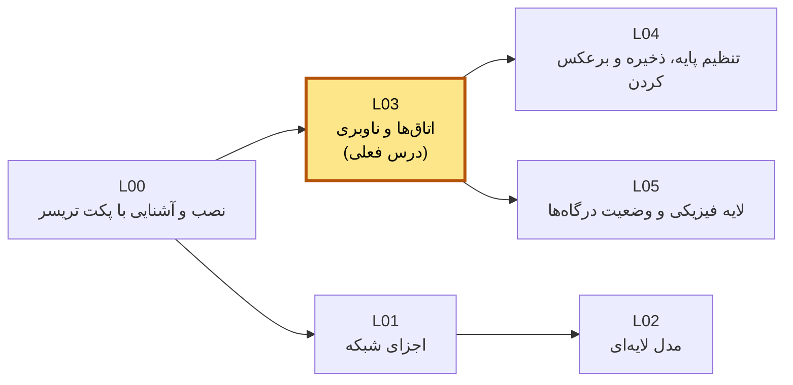

---

## ۸. مفاهیم مجاز و غیرمجاز در این مرحله

| مجاز در این درس | ممنوع در این درس |
|---|---|
| رفت‌وآمد بین اتاق‌ها | هر نوع تغییر تنظیمات واقعی دستگاه |
| ورود به اتاق درگاه و اتاق خط (فقط ورود و خروج) | آدرس‌دهی (دادن آدرس به درگاه یا رایانه) |
| دستورهای نمایشی «پرسیدن» | گذاشتن گذرواژه، تغییر نام دستگاه |
| علامت سؤال، تب، فلش‌ها | ذخیره کردن، پاک کردن، راه‌اندازی دوباره |
| خواندن پیام‌های خطا | پیشوندهای «برعکس‌ساز» و «صدازن» (درس بعد) |

قاعده طلایی این درس: **فقط نگاه کن و راه برو؛ هیچ چیز را عوض نکن.**

---

## ۹. واژه‌نامه درس (کد انگلیسی ← تلفظ فارسی ← معنی)

این جدول فقط برای مراجعه است. در متن فارسی همیشه تلفظ فارسی را می‌بینی و شکل
انگلیسی فقط در بلوک‌های کد و همین جدول می‌آید.

```text
CLI                 = سی‌اِل‌آی        = خط فرمان؛ جایی که جمله تایپ می‌کنی
console cable       = کابل کنسول       = کابل مخصوص حرف زدن مستقیم با دستگاه
user EXEC           = حالت کاربر       = اتاق ورودی؛ فقط نگاه‌های سبک
privileged EXEC     = حالت مدیر        = اتاق مدیر؛ نگاه‌های کامل
global configuration= حالت تنظیمات     = اتاق تنظیمات کل دستگاه
interface config    = حالت درگاه       = اتاق مخصوص یک درگاه
line config         = حالت خط          = اتاق مخصوص یک راه ورود (مثل کنسول)
prompt              = پرامپت (نشانه)   = علامت جلوی خط که اتاق را نشان می‌دهد
enable              = اینیبل           = اجازه بده بروم اتاق مدیر
disable             = دیسیبل           = برگردم اتاق عادی
configure terminal  = کانفیگر ترمینال  = برو حالت تنظیمات از همین پایانه
interface           = اینترفیس         = درگاه
gigabitethernet     = گیگابیت‌اترنت    = درگاه با سرعت یک گیگابیت
line                = لاین             = خط
console             = کنسول            = راه ورود از کابل کنسول
exit                = اگزیت            = یک پله برگرد عقب
end                 = اند              = یکراست برگرد اتاق مدیر
show                = شو               = نشونم بده
version             = ورژن             = نسخه
brief               = بریف             = خلاصه
running-config      = رانینگ‌کانفیگ    = تنظیمات زنده
history             = هیستوری          = تاریخچه
<cr>                = سی‌آر            = «جمله تمومه؛ اینتر بزن»
```

---
## ۱۰. آموزش مفهومی با نمودار

### ۱۰.۱ خط فرمان چیست و چرا لازم است؟

**مثال روزمره:** فرض کن می‌خواهی به منشی یک شرکت بزرگ کاری بسپاری، ولی منشی
فقط نامه نوشتنی قبول می‌کند. تو نامه می‌نویسی، او می‌خواند، کار را انجام می‌دهد
و جواب را به همان شکل برمی‌گرداند. هیچ دکمه و تصویری در کار نیست؛ فقط جمله.

**تعریف ساده:** خط فرمان یک صفحه متنی است که توش جمله تایپ می‌کنی و دستگاه
جواب متنی می‌دهد. سوییچ و روتر سیسکو صفحه نمایش و ماوس ندارند؛ تنها راه
حرف زدن با آن‌ها همین صفحه متنی است.

**چرا مهم است؟**

-   دستگاه تازه‌خریده هیچ آدرسی ندارد؛ پس از راه شبکه نمی‌شود به آن وصل شد.
    اولین بار حتماً با **کابل کنسول** و خط فرمان وصل می‌شوی.
-   سرعت: یک جمله تایپ‌شده کاری را انجام می‌دهد که با ماوس ده کلیک می‌خواهد.
-   همه دستگاه‌های سیسکو یک زبان مشترک دارند؛ یاد بگیری، همه‌جا کار می‌کند.
-   آزمون رسمی سی‌سی‌ان‌ای پر از خروجی خط فرمان است.

**اگر نباشد:** باید با رایانه جلوی هر دستگاه بروی و دکمه‌های ظاهری را بزنی؛
خودکارسازی هم ممکن نمی‌شد.

**در شبکه واقعی کجا دیده می‌شود؟** تکنسین با لپ‌تاپ و کابل کنسول جلوی قفسه
شبکه می‌ایستد؛ یا از راه دور با پروتکل مخصوص وصل می‌شود (درس‌های بعد).

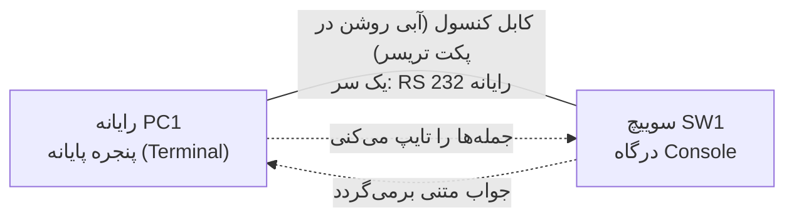

**جمع‌بندی یک‌دقیقه‌ای:** خط فرمان = گفتگوی متنی با دستگاه. کابل کنسول = تلفن
مستقیم تو به دستگاه، حتی وقتی دستگاه هنوز هیچ تنظیمی ندارد.

---

### ۱۰.۲ ساختمان اتاق‌ها

**مثال روزمره:** یک ساختمان اداری را در نظر بگیر:

-   **لابی:** هر مراجعه‌کننده‌ای می‌تواند وارد شود، فقط می‌تواند بپرسد و نگاه کند؛
-   **اتاق مدیر:** برای ورود باید اجازه گرفت؛ مدیر همه‌چیز را می‌بیند؛
-   **اتاق تنظیمات:** جایی که ساختمان را بازچینی می‌کنند؛
-   **زیراتاق‌ها:** هر کدام مخصوص یک کار: یکی برای یک درگاه، یکی برای یک راه ورود.

آی‌او‌اس دقیقاً همین‌طور است. **هر دستور فقط در اتاق خودش کار می‌کند.**

**نشانه هر اتاق همان علامت جلوی خط است (پرامپت).** اسم قبل از علامت، اسم
دستگاه است (در لب ما: سوییچ، که در بلوک کد می‌بینی)؛ آنچه می‌ماند، نشانه اتاق است:

| اتاق | نشانه جلوی خط | کارهایی که می‌شود کرد |
|---|---|---|
| حالت کاربر | `Switch>` | پرسیدن‌های سبک؛ رفتن به اتاق مدیر |
| حالت مدیر | `Switch#` | همه پرسیدن‌ها؛ رفتن به اتاق تنظیمات |
| حالت تنظیمات | `Switch(config)#` | تنظیمات کل دستگاه؛ رفتن به زیراتاق‌ها |
| حالت درگاه | `Switch(config-if)#` | تنظیمات یک درگاه مشخص |
| حالت خط | `Switch(config-line)#` | تنظیمات یک راه ورود مشخص (مثل کنسول) |

**حفظ‌کردنی ساده:**

-   علامت **بزرگ‌تر** (`>`) = لابی؛ هنوز مدیر نیستی؛
-   علامت **شارپ** (`#`) = اتاق مدیر؛
-   **پرانتز** در نشانه = اتاق تنظیمات یا یکی از زیراتاق‌هایش؛ داخل پرانتز اسم
    زیراتاق را می‌خوانی.

**چرا اتاق‌بندی؟** مثل ساختمان واقعی: همه نباید بتوانند به اتاق تنظیمات بروند.
اگر اتاقی نباشد، هر مراجعه‌کننده می‌تواند با یک اشتباه کل شبکه را از کار بیندازد.

**نقشه ساختمان (فلش‌ها = دستورهای رفت و برگشت):**

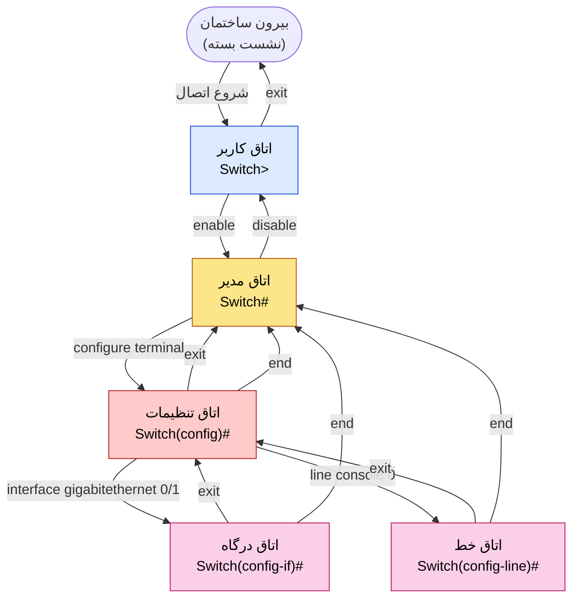

**جمع‌بندی یک‌دقیقه‌ای:** پنج اتاق داریم؛ نشانه جلوی خط می‌گوید کجایی. همیشه
**اول نشانه را بخوان، بعد جمله را بگو.**

---

### ۱۰.۳ رفت‌وآمد بین اتاق‌ها: «یک پله» یا «یکراست»؟

**مثال روزمره:** در آسانسور ساختمان دو دکمه داری: «یک طبقه پایین» و «یکراست
طبقه مدیر».

| هدف | دستور | رفتار |
|---|---|---|
| رفتن به اتاق مدیر (از اتاق کاربر) | `enable` | بالا رفتن |
| برگشتن به اتاق کاربر (از اتاق مدیر) | `disable` | پایین آمدن |
| رفتن به اتاق تنظیمات (از اتاق مدیر) | `configure terminal` | بالا رفتن |
| رفتن به زیراتاق درگاه (از اتاق تنظیمات) | `interface gigabitethernet 0/1` | بالا رفتن |
| رفتن به زیراتاق خط (از اتاق تنظیمات) | `line console 0` | بالا رفتن |
| یک پله برگشتن | `exit` | از زیراتاق ← تنظیمات؛ از تنظیمات ← مدیر |
| یکراست رفتن به اتاق مدیر | `end` | از هر اتاق خانواده تنظیمات |

**دو نکته که نباید فراموش شود:**

1.  `exit` در اتاق **مدیر** یا **کاربر**، از ساختمان بیرونت می‌کند (نشست بسته می‌شود)،
    نه اینکه یک پله پایین بیاورد. برای پایین آمدن از اتاق مدیر، `disable` بگو.
2.  `end` فقط در خانواده اتاق تنظیمات کار می‌کند. در اتاق مدیر یا کاربر معنی ندارد.

میان‌بر: فشردن همزمان دو کلید زیر در اتاق‌های خانواده تنظیمات، همان کار `end` را می‌کند:

```text
Ctrl+Z
```

---

### ۱۰.۴ ابزارهای کمک: علامت سؤال، کلید تب، فلش‌ها

یاد بگیر که **هیچ‌وقت لازم نیست دستورها را حفظ کنی**، چون دستگاه خودش راهنمایی می‌کند.

| ابزار | کلید | معنی به زبان انسانی |
|---|---|---|
| علامت سؤال تنها | `?` | «در این اتاق چه چیزهایی می‌توانم بگویم؟» |
| سؤال چسبیده به حروف | `co?` | «چه کلماتی با این حروف شروع می‌شوند؟» |
| سؤال با فاصله | `show ?` | «بعد از این کلمه، چه کلمه‌ای می‌تواند بیاید؟» |
| کلید تب | `Tab` | «کلمه‌ای را که نیمه نوشتم، برایم کامل کن» |
| فلش بالا | `↑` | «جمله قبلی را دوباره بگو» |
| فلش پایین | `↓` | «برگرد به جمله بعدی» |

**تفاوت ظریف و مهم:** فاصله قبل از علامت سؤال معنی را عوض می‌کند.

```text
Switch#co?
configure  connect  copy

Switch#configure ?
  terminal   Configure from the terminal
  <cr>
```

در خط اول، فاصله نیست؛ یعنی «چه کلماتی با co شروع می‌شوند؟». در خط دوم،
فاصله هست؛ یعنی «بعد از `configure` چه می‌تواند بیاید؟». علامت `<cr>` یعنی
«جمله می‌تواند همین‌جا تمام شود؛ اینتر بزن». (خروجی نمونه؛ فهرست نسخه شما
کمی فرق دارد. نیازمند راستی‌آزمایی در نسخه نصب‌شده.)

**نمودار تصمیم هنگام گیر کردن:**

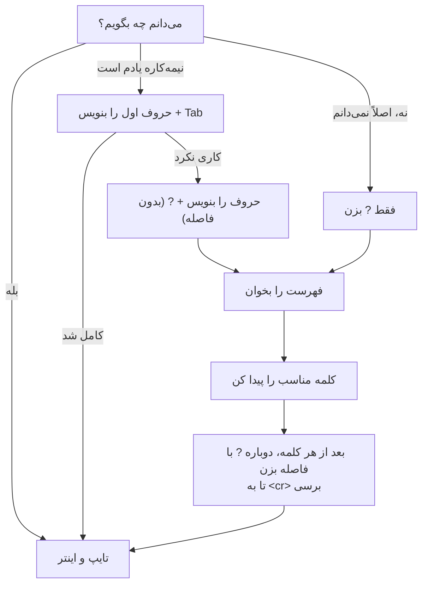

**جمع‌بندی یک‌دقیقه‌ای:** `?` = «چی بگم؟»، تب = «تکمیل کن»، فلش بالا = «دوباره بگو».

---

### ۱۰.۵ آناتومی جمله: اتاق + فعل + مفعول + قید

هر دستور یک جمله کامل است که **چهار جزء** دارد:

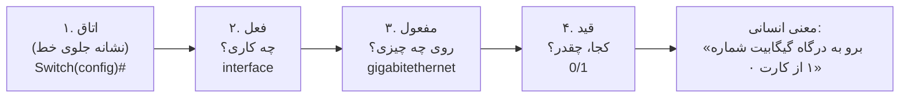

مثال‌های بیشتر:

```text
اتاق            فعل        مفعول             قید
Switch>         enable     -                 -
Switch#         configure  terminal          -
Switch(config)# interface  gigabitethernet   0/1
Switch(config)# line       console           0
Switch#         show       version           -
Switch#         show       ip interface      brief
```

بعضی جمله‌ها مفعول یا قید ندارند، مثل «برو مدیر». بعضی هر چهار جزء را دارند.
با علامت سؤال می‌توانی بفهمی کدام جزء کم است.

---

### ۱۰.۶ سه پیام خطای اصلی و ترجمه‌شان

دستگاه وقتی جمله‌ات را نفهمد، سه جور ایراد می‌گیرد. **همیشه همین‌طور ترجمه کن:**

```text
% Incomplete command.     = جمله‌ات ناقصه؛ یه کلمه کم داری
% Invalid input detected  = این کلمه رو نمی‌فهمم؛ جای علامت ^ رو نگاه کن
% Ambiguous command       = کلمه‌ات چند معنی داره؛ کامل‌ترش کن
```

نمونه برای هر کدام (خروجی نمونه؛ نیازمند راستی‌آزمایی در نسخه نصب‌شده):

```text
Switch#show ip
% Incomplete command.
```

```text
Switch>show running-config
            ^
% Invalid input detected at '^' marker.
```

```text
Switch#co
% Ambiguous command: "co"
```

**درمان هر خطا:**

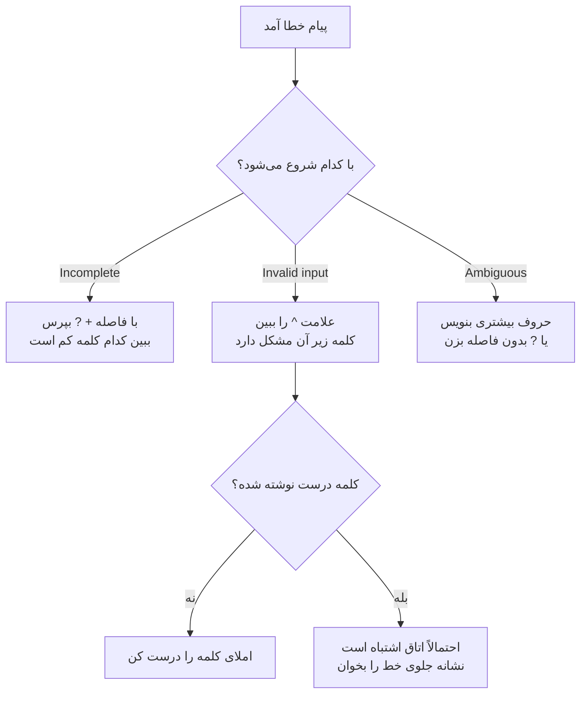

**تله مهم در پکت تریسر:** اگر کلمه‌ای تایپ کنی که اصلاً دستور نیست (مثلاً یک غلط
املایی در اتاق کاربر یا مدیر)، دستگاه فکر می‌کند اسم یک دستگاه دیگر را گفته‌ای و
مدتی دنبالش می‌گردد:

```text
Switch>enabel
Translating "enabel"...domain server (255.255.255.255)
% Unknown command or computer name, or unable to find computer address
```

صبر کن تا نشانه جلوی خط برگردد. این ایراد هم «کلمه‌ات را نمی‌فهمم» معنی می‌دهد.
(نیازمند راستی‌آزمایی در نسخه نصب‌شده.)

---

### ۱۰.۷ «پرسیدن» در برابر «دستور دادن»

**مثال روزمره:** از یک کارمند بپرسی «ساعت چنده؟» یا بگویی «ساعت را روی سه تنظیم کن». اولی
چیزی را عوض نمی‌کند؛ دومی عوض می‌کند.

-   دستورهای `show` = **پرسیدن**: فقط نگاه می‌کنند؛ هیچ چیز عوض نمی‌شود؛
-   دستورهای تنظیم = **دستور دادن**: دستگاه را عوض می‌کنند.

در این درس فقط **پرسیدن** داریم. حتی `interface gigabitethernet 0/1` و
`line console 0` فقط «رفتن به اتاق» هستند؛ تا وقتی چیزی داخل آن اتاق نگویی،
چیزی عوض نمی‌شود.

---
## ۱۱. درس زبان فرمان: جمله‌ها، تجزیه و گفتگوی انسانی

### ۱۱.۱ فرهنگ ریشه‌واژه‌ها (پیوست الف) — بخشی که در این درس کار می‌کنیم

این معنی‌ها در **تمام درس‌ها** یکسان‌اند. فقط ریشه‌هایی که در این درس به کار
می‌روند جلو آمده‌اند؛ بقیه را در درس‌های بعد می‌بینی.

```text
enable          = اجازه بده بروم به اتاق مدیر
disable         = برگردم به اتاق عادی
configure       = برو به حالت تنظیمات
terminal        = از همین پایانه
interface       = درگاه (جایی که کابل وصل می‌شود)
line            = راه ورود به خود دستگاه
show            = نشونم بده
running-config  = تنظیمات زنده (الان توی حافظه موقت)
exit            = یه پله برگرد عقب
end             = برگرد یکراست به اتاق مدیر
```

ریشه‌هایی که **هنوز کنارشان می‌مانیم** (مال L04 و بعد):
`no`، `do`، `shutdown`، `hostname`، `description`، `copy`، `write`، `startup-config`.

### ۱۱.۲ ترجمه هفت‌مرحله‌ای دوازده دستور

برای هر دستور هفت چیز می‌آید: **۱) جمله انسانی، ۲) تجزیه واژه‌به‌واژه،
۳) اتاق لازم، ۴) گفتگوی انسانی، ۵) دستور برعکس، ۶) اگر اشتباه بگویی،
۷) شکل کوتاه‌شده.** توجه: خروجی‌ها نمونه‌اند.

---

#### دستور ۱: `enable`

**۱) جمله انسانی:** «اجازه بده برم اتاق مدیر.»

**۲) تجزیه:**

```text
enable   = اجازه بده بروم به اتاق مدیر
```

**۳) اتاق لازم:** حالت کاربر (`Switch>`).

**۴) گفتگوی انسانی (کامل):**

```text
شما:      enable
```

```text
دستگاه:   «enable» رو شنیدم؛ یعنی می‌خوای بری اتاق مدیر.
          ببینم برای این اتاق گذرواژه گذاشته‌اند یا نه...
          نه، هنوز نگذاشته‌اند؛ پس بفرما تو.
دستگاه:   Switch#
          (یعنی: الان توی اتاق مدیری؛ نشانه‌ام از «>» به «#» عوض شد.)
```

اگر روزی گذرواژه گذاشته شود (درس‌های بعد)، دستگاه جور دیگری جواب می‌دهد:

```text
دستگاه:   Password:
          (یعنی: برای این اتاق گذرواژه گذاشته‌اند؛ بگو چیه.
          موقع تایپ، چیزی روی صفحه دیده نمی‌شود.)
```

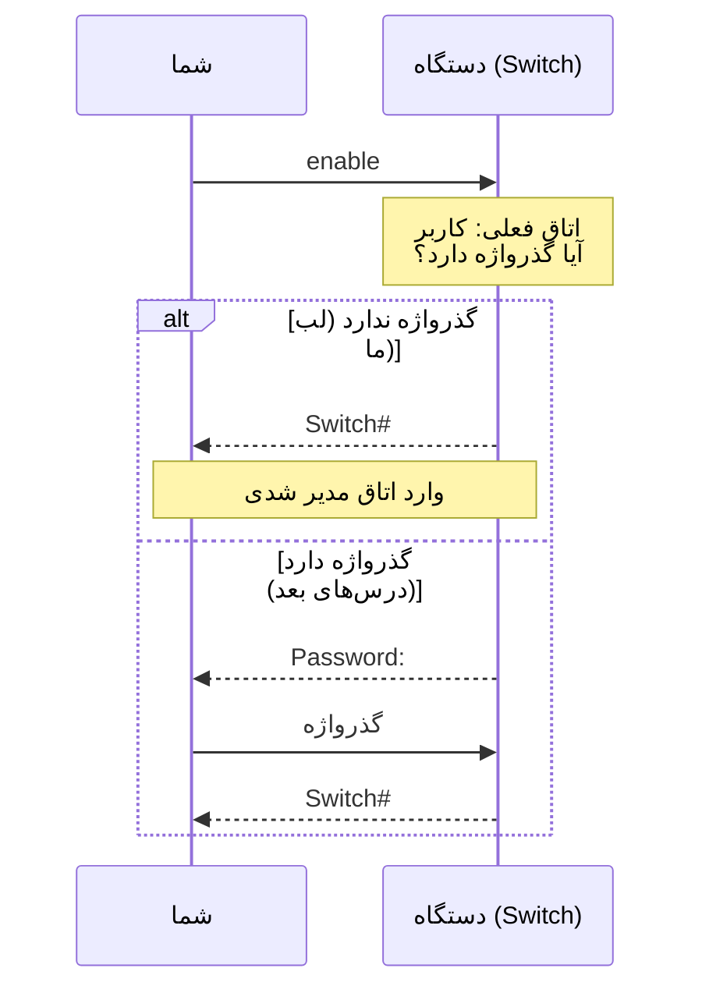

**۵) برعکس:** `disable` (برگشت به اتاق کاربر).

**۶) اگر اشتباه بگویی:** اگر یک حرف را جابه‌جا بنویسی، دستگاه فکر می‌کند اسم
یک دستگاه دیگر را گفته‌ای (تله «ترجمه کردن» در بخش ۱۰.۶):

```text
Switch>enabel
Translating "enabel"...domain server (255.255.255.255)
% Unknown command or computer name, or unable to find computer address
```

معنی: «این کلمه را نمی‌شناسم و آدم هم نیست که اسمش باشد.»

**۷) شکل کوتاه‌شده:**

```text
en
```

چرا کار می‌کند؟ دستگاه فقط نگاه می‌کند چند دستور با «en» شروع می‌شود. اگر فقط
یکی باشد (در اتاق کاربر همین است)، می‌فهمد منظورت همان است. اگر دو تا باشند،
می‌گوید «مبهم است».

---

#### دستور ۲: `disable`

**۱) جمله انسانی:** «برگردم به اتاق عادی.»

**۲) تجزیه:**

```text
disable   = برگردم به اتاق عادی (لابی)
```

**۳) اتاق لازم:** حالت مدیر (`Switch#`).

**۴) گفتگوی انسانی:**

```text
شما:      disable
دستگاه:   «disable» یعنی از اتاق مدیر بیای بیرون. باشه.
          Switch>
          (یعنی: برگشتی لابی؛ نشانه‌ام شد «>».)
```

**۵) برعکس:** `enable`.

**۶) اگر اشتباه بگویی:** در اتاق تنظیمات این دستور معنی ندارد:

```text
Switch(config)#disable
               ^
% Invalid input detected at '^' marker.
```

معنی: «از اتاق تنظیمات نمی‌شود مستقیم به لابی رفت؛ اول `end` یا `exit` بگو.»

**۷) شکل کوتاه‌شده:**

```text
disa
```

چرا `disa` و نه `dis`؟ چون با `dis` حداقل دو دستور شروع می‌شود (مثلاً قطع کردن
یک اتصال) و دستگاه «مبهم است» می‌گوید. (نیازمند راستی‌آزمایی در نسخه نصب‌شده.)

---

#### دستور ۳: `configure terminal`

**۱) جمله انسانی:** «از همین پایانه‌ای که باهاش حرف می‌زنم، برو به حالت تنظیمات.»

**۲) تجزیه:**

```text
configure   = برو به حالت تنظیمات
terminal    = از همین پایانه‌ای که باهاش حرف می‌زنم
```

**۳) اتاق لازم:** حالت مدیر (`Switch#`).

**۴) گفتگوی انسانی (کامل):**

```text
شما:      configure terminal
```

```text
دستگاه:   «configure» رو شنیدم؛ یعنی می‌خوای بری اتاق تنظیمات.
          «terminal» رو هم فهمیدم؛ یعنی تنظیمات رو از همین پایانه
          می‌گیری، نه از فایل یا از جای دیگه.
          خب، بفرما.
دستگاه:   Enter configuration commands, one per line.  End with CNTL/Z.
          (یعنی: هر خط یک دستور بگو؛ برای بیرون آمدن Ctrl+Z بزن.)
          Switch(config)#
          (یعنی: الان وسط اتاق تنظیماتی؛ پرانتز یعنی همین.)
```

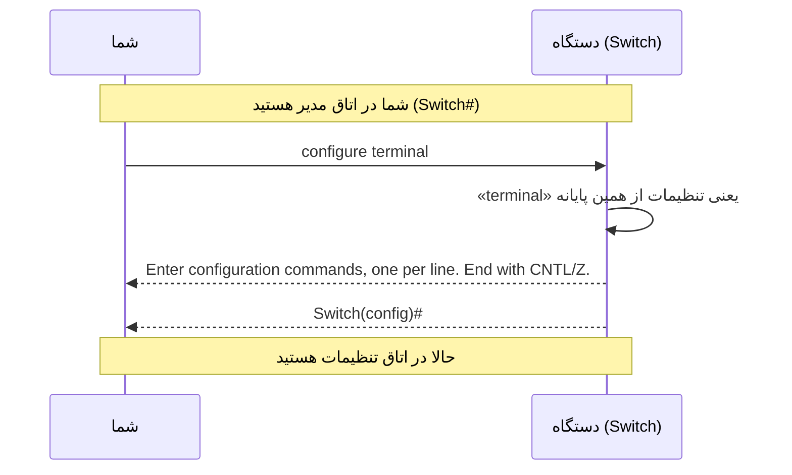

نکته: اگر فقط `configure` بگویی و اینتر بزنی، دستگاه می‌پرسد «تنظیمات را از کجا
بگیرم؟» و داخل کروشه نوشته است `terminal`. اینتر بزنی، همان پیش‌فرض قبول می‌شود:

```text
Switch#configure
Configuring from terminal, memory, or network [terminal]?
```

**۵) برعکس:** `exit` (یک پله) یا `end` / `Ctrl+Z` (یکراست مدیر).

**۶) اگر اشتباه بگویی:** از اتاق کاربر نمی‌شود مستقیم رفت اتاق تنظیمات:

```text
Switch>configure terminal
        ^
% Invalid input detected at '^' marker.
```

معنی: «در این اتاق چنین کلمه‌ای را نمی‌شناسم. اول `enable` بگو.»

**۷) شکل کوتاه‌شده:**

```text
conf t
```

چرا کار می‌کند؟ `conf` فقط با `configure` جور است؛ «t» هم از بین گزینه‌های بعدی
فقط با `terminal` جور است. وقتی پیشوند یکتا باشد، دستگاه کامل را می‌فهمد.

---

#### دستور ۴: `interface gigabitethernet 0/1`

**۱) جمله انسانی:** «برو به درگاه گیگابیت شماره ۱ از کارت صفر و آماده تنظیمش کن.»

**۲) تجزیه:**

```text
interface        = درگاه (جایی که کابل وصل می‌شود)
gigabitethernet  = از نوع گیگابیت (سرعت یک گیگابیت)
0/1              = کارت صفر، درگاه شماره یک
```

**۳) اتاق لازم:** حالت تنظیمات (`Switch(config)#`).

**۴) گفتگوی انسانی:**

```text
شما:      interface gigabitethernet 0/1
دستگاه:   «interface» یعنی یه درگاه. کدوم؟ «gigabitethernet 0/1» رو گفتی:
          نوع گیگابیت، کارت صفر، شماره یک. پیداش کردم.
          Switch(config-if)#
          (یعنی: توی اتاق مخصوص همین درگاهی؛ «if» یعنی درگاه.)
```

**۵) برعکس:** برای بیرون آمدن `exit`. (برعکس کردن «تنظیمی که داخل اتاق می‌دهی»
درس بعد است.)

**۶) اگر اشتباه بگویی:**

```text
Switch(config)#interface
% Incomplete command.
```

معنی: «گفتی درگاه، ولی کدام درگاه؟ جمله‌ات ناقص است.»

```text
Switch#interface gigabitethernet 0/1
       ^
% Invalid input detected at '^' marker.
```

معنی: «در اتاق مدیر چنین کلمه‌ای را نمی‌شناسم؛ اول برو اتاق تنظیمات.»

**۷) شکل کوتاه‌شده:**

```text
int g0/1
```

چرا کار می‌کند؟ `int` فقط با `interface` جور است، `g0/1` هم با `gigabitethernet 0/1`.
(نیازمند راستی‌آزمایی در نسخه نصب‌شده؛ بعضی نسخه‌ها `gi0/1` را ترجیح می‌دهند.)

نکته درباره مدل سوییچ این درس: دو درگاه گیگابیت بالایی (`0/1` و `0/2`) و بقیه
درگاه‌ها از نوع سریع‌تر از اترنت‌اند. نام درگاه‌های دیگر را با `?` می‌پرسیم.

---

#### دستور ۵: `line console 0`

**۱) جمله انسانی:** «برو به خط کنسول شماره صفر.»

**۲) تجزیه:**

```text
line      = راه ورود به خود دستگاه
console   = همان راه ورودی که کابل کنسول به آن وصل است
0         = شماره صفر (دستگاه فقط یک کنسول دارد)
```

نکته: «خط» با «درگاه» فرق دارد. درگاه جای وصل کردن کابل داده است؛ خط راهی است
که **تو** از آن وارد خود دستگاه می‌شوی. اتاق خط جایی است که بعداً (درس L04)
می‌گوییم «ورود به دستگاه از این راه چه شرطی دارد».

**۳) اتاق لازم:** حالت تنظیمات.

**۴) گفتگوی انسانی:**

```text
شما:      line console 0
دستگاه:   «line» یعنی یه راه ورود به خودم. «console» یعنی همونی که
          الان باهاش با من حرف می‌زنی. «0» هم شماره‌اش.
          Switch(config-line)#
          (یعنی: توی اتاق مخصوص راه ورود کنسولی.)
```

**۵) برعکس:** `exit`.

**۶) اگر اشتباه بگویی:**

```text
Switch#line console 0
       ^
% Invalid input detected at '^' marker.
```

معنی: «این کلمه مال اتاق تنظیمات است، نه اتاق مدیر.»

**۷) شکل کوتاه‌شده:**

```text
line con 0
```

---

#### دستور ۶: `exit`

**۱) جمله انسانی:** «یه پله برگرد عقب.»

**۲) تجزیه:**

```text
exit   = یه پله برگرد عقب
```

**۳) اتاق لازم:** هر اتاق. اما رفتارش بسته به اتاق فرق می‌کند:

| اتاق فعلی | بعد از `exit` |
|---|---|
| حالت درگاه یا حالت خط | حالت تنظیمات |
| حالت تنظیمات | حالت مدیر |
| حالت مدیر | **بیرون ساختمان** (نشست بسته می‌شود) |
| حالت کاربر | **بیرون ساختمان** (نشست بسته می‌شود) |

**۴) گفتگوی انسانی:**

```text
شما:      exit
دستگاه:   «exit» یعنی یه پله عقب. تو الان توی اتاق درگاه بودی؛
          می‌برمت اتاق تنظیمات.
          Switch(config)#
```

وقتی از اتاق تنظیمات به مدیر برمی‌گردی، دستگاه ممکن است یک خط خبر بدهد:

```text
Switch(config)#exit
Switch#
%SYS-5-CONFIG_I: Configured from console by console
```

معنی: «از اتاق تنظیمات از راه کنسول بیرون آمدی.» این فقط یک اطلاع است؛ چون
چیزی عوض نکرده‌ای، نگران نشو. (نیازمند راستی‌آزمایی در نسخه نصب‌شده.)

**۵) برعکس:** برای برگشت به همان اتاق، دوباره دستور ورود آن اتاق را بگو.

**۶) اگر اشتباه بگویی:** خطایی نمی‌دهد، ولی از اتاق مدیر بیرونت می‌اندازد:

```text
Switch#exit

Switch con0 is now available

Press RETURN to get started.
```

معنی: «نشست بسته شد؛ برای شروع دوباره اینتر بزن.» (نیازمند راستی‌آزمایی.)

**۷) شکل کوتاه‌شده:** خودش کوتاه است؛ لازم نیست کوتاه‌ترش کنی.

---

#### دستور ۷: `end`

**۱) جمله انسانی:** «برگرد یکراست به اتاق مدیر.»

**۲) تجزیه:**

```text
end   = برگرد یکراست به اتاق مدیر
```

**۳) اتاق لازم:** حالت تنظیمات یا زیراتاق‌هایش (درگاه، خط).

**۴) گفتگوی انسانی:**

```text
شما:      end
دستگاه:   «end» یعنی تموم کن و برو اتاق مدیر. اهمیتی نداره الان
          کجای ساختمونی؛ یکراست می‌برمت.
          Switch#
```

**۵) برعکس:** برای رفتن دوباره به اتاق تنظیمات: `configure terminal`.

**۶) اگر اشتباه بگویی:** در اتاق مدیر یا کاربر معنی ندارد:

```text
Switch#end
       ^
% Invalid input detected at '^' marker.
```

معنی: «تو که الان بیرون اتاق تنظیمات هستی؛ از کجا برگردم؟» (نیازمند راستی‌آزمایی.)

**۷) شکل کوتاه‌شده:** خودش کوتاه است؛ یا همان `Ctrl+Z`.

---

#### دستور ۸: `?`

**۱) جمله انسانی:** «بپرس چی می‌تونم بگم.»

**۲) تجزیه:**

```text
?       = در این اتاق چه چیزی می‌توانم بگویم؟
co?     = چه کلماتی با co شروع می‌شوند؟ (بدون فاصله)
show ?  = بعد از show چه کلمه‌ای می‌تواند بیاید؟ (با فاصله)
```

**۳) اتاق لازم:** هر اتاق. خروجی هر اتاق فرق دارد.

**۴) گفتگوی انسانی:**

```text
شما:      show ?
دستگاه:   «show» رو گفتی؛ می‌خوای بپرسی چی رو نشونت بدم. این‌ها رو
          می‌تونم نشون بدم:
          history   Display the session command history
          version   System hardware and software status
          ...
          (فهرست طولانی است؛ خروجی نمونه.)
```

اگر خروجی بلند باشد، پایین صفحه این نشانه می‌آید:

```text
 --More--
```

معنی: «بقیه هم هست.» کلید فاصله = یک صفحه بعد، اینتر = یک خط بعد، حرف `q` = بس است.

**۵) برعکس:** ندارد؛ فقط می‌پرسد.

**۶) اگر اشتباه بگویی:** خطایی ندارد؛ فقط ممکن است جواب نادرست بخوانی. جمله
«`show?` بدون فاصله» یعنی «چه کلماتی با `show` شروع می‌شوند»؛ و «`show ?` با فاصله»
یعنی «بعد از `show` چه بیاید».

**۷) شکل کوتاه‌شده:** خودش یک حرف است.

---

#### دستور ۹: `show version`

**۱) جمله انسانی:** «نشونم بده نسخه‌ات رو (نرم‌افزار و سخت‌افزار).»

**۲) تجزیه:**

```text
show      = نشونم بده
version   = نسخه (چه نرم‌افزاری و چه دستگاهی هستی)
```

**۳) اتاق لازم:** حالت کاربر یا حالت مدیر. (پرسیدن است، پس در هر دو کار می‌کند.)

**۴) گفتگوی انسانی:**

```text
شما:      show version
دستگاه:   «show» یعنی بپرسی. «version» یعنی درباره نسخه‌ام.
          بذار برات بگم کی‌ام:
          نسخه نرم‌افزارم فلانه، مدلم فلانه، فلان مدت روشنم،
          فلان تعداد درگاه دارم...
          (خروجی چند صفحه است؛ از --More-- با فاصله رد شو.)
```

الگوی خروجی (نمونه؛ مقدارها به نسخه تو بستگی دارد):

```text
Cisco IOS Software, ... Version <شماره نسخه> ...
...
<نام دستگاه> uptime is <مدت روشن بودن>
...
cisco <مدل> (...) processor with <مقدار> bytes of memory.
<تعداد> FastEthernet interfaces
<تعداد> Gigabit Ethernet interfaces
...
```

**چه چیزهایی را در این درس می‌خوانیم؟** فقط چهار چیز: نسخه نرم‌افزار، مدل
دستگاه، مدت روشن بودن، تعداد درگاه‌ها.

**۵) برعکس:** لازم نیست؛ فقط نگاه است.

**۶) اگر اشتباه بگویی:**

```text
Switch#show
% Incomplete command.
```

معنی: «گفتی نشان بده، ولی چه چیزی را؟»

**۷) شکل کوتاه‌شده:**

```text
sh ver
```

---

#### دستور ۱۰: `show ip interface brief`

**۱) جمله انسانی:** «نشونم بده خلاصه وضعیت درگاه‌ها از نظر آدرس‌دهی.»

**۲) تجزیه:**

```text
show        = نشونم بده
ip          = مربوط به آدرس‌دهی اینترنتی
interface   = درگاه‌ها
brief       = خلاصه (یک جدول جمع‌وجور)
```

**۳) اتاق لازم:** حالت کاربر یا حالت مدیر.

**۴) گفتگوی انسانی:**

```text
شما:      show ip interface brief
دستگاه:   «show» یعنی نشون بده. «ip interface» یعنی درباره درگاه‌هام
          از نظر آدرس‌دهی. «brief» هم یعنی خلاصه، پس یه جدول
          فشرده می‌دم. بفرما:
```

خروجی نمونه (سوییچ تازه که فقط کابل کنسول دارد؛ نیازمند راستی‌آزمایی):

```text
Interface              IP-Address      OK? Method Status                Protocol
FastEthernet0/1        unassigned      YES manual down                  down
FastEthernet0/2        unassigned      YES manual down                  down
...
GigabitEthernet0/1     unassigned      YES manual down                  down
GigabitEthernet0/2     unassigned      YES manual down                  down
Vlan1                  unassigned      YES manual administratively down down
```

**نحوه خواندن در این درس:** فقط بخوان **این جدول یک سطر برای هر درگاه دارد**.
ستون «آدرس» فعلاً همه خالی است (`unassigned`) و باید خالی بماند؛ آدرس‌دهی ممنوع
است. معنی ستون وضعیت را در درس L05 کامل می‌خوانیم. فعلاً همین‌قدر کافی است که
بدانی `down` یعنی «چیزی به این درگاه وصل نیست یا خاموش است».

**۵) برعکس:** لازم نیست؛ فقط نگاه است.

**۶) اگر اشتباه بگویی:**

```text
Switch#show ip
% Incomplete command.
```

معنی: «درباره آدرس‌دهی چه چیزی را نشان بدهم؟»

**۷) شکل کوتاه‌شده:**

```text
sh ip int br
```

---

#### دستور ۱۱: `show running-config`

**۱) جمله انسانی:** «نشونم بده تنظیمات زنده‌ات رو.»

**۲) تجزیه:**

```text
show            = نشونم بده
running-config  = تنظیمات زنده (الان توی حافظه موقت)
```

**۳) اتاق لازم:** فقط حالت مدیر.

**۴) گفتگوی انسانی:**

```text
شما:      show running-config
دستگاه:   «show» یعنی نشون بده. «running-config» یعنی تنظیماتی که الان
          دارم باهاشون کار می‌کنم. بفرما، این‌هاست:
          Building configuration...
          (یعنی: دارم تنظیمات زنده رو از حافظه برات جمع می‌کنم.)
```

الگوی خروجی (نمونه):

```text
Building configuration...

Current configuration : <تعداد> bytes
!
version <شماره>
!
hostname Switch
!
...
interface FastEthernet0/1
!
...
line con 0
!
...
end
```

در این درس فقط ساختار را نگاه کن: اول مشخصات کلی، بعد هر درگاه با یک بلوک،
بعد خط‌ها. معنی تک‌تک سطرها را در درس L04 می‌خوانیم.

**۵) برعکس:** لازم نیست؛ فقط نگاه است.

**۶) اگر اشتباه بگویی:** در اتاق کاربر نمی‌شود:

```text
Switch>show running-config
            ^
% Invalid input detected at '^' marker.
```

معنی: «این کلمه مال اتاق مدیر است؛ اول `enable` بگو.»

**۷) شکل کوتاه‌شده:**

```text
sh run
```

---

#### دستور ۱۲: `show history`

**۱) جمله انسانی:** «نشونم بده جمله‌هایی که تازه گفتم.»

**۲) تجزیه:**

```text
show      = نشونم بده
history   = تاریخچه (جمله‌های قبلی همین نشست)
```

**۳) اتاق لازم:** حالت کاربر یا مدیر.

**۴) گفتگوی انسانی:**

```text
شما:      show history
دستگاه:   «history» یعنی دفتر یادداشتم از حرف‌هایی که زدی. این‌ها رو
          گفتی:
          enable
          show version
          configure terminal
          ...
```

**فرق با فلش بالا:** فلش بالا **یک جمله** را برمی‌گرداند؛ `show history` **کل فهرست**
را یک‌جا نشان می‌دهد (به‌طور پیش‌فرض ده جمله آخر؛ نیازمند راستی‌آزمایی در نسخه
نصب‌شده).

**۵) برعکس:** لازم نیست.

**۶) اگر اشتباه بگویی:** اگر فقط `show` بگویی، خطای «ناقص» می‌گیری.

**۷) شکل کوتاه‌شده:**

```text
sh hist
```

---
## ۱۲. آماده‌سازی آزمایشگاه

### ۱۲.۱ سناریوی سازمانی

> **شرکت فرضی آرمان‌داده (کاملاً ساختگی) — مرحله ۱: یک اتاق کوچک.**
> تو **کارآموز شبکه** هستی. شرکت یک سوییچ تازه خریده و داخل اتاق سرور
> گذاشته است. هیچ تنظیمی روی آن نیست و آدرسی هم ندارد. مسئول شبکه از تو
> می‌خواهد فقط «از ساختمان دستگاه بازدید کنی»: وصل شوی، اتاق‌ها را بشناسی
> و گزارش بدهی. **چیزی را عوض نمی‌کنی.**

### ۱۲.۲ شناسنامه آزمایشگاه

| ردیف | مورد | مقدار |
|---|---|---|
| ۱ | سطح آزمایشگاه | سطح ۱ (دو دستگاه) |
| ۲ | تعداد دستگاه | ۲ |
| ۳ | نام فایل | `L03-cli-rooms-v1.pkt` |
| ۴ | روش بازگشت | بستن فایل بدون ذخیره، یا بازگشایی نسخه ذخیره‌شده |
| ۵ | سرویس‌های فعال | هیچ |

**جدول دستگاه‌ها:**

| نام روی نقشه | نوع دستگاه | مدل پیشنهادی | توضیح |
|---|---|---|---|
| `PC1` | رایانه | PC | رایانه مدیر برای پایانه |
| `SW1` | سوییچ | 2960 | سوییچ ۲۴ درگاه |

**جدول کابل:**

| از دستگاه | درگاه | به دستگاه | درگاه | نوع کابل |
|---|---|---|---|---|
| `PC1` | `RS 232` | `SW1` | `Console` | کابل کنسول (آبی روشن) |

**جدول آدرس‌دهی:** ندارد (آدرس‌دهی در این درس ممنوع است).

نکته مهم درباره نام: چیزی که روی نقشه برچسب می‌زنی (`SW1`) با چیزی که **دستگاه
خودش را صدا می‌زند** (`Switch` در نشانه جلوی خط) فرق دارد. اولی برچسب نقشه
است، دومی اسم واقعی دستگاه. تغییر اسم دستگاه واقعی درس L04 است.

### ۱۲.۳ برچسب پشتیبانی پکت تریسر

| موضوع | برچسب | توضیح |
|---|---|---|
| اتصال با کابل کنسول و باز کردن پایانه | کامل | |
| پنج اتاق و رفت‌وآمد | کامل | |
| علامت سؤال، تب، فلش‌ها | کامل | |
| سه پیام خطا | کامل | متن دقیق ممکن است کمی فرق کند |
| `show version` | کامل | شماره نسخه و مدل به نسخه نصب‌شده بستگی دارد |
| `show ip interface brief` | کامل | |
| `show running-config` | کامل | |
| `show history` | کامل | نیازمند راستی‌آزمایی در نسخه نصب‌شده |
| پیام «ترجمه کردن» در برابر غلط املایی | کامل | نیازمند راستی‌آزمایی در نسخه نصب‌شده |

**نقشه لب:**

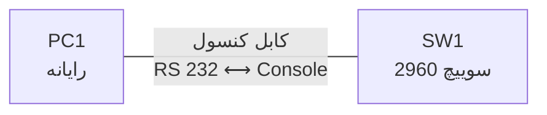

---

## ۱۳. آزمایش گام‌به‌گام با شبیه‌سازی صفحه

> قاعده این آزمایش: **فقط نگاه کن و راه برو.** اگر دستگاه از تو چیزی خواست که
> در این درس نیامده (مثلاً گذرواژه)، متوقف شو و به بخش عیب‌یابی نگاه کن.

### گام ۱: چیدن دستگاه‌ها

1.  از نوار پایین، دسته **رایانه‌ها** ← یک رایانه معمولی را به فضای کار بکش.
2.  دسته **سوییچ‌ها** ← سوییچ ۲۹۶۰ را بکش.
3.  روی نام زیر هر دستگاه کلیک کن و برچسب را عوض کن (`PC1` و `SW1`).

```text
+---------------------------------------------------------------+
|  فضای کار                                                     |
|                                                               |
|      [ PC1 ]                           [ SW1 ]                |
|       (رایانه)                          (سوییچ)               |
|                                                               |
+---------------------------------------------------------------+
|  نوار دستگاه‌ها:  [رایانه‌ها] [سوییچ‌ها] [روترها] [کابل‌ها]  |
+---------------------------------------------------------------+
```

### گام ۲: کشیدن کابل کنسول

1.  دسته **کابل‌ها** (آیکون رعد و برق) ← کابل **کنسول** (خط آبی روشن).
2.  روی `PC1` کلیک کن و درگاه سریال (برچسب RS 232) را انتخاب کن.
3.  روی `SW1` کلیک کن و درگاه **`Console`** را انتخاب کن.

```text
+------------------------------------------------------+
|  فضای کار                                            |
|                                                      |
|   [ PC1 ]---------(آبی روشن)---------[ SW1 ]       |
|    RS 232                              Console      |
+------------------------------------------------------+
```

### گام ۳: باز کردن پنجره پایانه

1.  روی `PC1` دوبار کلیک کن ← تب **`Desktop`** (میزکار).
2.  آیکون **`Terminal`** (پایانه) را باز کن.
3.  تنظیمات پیش‌فرض را دست نزن و OK بزن. مقدارهای معمول:

```text
Bits Per Second : 9600
Data Bits       : 8
Parity          : None
Stop Bits       : 1
Flow Control    : None
```

(معنی این مقدارها را لازم نیست بدانی؛ فقط عوضشان نکن. اگر عوض کنی ممکن است
چیزهای نامفهوم ببینی؛ نیازمند راستی‌آزمایی در نسخه نصب‌شده.)

```text
+--------------------------------------------------------------+
|  PC1                    [Physical|Config|Desktop|...]         |
+--------------------------------------------------------------+
|  Terminal                                                    |
|  Press RETURN to get started!                                |
|                                                              |
|  Switch>                                                     |
+--------------------------------------------------------------+
```

اگر «اینتر را بزن» نوشته بود، اینتر بزن. باید نشانه `Switch>` را ببینی؛ یعنی
هم‌اکنون در **اتاق کاربر** هستی.

### گام ۴: گشت در ساختمان (پنج اتاق)

یکی‌یکی وارد کن. بعد از هر دستور، **اول نشانه جلوی خط را بخوان.**

```text
Switch>enable
Switch#configure terminal
Enter configuration commands, one per line.  End with CNTL/Z.
Switch(config)#interface gigabitethernet 0/1
Switch(config-if)#exit
Switch(config)#line console 0
Switch(config-line)#end
Switch#
%SYS-5-CONFIG_I: Configured from console by console
Switch#disable
Switch>
```

(خروجی نمونه؛ نیازمند راستی‌آزمایی در نسخه نصب‌شده.)

**نقشه مسیر همین گشت:**

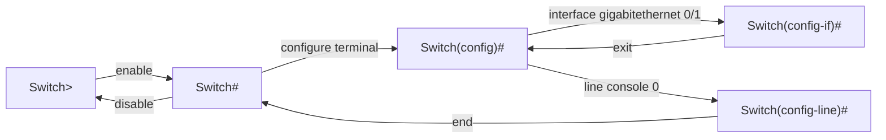

### گام ۵: کمک‌گرفتن با علامت سؤال

در هر اتاق، سه کار را امتحان کن:

```text
Switch>?
Switch>en?
Switch>enable
Switch#show ?
```

سؤال: چرا فهرست اتاق مدیر از اتاق کاربر بلندتر است؟ (جواب در بخش ۱۹، تمرین ۷.)

### گام ۶: کلید تب

در اتاق مدیر بنویس و تب بزن (اینتر نزن):

```text
conf<Tab>
```

دستگاه باید کلمه را کامل کند: `configure`. حالا بنویس:

```text
co<Tab>
```

چه می‌شود؟ (جواب در بخش ۱۹، تمرین ۹.)

### گام ۷: تاریخچه و فلش‌ها

چند دستور بزن (`show version`، `show history`) و بعد فلش بالا را چند بار فشار بده؛
هر بار یک جمله قبلی را می‌بینی. با فلش پایین برگرد.

### گام ۸: ساختن عمدی سه خطا

در اتاق **کاربر** (علامت `>`):

```text
Switch>show running-config
```

در اتاق **مدیر** (علامت `#`):

```text
Switch#show ip
Switch#co
```

هر سه خطا را ببین و با جدول بخش ۱۰.۶ ترجمه کن.

### گام ۹: سه پرسیدن

در اتاق مدیر:

```text
Switch#show version
Switch#show ip interface brief
Switch#show running-config
```

### گام ۱۰: اثبات گشت

```text
Switch#show history
```

خروجی را برای دفترچه ذخیره کن (تصویر صفحه + توضیح).

### گام ۱۱: بستن آزمایش

فایل را ببند. چون چیزی عوض نکرده‌ای، ذخیره کردن لازم نیست. اگر خواستی، با نام
`L03-cli-rooms-v1.pkt` ذخیره کن.

---

## ۱۴. سه زاویه و نگاه بسته

**دستور نمونه:** `enable`

**الف) من به دستگاه چی می‌گم؟** می‌گویم «اجازه بده بروم اتاق مدیر» چون می‌خواهم
نگاه‌های کامل‌تری بتوانم بکنم.

**ب) دستگاه حرف من رو چطور می‌فهمه؟** نوشته‌های تو از کابل کنسول به صورت
سیگنال می‌رود، به دستگاه می‌رسد و «مفسر دستور» (برنامه‌ای که جمله را می‌خواند)
آن را می‌گیرد. مفسر برای **هر اتاق یک فهرست جداگانه از جمله‌های مجاز** دارد.
جمله‌ات را با فهرست اتاق فعلی مقایسه می‌کند: اگر جور بود اجرا می‌کند، اگر نه،
یکی از سه پیام خطا را می‌دهد.

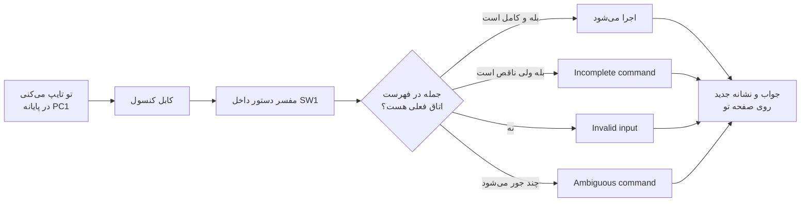

**ج) در نهایت چه اتفاقی می‌افتد؟** نشانه جلوی خط عوض می‌شود (`>` به `#`). این تنها
نتیجه قابل مشاهده است.

**نگاه بسته:** در این درس **هیچ بسته‌ای در شبکه نمی‌رود.** کابل کنسول، کابل
شبکه نیست؛ یک ارتباط جداست بین تو و خود دستگاه. اگر پکت تریسر را در حالت
شبیه‌سازی بگذاری و دستور تایپ کنی، هیچ رویدادی در فهرست رویدادها نمی‌بینی. (این
یک راه خوب برای فهمیدن تفاوت «حرف زدن با دستگاه» و «ترافیک شبکه» است؛
نیازمند راستی‌آزمایی در نسخه نصب‌شده.)

---

## ۱۵. راستی‌آزمایی

| چه چیزی را اثبات کنم؟ | با چه کاری | نشانه موفقیت |
|---|---|---|
| وصل شده‌ام | باز کردن پایانه | نشانه `Switch>` |
| به اتاق مدیر رفتم | `enable` | نشانه `Switch#` |
| به اتاق تنظیمات رفتم | `configure terminal` | نشانه `Switch(config)#` |
| به اتاق درگاه رفتم | `interface gigabitethernet 0/1` | نشانه `Switch(config-if)#` |
| به اتاق خط رفتم | `line console 0` | نشانه `Switch(config-line)#` |
| یکراست برگشتم | `end` | نشانه `Switch#` |
| به لابی برگشتم | `disable` | نشانه `Switch>` |
| هیچ چیز را عوض نکرده‌ام | `show history` + مرور خروجی | هیچ دستور تنظیمی در تاریخچه نیست |

---

## ۱۶. عیب‌یابی و بازگردانی

### ۱۶.۱ سه عیب اصلی این درس

1.  **گم کردن اتاق** (نمی‌دانی کجایی)؛
2.  **دستور درست، اتاق اشتباه**؛
3.  **ترجمه خطا.**

**درخت «گم شدم»:**

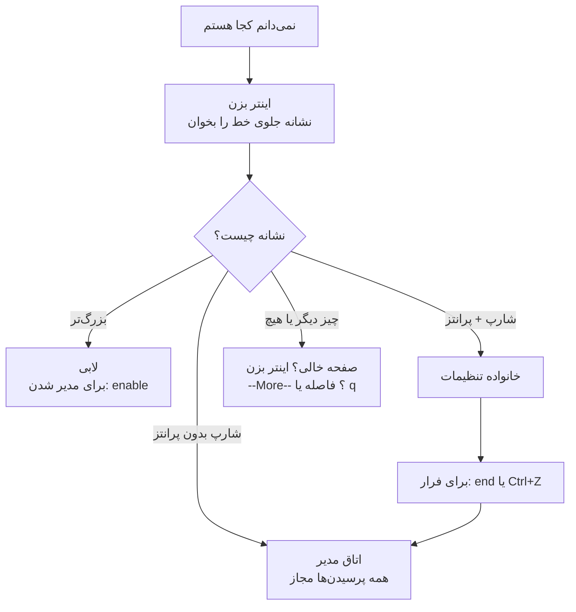

### ۱۶.۲ جدول علامت و علت

| نشانه | علت محتمل | راه حل |
|---|---|---|
| صفحه خالی است | نشست بسته یا بالا آمدن دستگاه | اینتر بزن؛ اگر نشد کابل کنسول را بررسی کن |
| `--More--` پایین صفحه | خروجی بلند است | فاصله یا `q` |
| `Translating...` می‌آید و کمی صبر می‌خواهد | یک کلمه اشتباه تایپ شده | صبر کن؛ بعد املا را درست کن |
| `Invalid input` | دستور در اتاق اشتباه یا غلط املایی | نشانه را بخوان؛ زیر `^` را ببین |
| `Incomplete` | جمله ناقص | فاصله + `?` |
| `Ambiguous` | پیشوند مبهم | حرف بیشتر یا `?` بدون فاصله |
| `Switch con0 is now available` | از اتاق مدیر یا کاربر `exit` گفته‌ای | اینتر بزن |
| `Password:` می‌پرسد | روی دستگاه گذرواژه گذاشته شده (در لب ما نباید باشد) | متوقف شو؛ لب را از نو بساز |
| پایانه چیزهای نامفهوم نشان می‌دهد | تنظیمات پایانه عوض شده | به مقدارهای پیش‌فرض برگردان؛ نیازمند راستی‌آزمایی |

### ۱۶.۳ بازگردانی

چون در این درس چیزی را تغییر نمی‌دهیم، **بازگردانی ساده است:** فایل را بدون ذخیره
ببند و از نو باز کن. اگر لب بد شد، دو دستگاه و یک کابل را از نو بچین؛ کمتر از دو
دقیقه کار است.

---

## ۱۷. نکته امنیتی

این درس امنیتی نیست و به همین دلیل هشدار حقوقی ثابت درس‌های امنیتی در آن نیامده
است. اما یک اصل را همین‌جا بنویس:

> **پنج اتاق برای این است که هر کس فقط به اندازه نیازش دسترسی داشته باشد.**
> اتاق کاربر فقط نگاه سبک می‌دهد، چون ممکن است یک همکار تازه‌وارد پشت دستگاه
> بنشیند. اتاق مدیر برای کسی است که مسئولیت دارد. گذاشتن گذرواژه برای این
> اتاق‌ها را در درس L04 می‌خوانی.

دو عادت خوب از همین حالا:

-   هر کجا تصویر صفحه برای دفترچه می‌گیری، مطمئن شو چیزی مثل گذرواژه در آن نیست
    (در لب این درس نیست، ولی عادتش را بساز)؛
-   هیچ‌وقت با کابل کنسول به دستگاهی وصل نشو که مالکیتش روشن نیست.

---

## ۱۸. دفترچه آزمایش و قالب آن

بعد از آزمایش، دفترچه کوتاهی بنویس. قالب:

```text
عنوان آزمایش:  گشت در اتاق‌های سوییچ
شناسه درس:     L03
تاریخ و زمان:
نویسنده:
نقش سازمانی:   کارآموز شبکه — شرکت آرمان‌داده

1. هدف
2. دستگاه‌ها و نقشه آزمایش
3. جدول آدرس‌دهی                    (این درس: ندارد)
4. پیش‌نیازها و نسخه پکت تریسر
5. تنظیمات انجام‌شده                (این درس: هیچ؛ فقط ناوبری)
6. روش راستی‌آزمایی                 (کدام دستور نمایشی، چه چیزی را اثبات می‌کند)
7. شواهد                            (خروجی‌ها و تصویر صفحه با توضیح)
8. تحلیل و تفسیر شواهد
9. خطاها و روش رفع آن‌ها
10. نتیجه و محدودیت‌ها
11. ریسک یا نکته امنیتی
12. روش آزمون مجدد
13. وضعیت نهایی
14. پیوست‌ها
```

**امتیازدهی دفترچه (از ۱۰۰):**

| معیار | نمره |
|---|---|
| هدف و نقشه | ۱۰ |
| تنظیمات صحیح (در این درس: «بدون تغییر» بودن) | ۲۰ |
| راستی‌آزمایی و شواهد | ۲۰ |
| تحلیل و استدلال | ۲۰ |
| عیب‌یابی و رفع خطا | ۱۰ |
| نکته امنیتی و آزمون مجدد | ۱۰ |
| نگارش و ساختار | ۱۰ |

**نمونه پر شده بخش‌های کوتاه (برای الگو):**

```text
1. هدف:
   بازدید از اتاق‌های سوییچ و اثبات توانایی رفت‌وآمد، بدون تغییر تنظیمات.

6. روش راستی‌آزمایی:
   - نشانه جلوی خط بعد از هر دستور؛ اثبات می‌کند در کدام اتاق هستم.
   - show history؛ اثبات می‌کند چه دستورهایی زده‌ام و هیچ‌کدام تنظیمی نبوده.

8. تحلیل:
   بعد از enable نشانه از ">" به "#" عوض شد، پس به اتاق مدیر رفتم.
   (مشاهده)  ...  (نتیجه) ...

9. خطاها:
   در اتاق کاربر show running-config زدم؛ پیام "Invalid input" آمد.
   علت: این دستور مال اتاق مدیر است. رفع: اول enable.
```

---
## ۱۹. تمرین‌ها (۱۰ تمرین، از ساده تا سخت) — هر تمرین با پاسخ

> از ده تمرین، **هفت تمرین مستقیم زبان فرمان** هستند (تمرین ۱، ۲، ۳، ۴، ۸، ۹، ۱۰)؛
> بیش از حداقل دو تمرین لازم.

---

### تمرین ۱ — اتاق‌یاب (ساده)

**سؤال:** از روی نشانه جلوی خط بگو در کدام اتاقی هستی. همچنین بگو آیا همین‌جا می‌توانی
دستور نمایش تنظیمات زنده را بزنی یا نه.

```text
الف)  Core-SW>
ب)    Switch(config-if)#
پ)    Switch#
ت)    Access1(config)#
ث)    Switch(config-line)#
```

**پاسخ:**

| نشانه | اتاق | آیا همین‌جا نمایش تنظیمات زنده را می‌زنی؟ |
|---|---|---|
| الف) `Core-SW>` | حالت کاربر (اسم دستگاه `Core-SW`) | نه؛ اول باید `enable` بگویی |
| ب) `Switch(config-if)#` | حالت درگاه | نه؛ اول `end` |
| پ) `Switch#` | حالت مدیر | **بله** |
| ت) `Access1(config)#` | حالت تنظیمات (اسم دستگاه `Access1`) | نه؛ اول `end` |
| ث) `Switch(config-line)#` | حالت خط | نه؛ اول `end` |

**منطق:** اسم دستگاه ممکن است هر چیزی باشد؛ **آخرین علامت** (`>` یا `#`) و **پرانتز**
اتاق را نشان می‌دهند. فقط شارپ بدون پرانتز = اتاق مدیر.

---

### تمرین ۲ — جمله انسانی به دستور (ساده)

**سؤال:** هر جمله را به دستور تبدیل کن (با فرض اینکه در اتاق درست هستی).

1.  «برو اتاق مدیر.»
2.  «از همین پایانه برو حالت تنظیمات.»
3.  «برو به درگاه گیگابیت شماره ۲ از کارت صفر.»
4.  «نشونم بده تنظیمات زنده‌ات رو.»
5.  «یه پله برگرد عقب.»
6.  «یکراست برگرد اتاق مدیر.»

**پاسخ:**

```text
1.  enable
2.  configure terminal
3.  interface gigabitethernet 0/2
4.  show running-config
5.  exit
6.  end
```

**منطق:** هر فعل را به ریشه‌اش (جدول بخش ۱۱.۱) برگردان: «برو اتاق مدیر» = اینیبل؛
«حالت تنظیمات از همین پایانه» = کانفیگر + ترمینال؛ «درگاه» = اینترفیس؛ «گیگابیت،
۰/۲» = قید.

---

### تمرین ۳ — دستور به جمله انسانی (متوسط)

**سؤال:** هر دستور را به یک جمله انسانی ترجمه کن.

```text
الف)  show version
ب)    show ip interface brief
پ)    line console 0
ت)    show history
ث)    exit
```

**پاسخ (نمونه ترجمه‌ها؛ هر ترجمه معادل درست هم قبول است):**

-   الف) «نشونم بده نسخه‌ات رو.»
-   ب) «نشونم بده خلاصه وضعیت درگاه‌هات رو از نظر آدرس‌دهی.»
-   پ) «برو به خط کنسول شماره صفر.»
-   ت) «نشونم بده جمله‌هایی که تازه گفتم.»
-   ث) «یه پله برگرد عقب.»

**منطق:** واژه‌به‌واژه تجزیه کن، بعد با زبان خودت کنار هم بچین. اگر «شو» را دیدی،
جمله با «نشونم بده» شروع می‌شود.

---

### تمرین ۴ — مترجم خطا (متوسط)

**سؤال:** برای هر خروجی بگو دستگاه چه چیزی را نفهمیده و تو چه کار می‌کنی.

```text
الف)  Switch>show
      % Incomplete command.

ب)    Switch>line console 0
             ^
      % Invalid input detected at '^' marker.

پ)    Switch#d
      % Ambiguous command: "d"
```

**پاسخ:** (خروجی نمونه؛ نیازمند راستی‌آزمایی در نسخه نصب‌شده)

| خروجی | ترجمه | کار درست |
|---|---|---|
| الف) ناقص | «گفتی نشون بده، ولی چی رو؟ یه کلمه کم داری.» | `show ?` بپرس و کلمه بعدی را انتخاب کن |
| ب) ورودی نامعتبر زیر `l` | «کلمه `line` رو در این اتاق نمی‌فهمم.» (اتاق اشتباه است: این دستور مال اتاق تنظیمات است) | `enable` ← `configure terminal` ← سپس `line console 0` |
| پ) مبهم | «با `d` چند دستور شروع می‌شود؛ منظورت کدام است؟» | حروف بیشتر بنویس یا `d?` بپرس |

**درخت تصمیم مرتبط:**

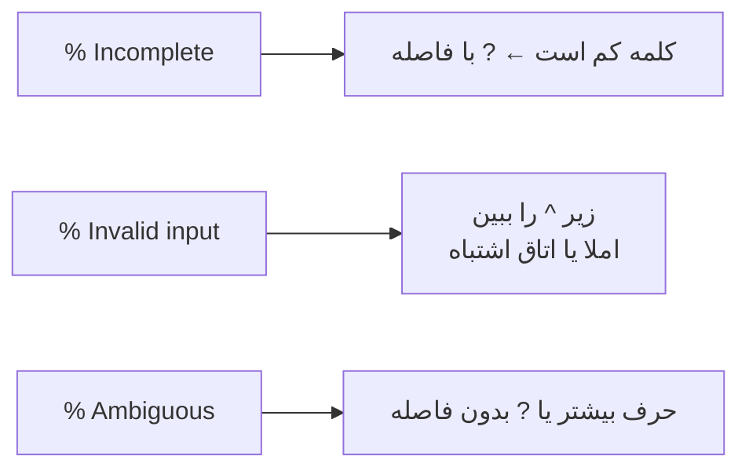

---

### تمرین ۵ — کوتاه‌ترین مسیر (متوسط)

**سؤال:** الف) از `Switch(config-line)#` تا `Switch>` کوتاه‌ترین مسیر چند دستور است؟
ب) از `Switch>` تا `Switch(config-if)#` چند دستور؟ (فقط ناوبری؛ از درگاه `0/1` استفاده کن.)

**پاسخ:**

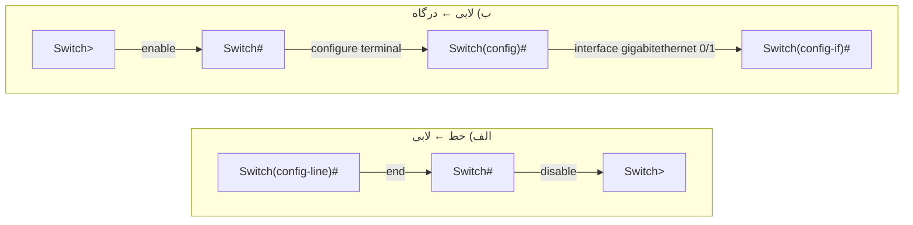

-   الف) **۲ دستور:** `end` سپس `disable`. (روش بلندتر: `exit`، `exit`، `disable` = ۳ دستور.)
-   ب) **۳ دستور:** `enable`، `configure terminal`، `interface gigabitethernet 0/1`.

**منطق:** `end` دو پله را یکجا می‌پرد. همیشه از زیراتاق به مدیر با `end` بهتر است
و بعد با `disable` پایین بیا.

---

### تمرین ۶ — ردیابی نشانه (متوسط)

**سؤال:** بعد از هر خط، نشانه جلوی خط را بنویس.

```text
Switch>enable
Switch#configure terminal
Switch(config)#line console 0
Switch(config-line)#exit
Switch(config)#interface gigabitethernet 0/2
Switch(config-if)#end
Switch#disable
Switch>exit
```

**پاسخ:** (نشانه *بعد از* اجرای هر دستور)

| دستور | نشانه بعد از آن |
|---|---|
| `enable` | `Switch#` |
| `configure terminal` | `Switch(config)#` |
| `line console 0` | `Switch(config-line)#` |
| `exit` | `Switch(config)#` |
| `interface gigabitethernet 0/2` | `Switch(config-if)#` |
| `end` | `Switch#` |
| `disable` | `Switch>` |
| `exit` | **هیچ؛ نشست بسته شد** (بیرون ساختمان) |

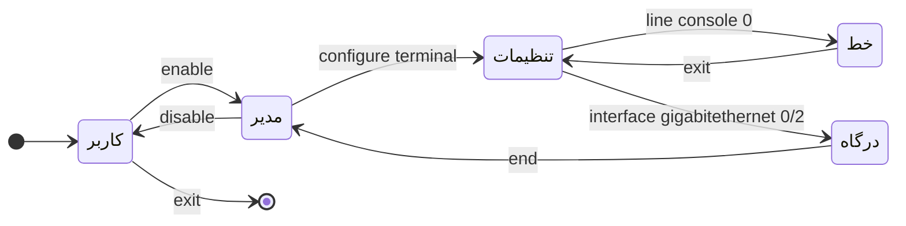

**منطق:** برای هر خط، «فعل» را به یک فلش در نقشه ساختمان تبدیل کن و فلش را دنبال کن.

---

### تمرین ۷ — کمک با علامت سؤال (متوسط)

**سؤال:** در اتاق کاربر `?` بزن و فهرست را ببین. بعد `enable` و دوباره `?`.
چرا فهرست اتاق مدیر از اتاق کاربر بلندتر است؟ یک دستوری را نام ببر که فقط در
اتاق مدیر است.

**پاسخ:** اتاق مدیر اختیارات بیشتری دارد؛ بنابراین کلمه‌های بیشتری می‌شناسد.
نمونه‌ای که فقط در اتاق مدیر است: `configure` (در اتاق کاربر نیست؛ برای همین
`configure terminal` در لابی خطا می‌داد).

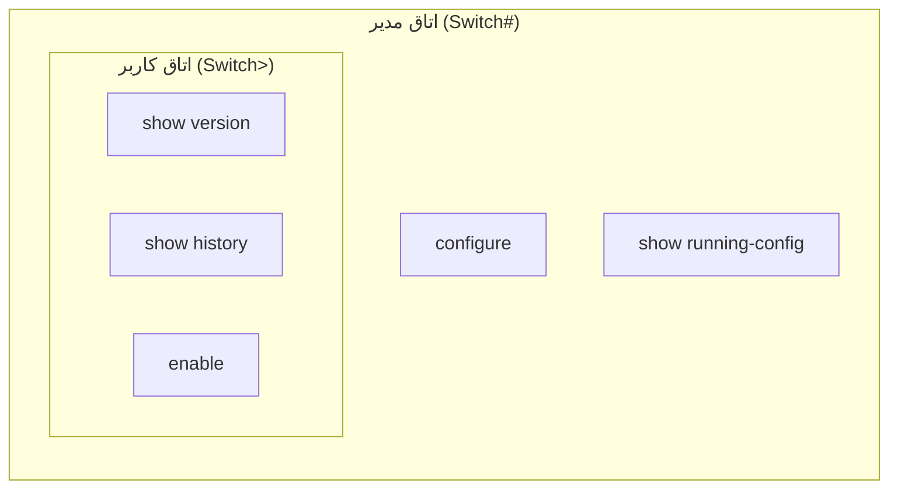

(فهرست‌ها به نسخه تو بستگی دارند. نیازمند راستی‌آزمایی در نسخه نصب‌شده؛ اصل
«مدیر ⊇ کاربر» برقرار است.)

---

### تمرین ۸ — تکمیل گفتگوی ناقص (متوسط)

**سؤال:** جاهای خالی را پر کن.

```text
شما:      ______
دستگاه:   «______» یعنی از اتاق ______ بیای بیرون. باشه.
          ______
          (یعنی: برگشتی ______؛ نشانه‌ام شد «___».)
```

**پاسخ:**

```text
شما:      disable
دستگاه:   «disable» یعنی از اتاق مدیر بیای بیرون. باشه.
          Switch>
          (یعنی: برگشتی لابی؛ نشانه‌ام شد «>».)
```

**منطق:** هر جای خالی از بخش ۱۱.۲ (دستور ۲) می‌آید: فعل، اتاق مبدأ، نشانه جدید،
اسم اتاق مقصد، علامت.

---

### تمرین ۹ — تب و پیشوند یکتا (سخت‌تر)

**سؤال:** در اتاق مدیر بنویس `co` و تب بزن؛ بعد بنویس `conf` و تب بزن. چرا نتیجه
فرق می‌کند؟ با علامت سؤال بدون فاصله ثابتش کن.

**پاسخ:** با `co` دستگاه نمی‌داند کدام کلمه مقصود است (چون هر سه کلمه با این حروف
شروع می‌شوند)، پس چیزی کامل نمی‌کند. با `conf` فقط `configure` جور است، پس کامل
می‌شود. برای اثبات:

```text
Switch#co?
configure  connect  copy

Switch#conf?
configure
```

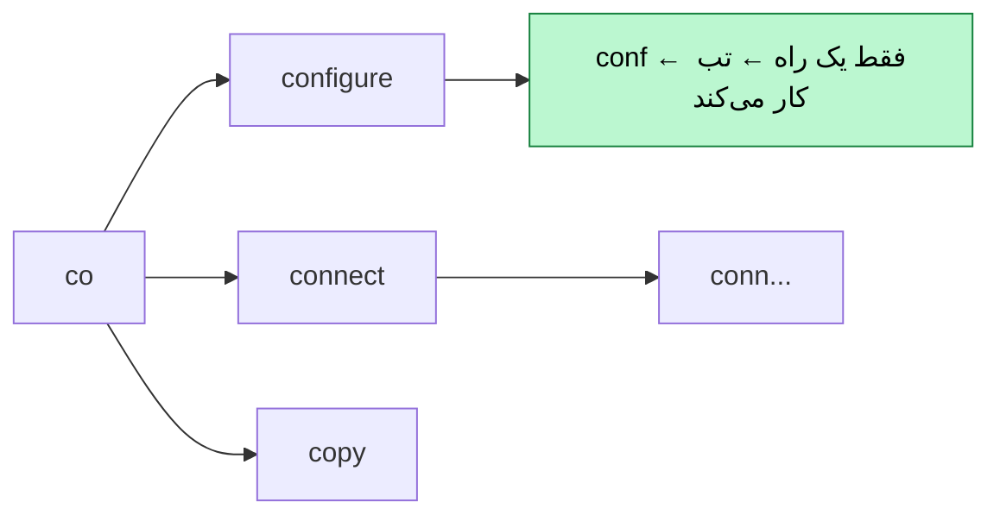

(خروجی نمونه؛ نیازمند راستی‌آزمایی در نسخه نصب‌شده.)

---

### تمرین ۱۰ — فرهنگ ریشه‌واژه‌ها (سخت‌تر)

**سؤال:** هر ریشه را به معنیش وصل کن.

```text
1) enable            الف) از همین پایانه
2) disable           ب) یه پله برگرد عقب
3) configure         پ) برگردم به اتاق عادی
4) terminal          ت) اجازه بده برم اتاق مدیر
5) interface         ث) برو به حالت تنظیمات
6) exit              ج) درگاه
7) end               چ) برگرد یکراست به اتاق مدیر
8) running-config    ح) تنظیمات زنده
```

**پاسخ:**

```text
1 ← ت      2 ← پ      3 ← ث      4 ← الف
5 ← ج      6 ← ب      7 ← چ      8 ← ح
```

---
## ۲۰. شش مینی‌پروژه — هر پروژه با پاسخ و راهنمای اجرا

> **توزیع:** پروژه ۱ و ۲ مبتدی؛ پروژه ۳ و ۴ متوسط؛ پروژه ۵ و ۶ چالشی.
> **لب خراب:** پروژه ۴ و ۵.
> همه پروژه‌ها در شرکت فرضی «آرمان‌داده» انجام می‌شوند؛ هیچ تنظیمی را تغییر
> نمی‌دهی.

---

### مینی‌پروژه ۱ (مبتدی) — اولین بازدید از ساختمان سوییچ

**نقش:** کارآموز شبکه.
**سناریو:** مسئول شبکه آرمان‌داده می‌خواهد مطمئن شود تو می‌توانی به‌تنهایی وارد
سوییچ شوی. از تو می‌خواهد با کابل کنسول وصل شوی، همه پنج اتاق را یک‌بار ببینی و
بدون هیچ تغییری برگردی.

**دستگاه‌ها:** `PC1`، `SW1`، کابل کنسول. (همان لب بخش ۱۲.)

**مراحل پیشنهادی:**

1.  لب را بچین و پایانه را باز کن؛
2.  به ترتیب به اتاق‌های کاربر، مدیر، تنظیمات، درگاه، خط برو؛
3.  از اتاق خط یکراست به اتاق مدیر و از آنجا به لابی برگرد؛
4.  بعد از هر دستور، نشانه جلوی خط را یادداشت کن؛
5.  `show history` را به‌عنوان شاهد بگیر.

**خروجی مورد انتظار:** یک جدول «دستور ← نشانه ← اتاق» و تصویر `show history`.

**معیار موفقیت:** هر پنج اتاق دیده شده؛ هیچ دستور تنظیمی در تاریخچه نیست؛
بازگشت به نشانه `Switch>`.

**پاسخ و راهنمای اجرا:**

| ردیف | دستور | نشانه بعد از اجرا | اتاق |
|---|---|---|---|
| ۰ | (اینتر بعد از باز شدن پایانه) | `Switch>` | کاربر |
| ۱ | `enable` | `Switch#` | مدیر |
| ۲ | `configure terminal` | `Switch(config)#` | تنظیمات |
| ۳ | `interface gigabitethernet 0/1` | `Switch(config-if)#` | درگاه |
| ۴ | `exit` | `Switch(config)#` | تنظیمات |
| ۵ | `line console 0` | `Switch(config-line)#` | خط |
| ۶ | `end` | `Switch#` | مدیر |
| ۷ | `disable` | `Switch>` | کاربر |
| ۸ | `enable` و بعد `show history` | `Switch#` | مدیر |

شاهد مورد انتظار (نمونه؛ نیازمند راستی‌آزمایی در نسخه نصب‌شده):

```text
Switch#show history
  enable
  configure terminal
  interface gigabitethernet 0/1
  exit
  line console 0
  end
  disable
  enable
  show history
```

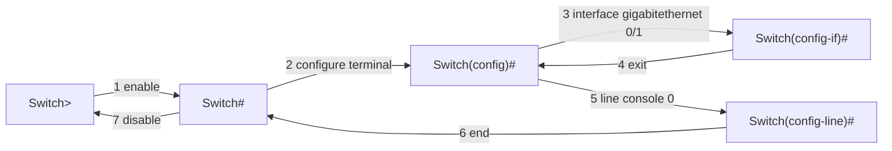

نکته ارزیابی: اگر در تاریخچه چیزی غیر از دستورهای ناوبری و `show` هست، پروژه
پذیرفته نمی‌شود.

---

### مینی‌پروژه ۲ (مبتدی) — گزارش سه پرسش

**نقش:** تکنسین شبکه.
**سناریو:** قبل از هر کاری روی یک سوییچ تازه، مسئول می‌خواهد سه چیز را بداند: مدل
و نسخه دستگاه، فهرست درگاه‌ها، و اینکه تنظیمات زنده خالی است یا نه. تو
نباید چیزی را عوض کنی.

**مراحل:**

1.  در اتاق کاربر، `show version` را بپرس و مدل، نسخه، مدت روشن بودن و تعداد درگاه‌ها را بنویس؛
2.  `show ip interface brief` را بپرس و تعداد سطرها و وضعیت درگاه‌ها را بنویس؛
3.  به اتاق مدیر برو و `show running-config` را بپرس؛
4.  جدول «هر پرسیدن در کدام اتاق‌ها کار می‌کند» را بساز.

**خروجی مورد انتظار:** یک جدول سه‌ستونی (پرسش ← اتاق‌های مجاز ← چه چیزی خواندم).

**معیار موفقیت:** جدول درست؛ مقدارها از دستگاه خودت؛ تفسیر درباره `down` در حد «چیزی
وصل نیست».

**پاسخ و راهنمای اجرا:**

| پرسش | اتاق‌های مجاز | چه چیزی می‌خوانم |
|---|---|---|
| نمایش نسخه | کاربر و مدیر | نسخه نرم‌افزار، مدل، مدت روشن بودن، تعداد درگاه‌ها (مقدارها را از خروجی خودت بنویس) |
| نمایش خلاصه درگاه‌ها | کاربر و مدیر | یک سطر برای هر درگاه؛ ستون آدرس همه خالی؛ وضعیت همه `down` چون فقط کابل کنسول وصل است |
| نمایش تنظیمات زنده | **فقط مدیر** | ساختار کلی: مشخصات، بلوک هر درگاه، بلوک خط‌ها |

**اثبات اینکه اتاق مهم است** (شاهد بگیر):

```text
Switch>show running-config
            ^
% Invalid input detected at '^' marker.
```

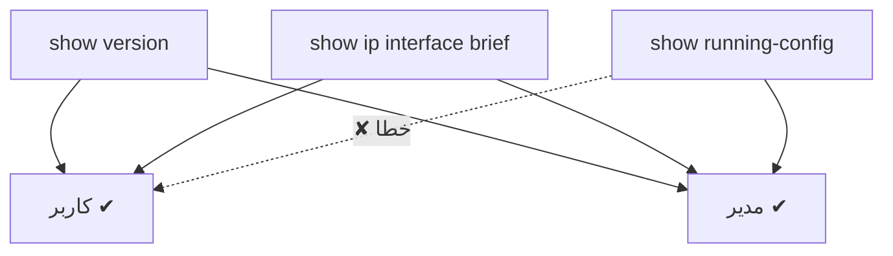

نکته: تعداد درگاه‌ها و مدل در دستگاه تو ممکن است با نمونه فرق داشته باشد. در
سوییچ ۲۹۶۰ با ۲۴ درگاه، معمولاً ۲۴ درگاه سریع و ۲ درگاه گیگابیت می‌بینی
(نیازمند راستی‌آزمایی در نسخه نصب‌شده).

---

### مینی‌پروژه ۳ (متوسط) — مسیر کم‌هزینه

**نقش:** تکنسین شبکه.
**سناریو:** مسئول شبکه می‌خواهد ببیند چقدر اتاق‌ها را خوب می‌شناسی. فهرست زیر را
می‌دهد و می‌گوید «با کمترین تعداد دستور ناوبری انجامش بده».

**ماموریت** (شروع از لابی، `Switch>`):

1.  برو جایی که `show running-config` کار می‌کند و آن را بپرس؛
2.  برو اتاق درگاه `0/1`؛
3.  برو اتاق خط کنسول؛
4.  برو اتاق درگاه `0/2`؛
5.  برگرد لابی.

**خروجی:** فهرست دستورهای ناوبری به ترتیب، تعدادشان، و مقایسه با روش «همیشه `end`».

**معیار موفقیت:** مسیر درست؛ تعداد دستورها کمتر یا برابر راه‌حل مرجع؛ توجیه
هر انتخاب.

**پاسخ و راهنمای اجرا:**

مسیر مرجع (فقط دستورهای ناوبری؛ پرسیدن‌ها شمرده نمی‌شوند):

```text
 1  enable
    (اینجا: show running-config)
 2  configure terminal
 3  interface gigabitethernet 0/1
 4  exit
 5  line console 0
 6  exit
 7  interface gigabitethernet 0/2
 8  end
 9  disable
```

**۹ دستور ناوبری.**

مقایسه با روش «همیشه `end` بزن و دوباره وارد شو»:

```text
enable, configure terminal, interface gigabitethernet 0/1, end,
configure terminal, line console 0, end,
configure terminal, interface gigabitethernet 0/2, end, disable
```

**۱۱ دستور.** پس `exit` (یک پله) وقتی می‌خواهی در همان خانواده بمانی، از `end`
ارزان‌تر است و `end` وقتی می‌خواهی کلاً بیرون بروی.

```mermaid
flowchart LR
    U0["Switch>"] -->|"enable"| M1["Switch#35;<br/>(show running-config)"]
    M1 -->|"configure terminal"| C1["Switch(config)#35;"]
    C1 -->|"interface gigabitethernet 0/1"| I1["(config-if)#35;"]
    I1 -->|"exit"| C2["Switch(config)#35;"]
    C2 -->|"line console 0"| L1["(config-line)#35;"]
    L1 -->|"exit"| C3["Switch(config)#35;"]
    C3 -->|"interface gigabitethernet 0/2"| I2["(config-if)#35;"]
    I2 -->|"end"| M2["Switch#35;"]
    M2 -->|"disable"| U1["Switch>"]
```

**ترفند اختیاری (برای کنجکاوها):** در آی‌او‌اس می‌شود از داخل یک زیراتاق، دستور ورود
به زیراتاق دیگر را مستقیم گفت؛ یعنی دو دستور `exit` حذف می‌شود و مسیر به ۷
دستور می‌رسد. **نیازمند راستی‌آزمایی در نسخه نصب‌شده**؛ اگر در دستگاه تو کار کرد،
در دفترچه بنویس. پاسخ اصلی همان ۹ دستور است.

---

### مینی‌پروژه ۴ (متوسط) — لب خراب: کنسول ساکت

**نقش:** تکنسین شبکه.
**سناریو:** همکارت لب را چیده، ولی می‌گوید «پایانه هیچ‌چیز نشان نمی‌دهد». تو باید
علت را پیدا کنی و لب را درست کنی.

**لب خراب (دقیقاً این‌طور بساز):**

| ردیف | از دستگاه | درگاه | به دستگاه | درگاه | کابل |
|---|---|---|---|---|---|
| ۱ | `PC1` | `FastEthernet0` | `SW1` | `FastEthernet0/1` | کابل مسی معمولی (مشکی) |

(یعنی همکارت به‌جای کابل کنسول، یک کابل شبکه کشیده است.)

**خروجی:** تشخیص علت، اصلاح، و اثبات اینکه درست شده.

**معیار موفقیت:** علت درست؛ اصلاح درست؛ شاهد `Switch>` روی پایانه.

**پاسخ و راهنمای اجرا:**

**تشخیص:** کابل نوعی که کشیده شده «کابل شبکه» است، نه «کابل کنسول»؛ و به درگاه
شبکه رایانه و درگاه شبکه سوییچ وصل شده، نه به درگاه سریال رایانه و درگاه
کنسول سوییچ. کابل شبکه برای عبور ترافیک بین دستگاه‌هاست و گفتگوی متنی با خود
دستگاه را باز نمی‌کند. پنجره پایانه در این وضعیت یا پیامی درباره وصل نبودن
می‌دهد یا چیزی نشان نمی‌دهد (متن دقیق؛ نیازمند راستی‌آزمایی در نسخه نصب‌شده).

**اصلاح:**

1.  کابل مسی را پاک کن؛
2.  کابل کنسول (آبی روشن) را بردار؛
3.  یک سر را به درگاه سریال `PC1` و سر دیگر را به درگاه `Console` روی `SW1` وصل کن؛
4.  پایانه را دوباره باز کن و اینتر بزن؛
5.  شاهد: نشانه `Switch>`.

```mermaid
flowchart LR
    subgraph X["لب خراب"]
        direction LR
        P1["PC1<br/>FastEthernet0"] ---|"کابل مسی ✘"| S1["SW1<br/>FastEthernet0/1"]
    end
    subgraph Y["لب اصلاح‌شده"]
        direction LR
        P2["PC1<br/>RS 232"] ---|"کابل کنسول ✔"| S2["SW1<br/>Console"]
    end
```

**عیب دوم (اگر هنوز نشد):** بخش «مقدارهای پایانه» را نگاه کن. باید مقدارهای
پیش‌فرض بخش ۱۳ (گام ۳) باشند. (نیازمند راستی‌آزمایی در نسخه نصب‌شده.)

**درس این پروژه:** «کابل شبکه» و «کابل کنسول» دو چیز جدا هستند؛ نشانه خرابی
هر دو شبیه است: پایانه ساکت.

---

### مینی‌پروژه ۵ (چالشی) — لب خراب: نشست ضبط‌شده همکار

**نقش:** مهندس شبکه (بازبین).
**سناریو:** همکارت نشست خودش را کپی کرده و می‌گوید «کار نکرد». او می‌خواست
`show ip interface brief` را بپرسد و در پایان به لابی برگردد. نشست را بخوان،
اشتباه‌ها را پیدا کن و نشست درست را بنویس.

**نشست خراب (بدون تغییر کپی کن):**

```text
Switch>configure terminal
       ^
% Invalid input detected at '^' marker.
Switch>enable
Switch#interface gigabitethernet 0/1
       ^
% Invalid input detected at '^' marker.
Switch#configure terminal
Switch(config)#interface gigabitethernet 0/1
Switch(config-if)#show ip interface brief
                  ^
% Invalid input detected at '^' marker.
Switch(config-if)#end
Switch#show ip
% Incomplete command.
Switch#exit
```

**خروجی:** فهرست اشتباه‌ها با علت، و نشست اصلاح‌شده.

**معیار موفقیت:** هر پنج اشتباه پیدا شود؛ نشست درست حداقل دستور را داشته باشد
و به نشانه `Switch>` ختم شود.

**پاسخ و راهنمای اجرا:**

| خط | اشتباه | علت | درمان |
|---|---|---|---|
| ۱ | `configure terminal` در لابی | این دستور مال اتاق مدیر است | اول `enable` |
| ۲ | `interface gigabitethernet 0/1` در اتاق مدیر | این دستور مال اتاق تنظیمات است | اول `configure terminal` |
| ۳ | `show ip interface brief` در اتاق درگاه | پرسیدن فقط در اتاق مدیر یا کاربر کار می‌کند | اول `end` |
| ۴ | `show ip` | جمله ناقص است؛ `brief` (یا کلمه دیگر) کم دارد | `show ip interface brief` |
| ۵ | `exit` در اتاق مدیر | همکارت می‌خواست به لابی برگردد، ولی `exit` از ساختمان بیرون می‌اندازد | `disable` |

**نشست اصلاح‌شده (حداقل دستور):**

```text
Switch>enable
Switch#show ip interface brief
...
Switch#disable
Switch>
```

(این کوتاه‌ترین راه است، چون برای پرسیدن لازم نیست اتاق تنظیمات یا درگاه را اصلاً ببینی.)

```mermaid
flowchart TD
    A["Switch>"] -->|"enable ✔"| B["Switch#35;"]
    B -->|"show ip interface brief ✔"| B
    B -->|"disable ✔ (نه exit)"| A
    A -.->|"✘ خط ۱: configure terminal در لابی"| X1["اتاق اشتباه"]
    B -.->|"✘ خط ۲: interface در اتاق مدیر"| X2["اتاق اشتباه"]
    C["Switch(config-if)#35;"] -.->|"✘ خط ۳: show در اتاق درگاه"| X3["اتاق اشتباه"]
```

**درس این پروژه:** قبل از هر دستور، **نشانه را بخوان.** اغلب «نشست خراب» همان
«دستور درست در اتاق اشتباه» است.

---

### مینی‌پروژه ۶ (چالشی) — کتابچه همکار جدید و اجرای بدون نگاه

**نقش:** مهندس شبکه.
**سناریو:** فردا یک کارآموز تازه به شرکت می‌آید. مسئول از تو می‌خواهد یک کتابچه
**یک‌صفحه‌ای** برایش بنویسی و **اثبات** کنی که خودت بدون نگاه به آن کار می‌کنی.

**کتابچه باید داشته باشد:** نقشه ساختمان (یک نمودار)، جدول «نشانه ← اتاق ← راه خروج»،
جدول سه پیام خطا، و پنج قاعده طلایی.

**اجرای بدون نگاه (زمان‌دار):** بدون نگاه به جزوه و فقط با `?` و تب، این مسیر را
اجرا کن و زمان بگیر:

1.  از لابی به اتاق درگاه `0/2` برو؛
2.  یکراست به اتاق مدیر بیا؛
3.  `show version` و `show ip interface brief` را بپرس؛
4.  به اتاق خط کنسول برو و یکراست به اتاق مدیر برگرد؛
5.  به لابی برگرد؛
6.  برای اثبات، `show history` بگیر.

**معیار موفقیت:** بدون خطا؛ بدون نگاه به جزوه؛ تاریخچه دقیقاً همین دستورها را
نشان دهد؛ زمان معقول (هدف تقریبی: کمتر از دو دقیقه).

**پاسخ و راهنمای اجرا:**

**نمونه کتابچه:**

```mermaid
flowchart TD
    U["لابی  Switch>"] -->|"enable"| P["مدیر  Switch#35;"]
    P -->|"disable"| U
    P -->|"configure terminal"| C["تنظیمات  Switch(config)#35;"]
    C -->|"interface ..."| I["درگاه  (config-if)#35;"]
    C -->|"line ..."| L["خط  (config-line)#35;"]
    I -->|"exit یک پله"| C
    L -->|"exit یک پله"| C
    I -->|"end یکراست"| P
    L -->|"end یکراست"| P
    C -->|"end یکراست"| P
```

| نشانه | اتاق | راه خروج |
|---|---|---|
| `>` | لابی | `enable` برای بالا؛ `exit` برای بیرون از ساختمان |
| `#` بدون پرانتز | مدیر | `disable` برای لابی؛ `configure terminal` برای تنظیمات |
| `(config)#` | تنظیمات | `exit` برای یک پله؛ `end` یکراست مدیر |
| `(config-if)#` | درگاه | `exit` یا `end` |
| `(config-line)#` | خط | `exit` یا `end` |

**پنج قاعده طلایی (نمونه):**

1.  اول نشانه، بعد جمله؛
2.  شک داری؟ `?`؛
3.  `exit` یک پله است، `end` یکراست؛
4.  `^` یعنی «همین‌جا نفهمیدم»؛
5.  در این مرحله فقط نگاه کن و راه برو.

**تاریخچه مورد انتظار** (نمونه؛ نیازمند راستی‌آزمایی):

```text
Switch>show history
  enable
  configure terminal
  interface gigabitethernet 0/2
  end
  show version
  show ip interface brief
  configure terminal
  line console 0
  end
  disable
  show history
```

**توضیح مسیر:** از لابی `enable`، `configure terminal` و `interface gigabitethernet 0/2`
تا به اتاق درگاه برسی؛ `end` یکراست به مدیر؛ دو پرسیدن؛ دوباره `configure terminal`
و `line console 0` و `end`؛ `disable` تا لابی؛ و برای اثبات `show history` که در لابی
هم کار می‌کند. اگر تاریخچه تو کمی فرق داشت (مثلاً مسیرت یک پله بیشتر یا کمتر بود)،
مشکلی نیست؛ **مهم این است که هیچ دستور تنظیمی در آن نباشد و مسیر شرط‌های ماموریت را
پوشش بدهد.**

**نمره‌دهی پیشنهادی (۱۰۰):** کتابچه (نمودار، جدول‌ها، قاعده‌ها) ۴۰؛ اجرای بدون
خطا ۳۰؛ شاهد تاریخچه و تفسیر ۲۰؛ زمان ۱۰.

---
## ۲۱. آزمون (دقیقاً ۵ سؤال) — هر سؤال با پاسخ دقیق

> این سؤال‌ها اورجینال و ساخته‌شده برای همین دوره‌اند؛ از سؤال‌های رسمی آزمون
> گرفته نشده‌اند.

---

### سؤال ۱ (مفهومی)

دو جمله یکسان را در دو اتاق متفاوت وارد می‌کنی و یکی خطا می‌دهد و دیگری کار می‌کند.
**الف)** چرا؟ **ب)** با یک مثال از همین درس و یک نمودار نشان بده. **ج)** نشانه جلوی خط
چه نقشی در پیشگیری از این خطا دارد؟

**پاسخ:**

**الف)** دستگاه برای هر اتاق یک **فهرست جداگانه از جمله‌های مجاز** دارد. وقتی جمله‌ای
را می‌گویی، مفسر فقط در فهرست **اتاق فعلی** می‌گردد. اگر جمله در آن فهرست نبود،
می‌گوید «نفهمیدم».

**ب)** مثال: `configure terminal` در اتاق مدیر کار می‌کند، در لابی خطا می‌دهد.

```mermaid
flowchart LR
    subgraph L["لابی Switch>"]
        L1["enable ✔"]
        L2["show version ✔"]
        L3["configure terminal ✘"]
    end
    subgraph M["مدیر Switch#35;"]
        M1["configure terminal ✔"]
        M2["show running-config ✔"]
        M3["show version ✔"]
    end
    L1 -->|"enable"| M
```

**ج)** نشانه همیشه می‌گوید اتاق فعلی کدام است؛ پس **قبل از تایپ**، با یک نگاه می‌دانی
جمله‌ات به این اتاق می‌خورد یا نه.

**معیار نمره‌دهی:** توضیح فهرست جداگانه هر اتاق (۴)؛ مثال درست (۳)؛ نمودار (۱)؛ نقش
نشانه (۲).

---

### سؤال ۲ (پیش‌بینی خروجی دستور نمایشی)

سوییچ تازه است و فقط کابل کنسول دارد. این پنج جمله را به ترتیب وارد می‌کنی. برای
هر کدام بگو چه می‌بینی.

```text
Switch>show running-config
Switch>show version
Switch>enable
Switch#show ip
Switch#show ip interface brief
```

**پاسخ:** (نمونه‌ها؛ نیازمند راستی‌آزمایی در نسخه نصب‌شده)

| جمله | چه می‌بینی؟ | چرا؟ |
|---|---|---|
| ۱) `show running-config` در لابی | پیام ورودی نامعتبر با علامت `^` زیر `running-config` (اول کلمه دوم) | این پرسش مال اتاق مدیر است |
| ۲) `show version` | چند خط اطلاعات: نسخه نرم‌افزار، مدل، مدت روشن بودن، تعداد درگاه‌ها (ممکن است `--More--` بیاید) | این پرسش در لابی هم مجاز است |
| ۳) `enable` | نشانه به `Switch#` عوض می‌شود؛ بدون پیام دیگر | رفتن به اتاق مدیر؛ گذرواژه‌ای نگذاشته‌ایم |
| ۴) `show ip` | `% Incomplete command.` | جمله ناقص است؛ «ip» به‌تنهایی کافی نیست |
| ۵) `show ip interface brief` | جدول شش ستونی؛ یک سطر برای هر درگاه؛ در ستون آدرس همه `unassigned`؛ درگاه‌ها `down`؛ سطر مربوط به شبکه پیش‌فرض هم هست | هیچ آدرسی نداده‌ایم و کابل شبکه‌ای وصل نیست |

شش ستون جدول جمله ۵ به ترتیب:

```text
Interface   IP-Address   OK?   Method   Status   Protocol
```

**معیار نمره‌دهی:** هر ردیف ۲ نمره (بدون «چرا» نمره کامل نمی‌گیرد).

---

### سؤال ۳ (پیدا کردن اشتباه)

همکارت برای خودش یادداشت نوشته که «در هر نشانه، چه دستوری بزنم». پنج مورد زیر را
بخوان. کدام‌ها اشتباه‌اند؟ علت و اصلاح هر کدام را بنویس.

```text
۱.  در نشانه Switch>               بزن: configure terminal
۲.  در نشانه Switch#               بزن: interface gigabitethernet 0/1
۳.  در نشانه Switch(config)#       بزن: show running-config
۴.  در نشانه Switch(config-if)#    بزن: disable
۵.  در نشانه Switch(config-line)#  بزن: end
```

**پاسخ:**

| مورد | درست یا غلط؟ | علت | اصلاح |
|---|---|---|---|
| ۱ | **غلط** | `configure terminal` مال اتاق مدیر است | اول `enable` سپس `configure terminal` |
| ۲ | **غلط** | `interface ...` مال اتاق تنظیمات است | اول `configure terminal` |
| ۳ | **غلط** | پرسیدن تنظیمات زنده مال اتاق مدیر است | اول `end` سپس `show running-config` |
| ۴ | **غلط** | `disable` فقط از اتاق مدیر کار می‌کند | اول `end` (به مدیر)، سپس `disable` |
| ۵ | **درست** | `end` از خط یکراست به مدیر می‌برد | — (نشانه بعدی `Switch#`) |

```mermaid
flowchart LR
    U["Switch>"] -->|"۱ ✘ مستقیم نمی‌شود"| C["Switch(config)#35;"]
    U -->|"✔ enable"| M["Switch#35;"]
    M -->|"✔ configure terminal"| C
    C -->|"✔ interface gigabitethernet 0/1"| I["Switch(config-if)#35;"]
    I -->|"✔ end"| M
    M -->|"✔ disable"| U
```

**معیار نمره‌دهی:** هر مورد ۴ نمره: شناسایی (۱) + علت (۲) + اصلاح (۱).

---

### سؤال ۴ (تحلیل خروجی و شبیه‌سازی)

یک همکار این خروجی را فرستاده است:

```text
Switch#show history
  enable
  configure terminal
  interface gigabitethernet 0/1
  show ip interface brief
  exit
  line console 0
  end
  show history
```

**الف)** نشانه جلوی خط هنگام تایپ هر خط چه بوده است؟
**ب)** کدام خط خطا داده و پیامش چه بوده؟
**پ)** اگر در حالت شبیه‌سازی پکت تریسر بودی، برای این خطوط چند رویداد می‌دیدی و چرا؟
**ت)** همکارت می‌پرسد «ثابت کن چیزی را تغییر نداده‌ام». چه می‌گویی؟

**پاسخ:**

**الف)**

| دستور | نشانه هنگام تایپ |
|---|---|
| `enable` | `Switch>` |
| `configure terminal` | `Switch#` |
| `interface gigabitethernet 0/1` | `Switch(config)#` |
| `show ip interface brief` | `Switch(config-if)#` |
| `exit` | `Switch(config-if)#` |
| `line console 0` | `Switch(config)#` |
| `end` | `Switch(config-line)#` |
| `show history` | `Switch#` |

**ب)** خط چهارم (`show ip interface brief`) خطا داده، چون در اتاق درگاه گفته شده؛
پیام: ورودی نامعتبر با `^` زیر `show`. (تاریخچه **آنچه تایپ شده** را نگه می‌دارد، چه
خطا داده باشد چه نه؛ نیازمند راستی‌آزمایی در نسخه نصب‌شده.)

```mermaid
sequenceDiagram
    participant S as همکار
    participant D as سوییچ
    S->>D: enable
    D-->>S: Switch#35;
    S->>D: configure terminal
    D-->>S: Switch(config)#35;
    S->>D: interface gigabitethernet 0/1
    D-->>S: Switch(config-if)#35;
    S->>D: show ip interface brief
    D-->>S: ✘ Invalid input detected
    S->>D: exit
    D-->>S: Switch(config)#35;
    S->>D: line console 0
    D-->>S: Switch(config-line)#35;
    S->>D: end
    D-->>S: Switch#35;
    S->>D: show history
    D-->>S: فهرست بالا
```

**پ)** **هیچ رویدادی.** چون تایپ کردن روی کابل کنسول ترافیک شبکه نیست؛ بسته‌ای
از سوییچ به جای دیگر نمی‌رود. (نیازمند راستی‌آزمایی در نسخه نصب‌شده.)

**ت)** به تاریخچه اشاره می‌کنم: دستورها فقط ناوبری و پرسیدن‌اند (`enable`،
`configure terminal`، `interface ...`، `line console 0`، `exit`، `end` و `show ...`)؛
هیچ دستور تنظیمی در آن نیست. پس چیزی تغییر نکرده است. (دستور خطادار هم اثری
نداشته.)

**معیار نمره‌دهی:** الف (۸)، ب (۵)، پ (۴)، ت (۳).

---

### سؤال ۵ (سناریوی سازمانی در لب)

**نقش:** کارآموز شبکه آرمان‌داده.
**سناریو:** مسئول شبکه یک سوییچ تازه را به تو می‌سپارد و می‌گوید:
«وصل شو، ببین مدل و نسخه‌اش چیست، جدول درگاه‌هایش را ببین، به اتاق مخصوص
درگاه شماره ۲ گیگابیت و اتاق خط کنسول سر بزن، و بدون تغییر چیزی برگرد لابی.
تا آخر وقت هم ثابت کن چیزی را تغییر نداده‌ای.»

**الف)** فهرست دستورها را به ترتیب بنویس (با فرض اینکه بعد از اتصال، نشانه `Switch>`
است). **ب)** پس از هر دستور نشانه مورد انتظار. **پ)** کدام دستورها «پرسیدن» و
کدام «رفتن به اتاق» هستند؟ **ت)** چه شاهدی تحویل می‌دهی؟

**پاسخ:**

**الف و ب)** (یک راه حل نمونه؛ راه‌های دیگر هم قبول است اگر درست باشند)

| ردیف | دستور | نشانه بعد | نوع |
|---|---|---|---|
| ۱ | `show version` | `Switch>` | پرسیدن |
| ۲ | `show ip interface brief` | `Switch>` | پرسیدن |
| ۳ | `enable` | `Switch#` | رفتن به اتاق |
| ۴ | `configure terminal` | `Switch(config)#` | رفتن به اتاق |
| ۵ | `interface gigabitethernet 0/2` | `Switch(config-if)#` | رفتن به اتاق |
| ۶ | `exit` | `Switch(config)#` | رفتن (یک پله) |
| ۷ | `line console 0` | `Switch(config-line)#` | رفتن به اتاق |
| ۸ | `end` | `Switch#` | رفتن (یکراست) |
| ۹ | `disable` | `Switch>` | رفتن (برگشت) |
| ۱۰ | `show history` | `Switch>` | پرسیدن (شاهد) |

```mermaid
flowchart TD
    Z["وصل شدن با کابل کنسول<br/>Switch>"] --> A["show version<br/>show ip interface brief"]
    A -->|"enable"| B["Switch#35;"]
    B -->|"configure terminal"| C["Switch(config)#35;"]
    C -->|"interface gigabitethernet 0/2"| D["Switch(config-if)#35;"]
    D -->|"exit"| C
    C -->|"line console 0"| E["Switch(config-line)#35;"]
    E -->|"end"| B
    B -->|"disable"| F["Switch>"]
    F -->|"show history"| G["شاهد: فقط ناوبری و پرسیدن"]
```

**پ)** «پرسیدن»: ردیف ۱، ۲ و ۱۰. «رفتن به اتاق»: بقیه.

**ت)** شاهد: خروجی `show history` (فقط ناوبری و `show`)، به‌همراه تصویر صفحه و
توضیح مشاهده/نتیجه در دفترچه. اگر بخواهند شاهد قوی‌تر شود، قبل از شروع و بعد از
پایان `show running-config` را بگیر و در دفترچه مقایسه کن؛ هر دو باید یکسان باشند
(نیازمند راستی‌آزمایی در نسخه نصب‌شده؛ مثلاً زمان در برخی نسخه‌ها در خروجی هست).

**معیار نمره‌دهی:** ترتیب درست (۸)، نشانه‌ها (۶)، دسته‌بندی (۳)، شاهد (۳).

---

## ۲۲. نکات آزمون رسمی این موضوع

در آزمون رسمی سی‌سی‌ان‌ای، بخش زبان فرمان معمولاً در قالب شبیه‌سازی یا خواندن
خروجی دستگاه می‌آید. از این درس برای آزمون این‌ها را نگه دار:

-   **نشانه را اول بخوان.** بسیاری از سؤال‌ها فقط این است که «در این اتاق کدام
    دستور کار می‌کند؟»
-   **تفاوت `exit` و `end`** را دقیق بدان؛ یک گزینه فریبنده معروف است.
-   **سه پیام خطا** را از روی متنشان بشناس؛ فرق «ناقص» و «نامعتبر» و «مبهم» را
    بدان.
-   **علامت `^`** جای مشکل را نشان می‌دهد؛ برای اشتباه در املا یا اتاق از آن
    استفاده کن.
-   شکل‌های کوتاه‌شده (`conf t`، `sh ip int br`) در آزمون هم می‌آیند؛ آن‌ها را بدون
    ترجمه شهودی بخوان.
-   در لب‌های آزمون، تایپ سریع و درست مهم‌تر از حفظ است؛ `?` و تب را فراموش نکن.

---

## ۲۳. جمع‌بندی

**آنچه امروز یاد گرفتی:**

```mermaid
flowchart TD
    A["خط فرمان<br/>گفتگوی متنی با دستگاه"] --> B["پنج اتاق<br/>نشانه جلوی خط"]
    B --> C["رفت‌وآمد<br/>enable / disable / configure terminal / exit / end"]
    A --> D["کمک<br/>? / Tab / فلش‌ها"]
    A --> E["آناتومی جمله<br/>اتاق + فعل + مفعول + قید"]
    A --> F["سه پیام خطا<br/>Incomplete / Invalid / Ambiguous"]
    A --> G["پرسیدن<br/>show ..."]
```

**کارت یادآور:**

```text
> لابی      →(enable)→   # مدیر      →(configure terminal)→   (config)# تنظیمات
(config)# →(interface ...)→ (config-if)#      →(line ...)→ (config-line)#
exit = یک پله عقب          end = یکراست مدیر        ? = چی بگم؟
Incomplete = ناقص         Invalid = نفهمیدم (^)     Ambiguous = مبهم
```

---

## ۲۴. معیار آمادگی برای درس بعد (L04)

برای رفتن به درس L04 باید **همه** موارد زیر درست باشد:

-   [ ] بدون جزوه بین هر پنج اتاق می‌روم و برمی‌گردم؛
-   [ ] با `?` دستور را پیدا می‌کنم؛
-   [ ] هر یک از دوازده دستور را به جمله انسانی ترجمه می‌کنم؛
-   [ ] سه پیام خطا را ترجمه و درمان می‌کنم؛
-   [ ] تمرین‌های ۱ تا ۱۰ را درست (با توضیح «چرا») حل کرده‌ام؛
-   [ ] دفترچه آزمایش را نوشته‌ام و تاریخچه نشان می‌دهد چیزی را تغییر نداده‌ام.

**وضعیت مهارت‌ها در پایان این درس** (برای فرم وضعیت هنرجو):

| مهارت | وضعیت پیشنهادی بعد از درس | تبدیل به `Verified` وقتی... |
|---|---|---|
| وصل شدن با کابل کنسول | `Practicing` | یک‌بار بدون راهنما انجام شود |
| تشخیص اتاق از نشانه | `Practicing` | تمرین ۱ و ۶ بدون خطا |
| رفت‌وآمد بین اتاق‌ها | `Practicing` | مینی‌پروژه ۱ و ۳ |
| کمک‌گیری با `?`/تب/فلش | `Practicing` | تمرین ۷ و ۹ |
| ترجمه سه پیام خطا | `Practicing` | تمرین ۴ و مینی‌پروژه ۵ |
| ترجمه دستور به جمله | `Practicing` | تمرین ۲، ۳ و ۱۰ |

**درس بعد:** در L04 اولین تنظیمات واقعی را می‌دهی، ذخیره می‌کنی و برمی‌گردانی.
چیزی که امروز یاد گرفتی (اتاق‌ها) پایه همه آن‌هاست.

---

**پایان درس L03.**
