# آموزش جامع سیسکو سی‌سی‌ان‌ای

## درس L05 — لایه فیزیکی، کابل‌ها و وضعیت درگاه‌ها

| مورد | مقدار |
|---|---|
| مدرس | محمد مهدی گنجی |
| حوزه آزمون / فاز | حوزه ۱ (اصول شبکه) / فاز یک |
| سطح لب | ۲ |
| برچسب پشتیبانی پکت تریسر | کامل (جزئیات هر بخش در جدول بخش ۸) |
| پیش‌نیاز قطعی | L03 و L04 |
| نسخه نقشه راه | ۱٫۰ |
| نوع این فایل | نسخه یکپارچه: درس + پاسخ هر تمرین، پروژه و سؤال کنار خودش |

> **توضیح مهم درباره این فایل:** طبق درخواست مدرس، پاسخ کامل هر تمرین، هر
> مینی‌پروژه و هر سؤال آزمون درست زیر خودش آمده. بنابراین این فایل
> **محرمانهٔ مدرس** است و نباید به هنرجو داده شود. اگر نسخهٔ هنرجو (بدون
> پاسخ) لازم شد، از همین فایل ساخته می‌شود؛ کافی است بخش‌های «پاسخ» حذف شوند.

---

## ۱. خوشامدگویی

سلام! من محمد مهدی گنجی‌ام و توی این درس کنارتم.

تا اینجا یاد گرفتی با دستگاه «حرف بزنی»: بین اتاق‌ها بروی، تنظیم کنی، ذخیره
کنی و برگردانی. حالا وقتشه بفهمی **حرف‌هات از کجا رد می‌شن**: از یک سیم، یک
درگاه، و یک چراغ کوچک. خیلی از مشکل‌های شبکه توی دنیای واقعی هیچ ربطی به
تنظیمات پیچیده ندارن؛ سیم شل بوده، درگاه خاموش بوده، یا سرعت دو طرف
نمی‌خونده. کسی که این‌ها رو خوب بخونه، نصف عیب‌یابی رو بلده.

---

## ۲. اهداف قابل سنجش

در پایان درس، هنرجو می‌تواند:

1. برای هر اتصال (رایانه، سوییچ، روتر، نقطه دسترسی) نوع کابل مسی مناسب را انتخاب کند و دلیلش را بگوید؛
2. تفاوت فیبر تک‌مد و چندمد را بگوید و برای فاصله و محیط داده‌شده یکی را انتخاب کند؛
3. بگوید تشخیص خودکار نوع کابل و تشخیص خودکار سرعت چه کاری می‌کنند و کجا کم می‌آورند؛
4. با یک جدول، نتیجهٔ ناسازگاری سرعت و دوطرفه بودن را پیش‌بینی کند؛
5. چهار وضعیت درگاه را از روی خروجی دستگاه و رنگ نقطهٔ اتصال بشناسد؛
6. سه دستور نمایشی را بخواند و **هر کلمهٔ خروجی** را ترجمه کند؛
7. با دستورهای این درس سرعت و دوطرفه بودن را تنظیم کند و درگاه را خاموش اداری یا روشن کند؛
8. با ترتیب «کابل ← درگاه ← سرعت ← دوطرفه» یک عیب فیزیکی را پیدا و رفع کند؛
9. از روی `show ip interface brief` بگوید هر درگاه کجا مشکل دارد (معیار آمادگی).

---

## ۳. پیش‌نیازها و وضعیت احراز آن‌ها

فرم وضعیت هنرجو همراه درخواست نیامده است. بنابراین فرض می‌کنیم مهارت‌های
L03 و L04 در وضعیت «تأییدشده» هستند، ولی **قبل از شروع یک مرور پنج‌دقیقه‌ای**
می‌کنیم (قانون بخش ۱۴ پرامپت مادر).

| دستور یا مفهوم | درس معرفی‌کننده | وضعیت | تصمیم |
|---|---|---|---|
| `enable` و `configure terminal` | L03 | آموزش‌داده‌شده | مجاز |
| `interface <type> <number>` | L03 | آموزش‌داده‌شده | مجاز |
| `show ip interface brief` (خواندن ساده) | L03 | آموزش‌داده‌شده | مجاز؛ در این درس عمیق‌تر می‌شود |
| `description` | L04 | آموزش‌داده‌شده | مجاز |
| `no shutdown` و پیشوند `no` | L04 | آموزش‌داده‌شده | مجاز |
| `do show ...` و `write memory` | L04 | آموزش‌داده‌شده | مجاز |
| `shutdown` | L04 (فقط به‌صورت برعکسِ آن) | نیمه‌آموزش‌داده‌شده | **پل:** در همین درس ترجمهٔ کامل دارد |
| لایه یک و کپسوله‌سازی | L02 | آموزش‌داده‌شده | مجاز |

**مرور پنج‌دقیقه‌ای (پیش از شروع):**

1. نشانهٔ اتاق مدیر چیست و نشانهٔ اتاق درگاه چیست؟
2. پیشوند `no` یعنی چه؟
3. اگر تنظیم را ذخیره نکنی و دستگاه خاموش و روشن شود، چه می‌شود؟

**پاسخ مرور:**

1. اتاق مدیر با `#` و اتاق درگاه با `(config-if)#` نشان داده می‌شود.
2. «برعکسش کن».
3. تنظیمات زنده از بین می‌رود و تنظیمات ذخیره‌شده بالا می‌آید.

---

## ۴. مفاهیم مجاز و غیرمجاز در این درس

| مجاز | غیرمجاز (در این درس) |
|---|---|
| کابل، درگاه، سرعت، دوطرفه بودن، برق از کابل، خطاها | آدرس‌دهی آی‌پی (درس L06) |
| `show interfaces` و `show interfaces status` | وی‌لن (درس L12) |
| `show ip interface brief` | آزمایش پینگ (نیاز به آدرس دارد) |
| `speed`, `duplex`, `shutdown`, `no shutdown`, `description` | اس‌تی‌پی (درس L15) و امنیت درگاه (درس L29) |

**دو یادآوری لازم:**

- در خروجی‌ها ستون‌هایی هست به نام «آدرس» و «وی‌لن». **فعلاً آن‌ها را نادیده بگیر.** فقط می‌بینی‌شان، معنی‌شان را در درس‌های بعد می‌فهمی.
- چون آدرس‌دهی نداریم، رایانه‌ها در این درس پیام نمی‌فرستند. ما فقط **سیم، درگاه و چراغ** را بررسی می‌کنیم.

---

## ۵. واژه‌نامه درس (کد انگلیسی ← تلفظ فارسی)

| انگلیسی | تلفظ فارسی | معنی |
|---|---|---|
| Physical layer | لایه فیزیکی | لایهٔ یک؛ سیم، سیگنال و درگاه |
| Straight-through cable | کابل استریت‌ترو (مستقیم) | دو سر یک‌جور سیم‌بندی شده |
| Crossover cable | کابل کراس‌اور (متقاطع) | یک سر با سر دیگر جفت‌سیم‌هاش جابه‌جا شده |
| UTP | یو‌تی‌پی | کابل مسی زوج‌به‌هم‌تابیده بدون پوشش فلزی |
| RJ-45 | آر‌جی‌چهل‌وپنج | سرکابل مسی |
| Auto-MDIX | آتو ام‌دی‌آی‌ایکس | تشخیص خودکار نوع کابل |
| Fiber optic | فیبر نوری | کابل شیشه‌ای که نور عبور می‌دهد |
| Single-mode | تک‌مد | فیبر باریک برای فاصله زیاد |
| Multi-mode | چندمد | فیبر پهن‌تر برای فاصله کوتاه‌تر |
| LC / SC / ST | ال‌سی / اس‌سی / اس‌تی | سه نوع رابط فیبر |
| SFP | اس‌اف‌پی | ماژول کوچک قابل تعویض برای فیبر یا مس |
| Speed | اسپید (سرعت) | سرعت درگاه |
| Duplex | دوپلکس (دوطرفه بودن) | یک‌طرفه یا دوطرفه |
| Half / Full duplex | یک‌طرفه / دوطرفه | نوبتی حرف زدن / همزمان حرف زدن |
| Auto-negotiation | تشخیص خودکار سرعت | دو سر توافق می‌کنند |
| PoE | برق از طریق کابل شبکه | سوییچ برق دستگاه را هم از سیم می‌دهد |
| PSE / PD | منبع برق / دستگاه برق‌گیر | سوییچ / تلفن آی‌پی یا نقطه دسترسی |
| Administratively down | خاموش اداری | خودِ ادمین درگاه را خاموش کرده |
| Connected / Notconnect / Disabled | وصل / نیست‌وصل / غیرفعال | سه وضعیت در `show interfaces status` |
| CRC | سی‌آر‌سی (خطای بررسی چرخه‌ای) | فریم خراب‌شده در مسیر |
| Collision / Late collision | برخورد / برخورد دیرهنگام | دو دستگاه همزمان فرستادند |
| Runt / Giant | کوتوله / غول | فریم کوچک‌تر یا بزرگ‌تر از حد مجاز |

---
## ۶. آموزش مفهومی با نمودار

### ۶.۱ لایه فیزیکی کجاست و چرا اول از همه چک می‌شود؟

**مثال روزمره:** فرض کن نامه‌ای با آدرس کاملاً درست نوشته‌ای، ولی جادهٔ جلوی
خانه‌ات ریزش کرده. آدرس درست هیچ کمکی نمی‌کند؛ نامه نمی‌رسد.

**تعریف ساده:** لایهٔ فیزیکی همان «جاده» است: سیم، درگاه و سیگنال (برق، نور
یا موج) که صفر و یک‌ها را جابه‌جا می‌کند.

**چرا مهم است؟** همهٔ لایه‌های بالاتر روی این لایه سوارند.

**اگر خراب باشد:** هیچ تنظیمی روی دستگاه کمکی نمی‌کند.

**در شبکه واقعی:** حدود نیمی از تماس‌های «اینترنت قطعه» به سیم جدا شده، درگاه
خاموش یا سرعت ناسازگار برمی‌گردد.

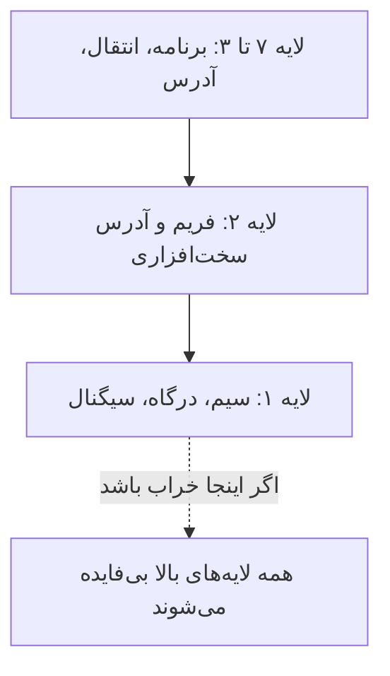

**جمع‌بندی یک‌دقیقه‌ای:** عیب‌یابی همیشه از پایین شروع می‌شود: اول سیم و درگاه،
بعد بقیه.

---

### ۶.۲ کابل مسی: مستقیم و متقاطع

**مثال روزمره:** دو گوشی تلفن قدیمی را فکر کن. هر کدام یک سیم برای «حرف زدن» و
یک سیم برای «گوش دادن» دارد. حرف‌زدنِ من باید به گوش‌دادنِ تو وصل شود.

**تعریف ساده:** کابل مسی شبکه هشت سیم دارد که چهار جفت هستند. برای سرعت
۱۰ و ۱۰۰ مگابیت فقط دو جفت کار می‌کند:

- پایه‌های ۱ و ۲: یک جفت
- پایه‌های ۳ و ۶: جفت دیگر

**دو گروه دستگاه:**

- **گروه اول:** رایانه، روتر، سرور، چاپگر، نقطه دسترسی. این‌ها روی پایه‌های ۱ و ۲ **ارسال** و روی ۳ و ۶ **دریافت** می‌کنند.
- **گروه دوم:** سوییچ و هاب. این‌ها برعکس‌اند: روی ۱ و ۲ **دریافت** و روی ۳ و ۶ **ارسال**.

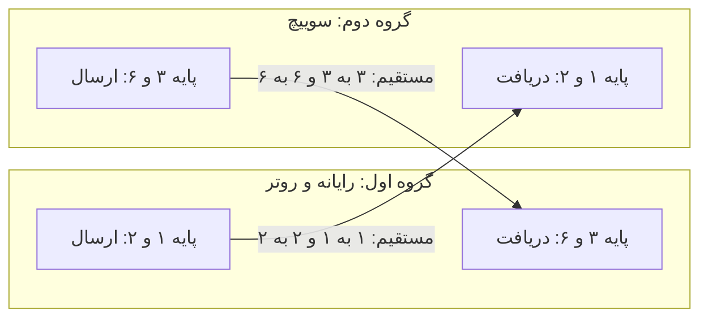

**قانون طلایی:**

- دو دستگاه **از دو گروه مختلف** ← کابل **مستقیم**
- دو دستگاه **از یک گروه** ← کابل **متقاطع**

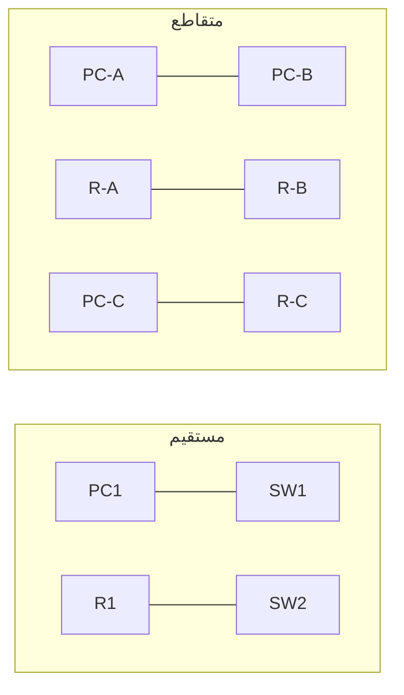

در کابل متقاطع، جفت ۱ و ۲ یک سر به جفت ۳ و ۶ سر دیگر می‌رسد. بدین ترتیب
«حرف‌زدنِ» هر دستگاه به «گوش‌دادنِ» دیگری می‌افتد.

| ردیف | دو سر اتصال (گروه) | کابل |
|---|---|---|
| ۱ | رایانه ↔ سوییچ | مستقیم |
| ۲ | روتر ↔ سوییچ | مستقیم |
| ۳ | سوییچ ↔ سوییچ | متقاطع |
| ۴ | رایانه ↔ رایانه | متقاطع |
| ۵ | روتر ↔ روتر | متقاطع |
| ۶ | رایانه ↔ روتر | متقاطع |
| ۷ | نقطه دسترسی ↔ سوییچ | مستقیم |

**نکته سیم‌بندی:** در استاندارد رنگ‌ها، دو سر کابل **مستقیم** هر دو یک‌جور
بسته می‌شوند (معمولاً الگوی B). کابل **متقاطع** یک سر الگوی A و یک سر الگوی B
دارد. برای سرعت ۱۰۰۰ مگابیت هر چهار جفت استفاده می‌شود و متقاطع چهار جفت را
جابه‌جا می‌کند.

**حد فاصله:** حداکثر ۱۰۰ متر برای کابل مسی. بیشتر از آن، سیگنال ضعیف می‌شود و
خطا می‌آید.

**کابل چهارم، کابل کنسول:** همان کابلی که در L03 به کار بردی. آن یک **کابل
مدیریتی** است، نه کابل داده‌ای.

**اگر اشتباه باشد:** نقطهٔ اتصال قرمز می‌ماند و درگاه «پایین/پایین» می‌شود.

---

### ۶.۳ تشخیص خودکار نوع کابل

**مثال روزمره:** مثل خودکاری که چه از این سر بنویسی و چه از آن سر، کار می‌کند.

**تعریف ساده:** درگاه‌های جدید خودشان تشخیص می‌دهند که روی کدام پایه باید
ارسال و روی کدام دریافت کنند، و در صورت نیاز **داخل خودشان جابه‌جا می‌کنند**.
نامش «آتو ام‌دی‌آی‌ایکس» است.

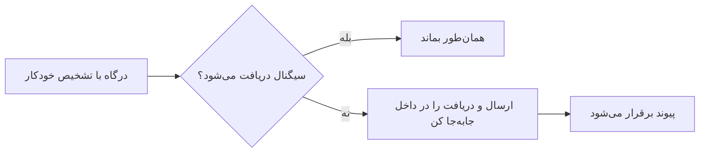

**نتیجه:** روی دستگاه‌های واقعی جدید، کابل مستقیم و متقاطع تفاوتی نمی‌کند.

**اما سه تذکر:**

1. در **آزمون** مگر اینکه سؤال بگوید «تشخیص خودکار فعال است»، فرض می‌کنیم **غیرفعال** است و قانون طلایی را به کار می‌بریم.
2. دستگاه‌های قدیمی این قابلیت را ندارند.
3. در پکت تریسر، رفتار هر مدل **نیازمند راستی‌آزمایی در نسخه نصب‌شده** است (در بخش ۹ آزمایش می‌کنیم).

---

### ۶.۴ فیبر نوری: تک‌مد و چندمد

**مثال روزمره:** یک لولهٔ باریک را فکر کن که یک پرتو نور فقط مستقیم از آن عبور
می‌کند (تک‌مد). در مقابل، لولهٔ پهن‌تر که نور می‌تواند از دیواره‌ها برگردد و
چند مسیر داشته باشد (چندمد). در فاصله‌های زیاد، مسیرهای مختلف نور به هم
می‌ریزند.

| ویژگی | تک‌مد | چندمد |
|---|---|---|
| قطر هسته | حدود ۹ میکرون | ۵۰ یا ۶۲٫۵ میکرون |
| منبع نور | لیزر | ال‌ای‌دی یا لیزر کم‌توان |
| فاصله معمول | چند ده کیلومتر | چند صد متر |
| قیمت | گران‌تر | ارزان‌تر |
| رنگ روکش معمول | زرد | نارنجی یا آبی‌روشن |

**مزیت‌های فیبر نسبت به مس:** فاصلهٔ بیشتر، مصون در برابر نویز برقی و صاعقه،
امنیت بالاتر، سرعت بالاتر.

**رابط‌ها:**

| رابط | ظاهر | کاربرد |
|---|---|---|
| ال‌سی | کوچک، دوگانه، گیره‌ای | رایج‌ترین، در ماژول اس‌اف‌پی |
| اس‌سی | مربعی، فشاری | رایج در سازمان‌ها |
| اس‌تی | گرد، پیچشی | قدیمی‌تر |

**دو رشته، دو جهت:** هر پیوند فیبر دو رشته دارد؛ یکی فقط برای ارسال و دیگری
فقط برای دریافت. ارسالِ یک سر باید به دریافتِ سر دیگر برسد.

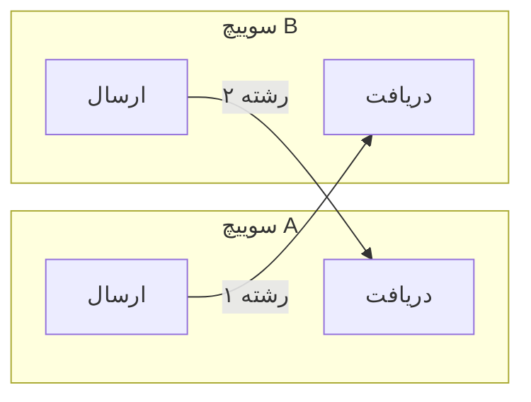

**ماژول اس‌اف‌پی:** یک قطعهٔ کوچک است که داخل درگاه سوییچ می‌رود و نوع پیوند
(مس، چندمد، تک‌مد) را تعیین می‌کند. به‌جای تعویض سوییچ، فقط ماژول عوض می‌شود.

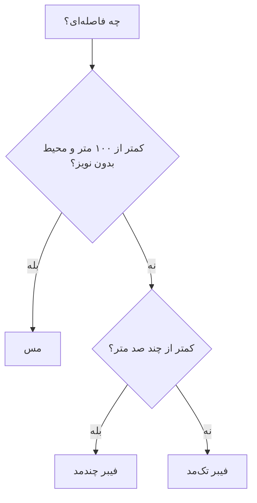

**برچسب پشتیبانی:** فیبر در پکت تریسر **جزئی** است. کابل فیبر هست ولی فقط با
ماژول‌های مشخص کار می‌کند (نیازمند راستی‌آزمایی در نسخه نصب‌شده).

---

### ۶.۵ سرعت، دوطرفه بودن و ناسازگاری

**مثال روزمره:**

- **یک‌طرفه:** بی‌سیم دستی؛ یکی حرف می‌زند، دیگری فقط گوش می‌کند، بعد جابه‌جا می‌شوند.
- **دوطرفه:** تلفن؛ هر دو همزمان حرف می‌زنند و گوش می‌کنند.

**سرعت‌های رایج:** ۱۰، ۱۰۰ و ۱۰۰۰ مگابیت بر ثانیه (و بالاتر).

**تشخیص خودکار سرعت:** وقتی هر دو سر «خودکار» باشند، دو دستگاه به هم می‌گویند
چه می‌توانند و بهترین حالت مشترک را برمی‌گزینند.

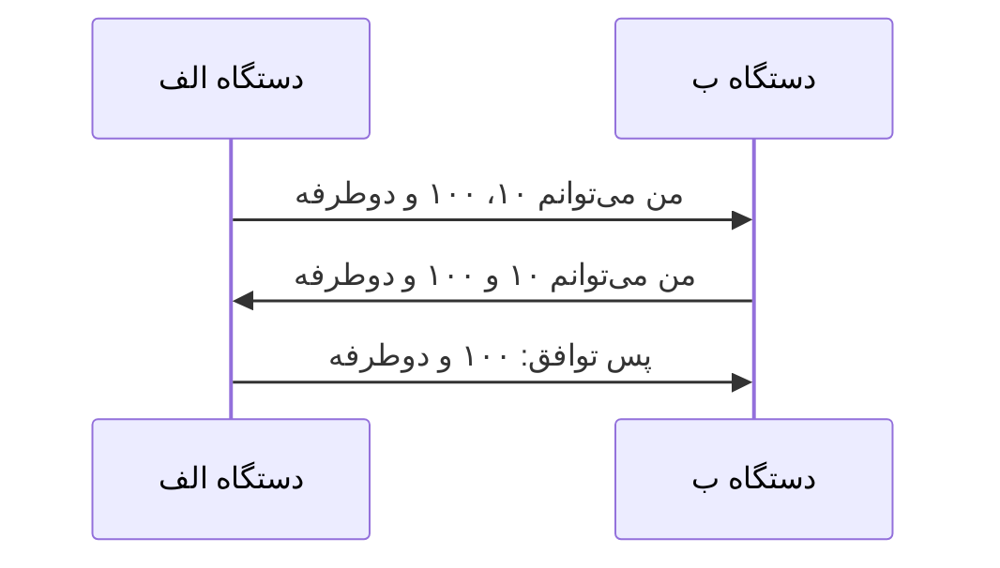

**ناسازگاری:** اگر یک سر را **دستی** تنظیم کنی و سر دیگر «خودکار» بماند، یا هر دو را
دستی ولی متفاوت بگذاری، مشکل پیش می‌آید.

| سر الف | سر ب | نتیجه |
|---|---|---|
| خودکار | خودکار | بهترین حالت مشترک؛ سالم |
| دستی ۱۰۰ دوطرفه | دستی ۱۰۰ دوطرفه | سالم |
| دستی ۱۰۰ دوطرفه | خودکار | سر خودکار سرعت را حدس می‌زند ولی دوطرفه را «یک‌طرفه» فرض می‌کند؛ **ناسازگاری دوطرفه** |
| دستی ۱۰۰ | دستی ۱۰ | **پیوند پایین** (سرعت‌ها نمی‌خوانند) |
| دستی دوطرفه | دستی یک‌طرفه | **پیوند بالا ولی پراشکال** |

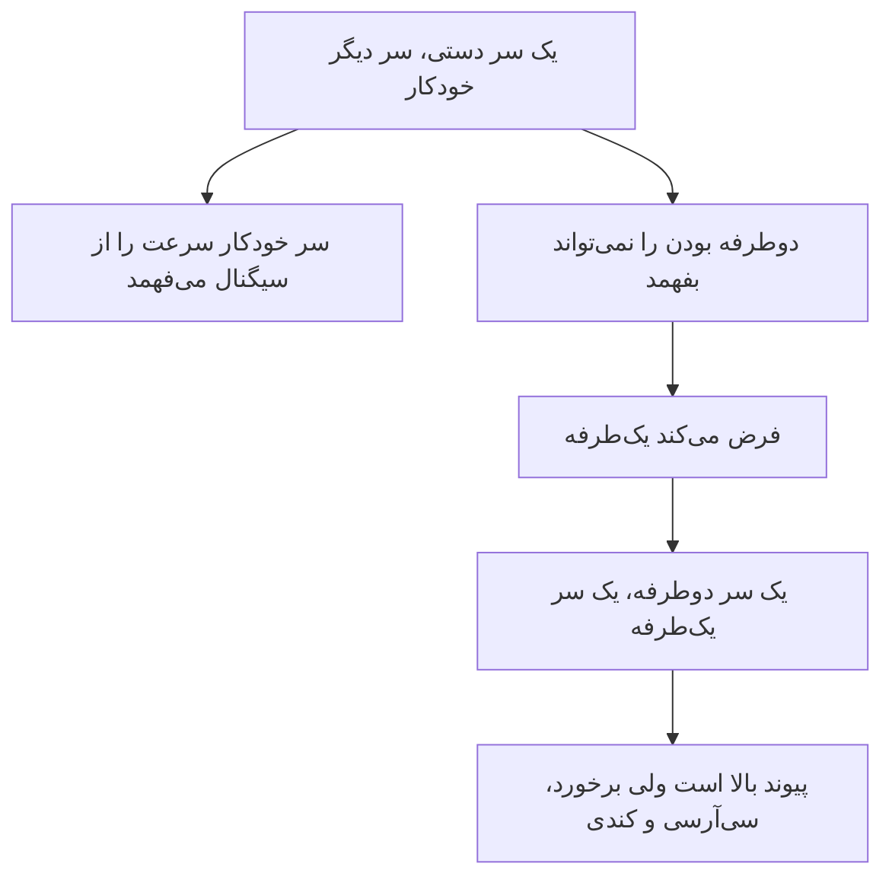

**قانون عملی:** یا هر دو سر «خودکار»، یا هر دو سر **دستی و کاملاً یکسان**.

> **نکته مهم برای عیب‌یابی:** ناسازگاری دوطرفه یکی از موذی‌ترین عیب‌هاست.
> چراغ سبز است، وضعیت «بالا/بالا» است، ولی شبکه کند است. فقط با خواندن
> **شمارنده‌ها** پیدایش می‌کنی.

---

### ۶.۶ برق از طریق کابل شبکه

**مثال روزمره:** مثل شارژری که هم برق می‌دهد و هم داده منتقل می‌کند. لازم نیست
برای تلفن آی‌پی یا نقطهٔ دسترسی بی‌سیم، پریز جدا بکشی.

**نام‌ها:**

- **منبع برق:** سوییچ یا روتر مجهز؛
- **دستگاه برق‌گیر:** تلفن آی‌پی، دوربین، نقطه دسترسی بی‌سیم.

**سازوکار:** سوییچ ابتدا یک ولتاژ بسیار کم می‌فرستد و می‌بیند دستگاه سمت دیگر
«برق‌گیر» است یا نه. اگر بود، میزان برق لازم را می‌پرسد و می‌دهد. اگر نبود
(مثلاً یک رایانهٔ معمولی)، هیچ برقی نمی‌فرستد؛ پس دستگاه سالم می‌ماند.

| استاندارد | نام | بیشترین توان از سمت سوییچ |
|---|---|---|
| ۸۰۲٫۳af | پو‌ئی | حدود ۱۵٫۴ وات |
| ۸۰۲٫۳at | پو‌ئی پلاس | حدود ۳۰ وات |
| ۸۰۲٫۳bt | پو‌ئی پلاس‌پلاس | حدود ۶۰ تا ۹۰ وات |

**بودجهٔ برق:** هر سوییچ توان کل محدودی دارد. مجموع توان همهٔ درگاه‌ها از آن
بیشتر نمی‌شود. اگر بیشتر شود، بعضی دستگاه‌ها برق نمی‌گیرند.

**برچسب پشتیبانی:** در پکت تریسر **جزئی/مفهومی** است. بعضی دستگاه‌ها (مثل
تلفن آی‌پی) در بعضی مدل‌های سوییچ برق می‌گیرند، ولی کنترل دقیق بودجه و
دستورهای مربوطه **نیازمند راستی‌آزمایی در نسخه نصب‌شده** است. در این درس فقط
مفهوم را یاد می‌گیریم و دستور تنظیم نمی‌دهیم.

---

### ۶.۷ چهار وضعیت درگاه

**مثال روزمره:** چراغ برق خانه.

- چراغ روشن است و برق هم هست: **همه‌چیز سالم** (بالا/بالا).
- کلید را زده‌ای ولی لامپ نمی‌سوزد چون سیم‌کشی ایراد دارد: **برق نیامده** (پایین/پایین).
- خودت کلید را خاموش کرده‌ای: **خاموش اداری**.
- برق هست ولی کنتور خراب است و نتیجه‌اش درست نیست: **بالا/پایین**.

دستگاه دو مرحله را جداگانه گزارش می‌کند:

1. **وضعیت خط** (لایه یک): آیا سیگنال هست؟
2. **وضعیت پروتکل** (لایه دو): آیا پیوند داده‌ای سالم کار می‌کند؟

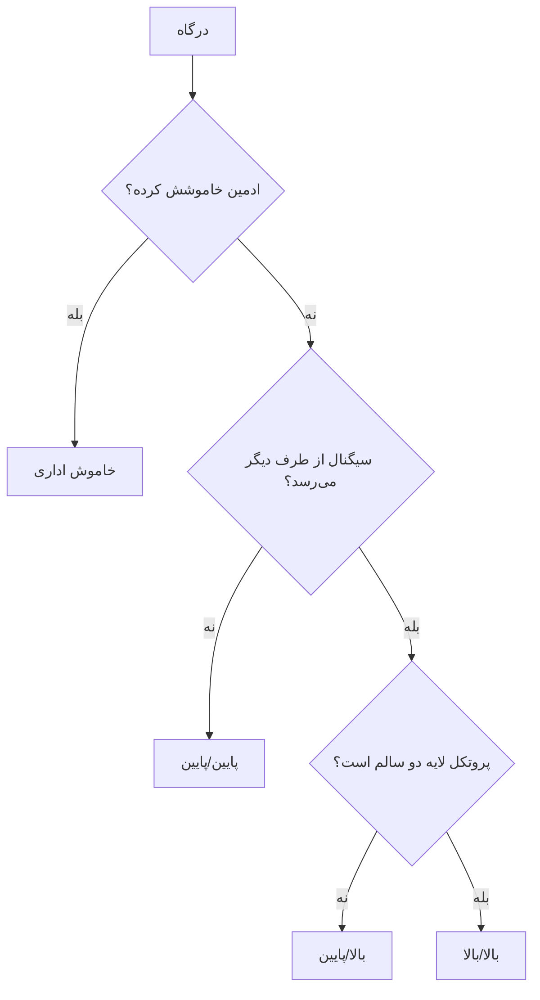

| وضعیت خط | وضعیت پروتکل | نام فارسی | معنی |
|---|---|---|---|
| up | up | بالا/بالا | سالم |
| up | down | بالا/پایین | سیگنال هست ولی لایه دو مشکل دارد (در اترنت کمیاب است) |
| down | down | پایین/پایین | سیگنال نیست: سیم، سر دیگر، سرعت |
| administratively down | down | خاموش اداری | خودِ مدیر `shutdown` زده است |

**چرا «بالا/پایین» در اترنت نادر است؟** چون اگر سیگنال هست معمولاً پروتکل
هم بالا می‌آید. مثال‌های واقعی: حلقه‌شدن خود درگاه، یا نوع بسته‌بندی ناسازگار
در پیوندهای خاص. برچسب: **مفهومی** (در پکت تریسر معمولاً ساخته نمی‌شود).

**رنگ نقطه‌های اتصال در پکت تریسر:**

| رنگ نقطه | معنی |
|---|---|
| سبز ثابت | پیوند برقرار و درگاه آماده |
| سبز چشمک‌زن | در حال انتقال داده |
| نارنجی (کهربایی) | پیوند برقرار ولی سوییچ هنوز اجازه عبور نداده (مثلاً چند ثانیه اول بعد از وصل شدن) |
| قرمز | پیوند پایین (سیم اشتباه، سرعت ناسازگار، درگاه خاموش اداری) |
| بدون نقطه | هیچ سیمی وصل نیست |

> نارنجی بودن موقت در سوییچ طبیعی است؛ دلیلش را در L15 یاد می‌گیری. فعلاً
> کافی است بدانی حدود نیم دقیقه صبر کنی تا سبز شود. اگر نارنجی ماند، به
> مدرس بگو.

**فرق اصلی خاموش اداری با کابل وصل نیست:**

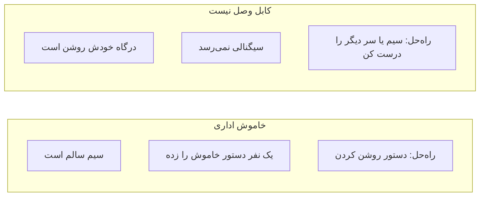

**جمع‌بندی:** «خاموش اداری» یعنی **انسان** خاموش کرده؛ «پایین/پایین» یعنی
**دنیای فیزیکی** مشکل دارد.

---

### ۶.۸ خطاها و شمارنده‌ها

**مثال روزمره:** صندوق نامه‌های برگشتی پست. وقتی نامه‌ها پاره یا خراب
برسند، می‌شمارند و ثبت می‌کنند.

**شمارنده‌ها** ثبت می‌کنند چند فریم سالم و چند فریم خراب از درگاه گذشته است.

| شمارنده | ترجمه | معنی ساده | علت‌های رایج |
|---|---|---|---|
| input errors | خطاهای ورودی | کل خطاهای دریافتی | مجموع زیر |
| CRC | بررسی چرخه‌ای | فریم رسید ولی هنگام عبور خراب شده بود | سیم بد، نویز، ناسازگاری دوطرفه، کارت شبکه خراب |
| runts | فریم کوتوله | فریم کوچک‌تر از حد (کمتر از ۶۴ بایت) | برخورد، ناسازگاری دوطرفه |
| giants | فریم غول | فریم بزرگ‌تر از حد | تنظیم یا دستگاه معیوب |
| collisions | برخورد | دو دستگاه همزمان فرستادند | در حالت یک‌طرفه طبیعی؛ در دوطرفه نباید باشد |
| late collisions | برخورد دیرهنگام | برخورد بعد از ۶۴ بایت اول | ناسازگاری دوطرفه یا کابل بیش از حد بلند |
| interface resets | بازشروع درگاه | درگاه چند بار بالا و پایین شد | سیم لق، ماژول خراب |

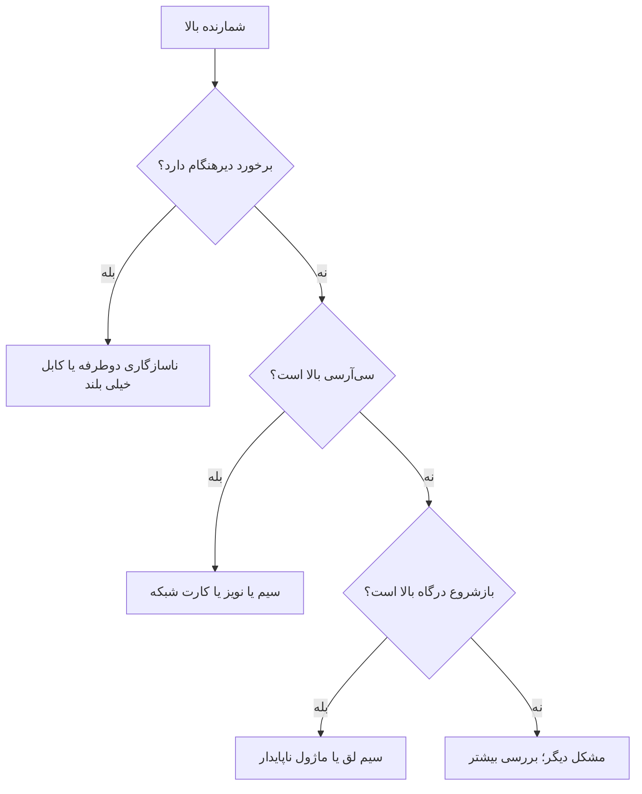

**نکتهٔ مهم:** شمارنده‌ها از آخرین پاک‌سازی (یا روشن شدن) جمع می‌شوند. عدد
بزرگ به‌تنهایی نشانهٔ مشکل نیست؛ **رشد سریع عدد** نشانه است.

**برچسب پشتیبانی:** شمارنده‌های واقعی در پکت تریسر **جزئی** هستند؛ معمولاً
صفر می‌مانند. بنابراین خروجی‌هایی که برای تمرین می‌بینی «نمونه آموزشی»
هستند.

---
## ۷. درس زبان فرمان: «درگاه رو چطوری می‌خونی؟»

تا حالا بیشتر به دستگاه «دستور می‌دادی». این‌جا یاد می‌گیری **بپرسی** و جواب را
**بخوانی**. دستورهای `show` فقط نگاه می‌کنند و چیزی را عوض نمی‌کنند؛ پس
می‌توانی هر چقدر دلت خواست بپرسی.

### ۷.۱ سه سطح پرسیدن

**مثال روزمره:** برای شناخت یک شهر سه نقشه داری: نقشهٔ کلی خیابان‌ها، فهرست
محله‌ها، و پروندهٔ کامل هر خانه.


| سطح | دستور | چه چیزی نشان می‌دهد | کِی استفاده کنم؟ |
|---|---|---|---|
| ۱ | `show ip interface brief` | بالا یا پایین بودن همه درگاه‌ها | اولین نگاه |
| ۲ | `show interfaces status` | وصل بودن، سرعت، دوطرفه، برچسب | بررسی سرعت و دوطرفه |
| ۳ | `show interfaces` | همه جزئیات و شمارنده‌ها | کندی و خطا |

### ۷.۲ گفتگوی انسانی: خواندن وضعیت

```text
شما:      show interfaces status
```

```text
دستگاه:   «show» رو شنیدم؛ یعنی «نشونم بده».
          «interfaces» رو هم فهمیدم؛ یعنی «درگاه‌ها».
          «status» هم یعنی «وضعیتشون».
          پس یه جدول کوتاه از وضعیت همهٔ درگاه‌هام نشونت می‌دم.
          (و چیزی رو تغییر نمی‌دم؛ فقط نگاه می‌کنم.)
```

### ۷.۳ ترجمهٔ هر کلمهٔ خروجی

> خروجی‌های زیر **نمونهٔ آموزشی** هستند، نه خروجی واقعی. در پکت تریسر
> خودت ممکن است ظاهر و فاصله‌ها کمی فرق کند.

**الف) `show ip interface brief`**

```text
SW1#show ip interface brief
Interface              IP-Address      OK? Method Status                Protocol
FastEthernet0/1        unassigned      YES unset  up                    up
FastEthernet0/2        unassigned      YES unset  down                  down
FastEthernet0/3        unassigned      YES unset  administratively down down
```

```text
Interface    = درگاه
IP-Address   = آدرس (فعلاً نادیده؛ unassigned یعنی «هنوز آدرس ندادی»)
OK?          = آیا آدرس درست ثبت شده؟ (فعلاً نادیده)
Method       = آدرس چطور به دست آمده؟ (فعلاً نادیده)
Status       = وضعیت خط (لایه یک: سیگنال هست؟)
Protocol     = وضعیت پروتکل (لایه دو: پیوند سالمه؟)
up           = بالا
down         = پایین
administratively down = خاموش اداری (ادمین خاموشش کرده)
```

**ب) `show interfaces status`**

```text
SW1#show interfaces status
Port      Name               Status       Vlan       Duplex  Speed Type
Fa0/1     to-PC1             connected    1          a-full  a-100 10/100BaseTX
Fa0/2     to-PC2             notconnect   1          auto    auto  10/100BaseTX
Fa0/3     to-R1              disabled     1          auto    auto  10/100BaseTX
Fa0/4     printer            connected    1          full    100   10/100BaseTX
```

```text
Port         = درگاه
Name         = برچسبی که با description گذاشتی
Status       = وضعیت
Vlan         = (فعلاً نادیده؛ درس L12)
Duplex       = یک‌طرفه یا دوطرفه
Speed        = سرعت
Type         = نوع درگاه
connected    = وصل و سالم
notconnect   = سیگنالی نمی‌رسد
disabled     = خاموش اداری
full / half  = دوطرفه / یک‌طرفه
auto         = تنظیم نشده، به تشخیص خودکار سپرده شده
a-full       = تشخیص خودکار، نتیجه شد «دوطرفه»
a-100        = تشخیص خودکار، نتیجه شد «۱۰۰»
full و 100   (بدون a-) = ادمین دستی تنظیم کرده
```

> **حرف a- را از یاد نبر.** اگر قبل از مقدار `a-` دیدی یعنی
> «دستگاه خودش به این نتیجه رسیده». اگر ندیدی یعنی «کسی دستی گذاشته».

**معادل سه وضعیت:**

| در `show ip interface brief` | در `show interfaces status` | معنی |
|---|---|---|
| up / up | connected | سالم |
| down / down | notconnect | سیگنال نیست |
| administratively down / down | disabled | خاموش اداری |
| down / down | err-disabled | خود سوییچ به دلیل محافظتی بستش (درس L29؛ فعلاً فقط بشناس) |

**ج) `show interfaces fastethernet 0/1` (بخش‌های مهم)**

```text
SW1#show interfaces fastethernet 0/1
FastEthernet0/1 is up, line protocol is up (connected)
  Hardware is Fast Ethernet, address is 0001.4212.3301 (bia 0001.4212.3301)
  Description: to-PC1
  MTU 1500 bytes, BW 100000 Kbit, DLY 100 usec,
  Full-duplex, 100Mb/s
  input flow-control is off, output flow-control is off
  5 minute input rate 0 bits/sec, 0 packets/sec
  0 input errors, 0 CRC, 0 frame, 0 overrun, 0 ignored
  0 output errors, 0 collisions, 0 interface resets
  0 late collision, 0 deferred
```

```text
FastEthernet0/1 is up          = درگاه فست‌اترنت ۰/۱ : وضعیت خط بالا
line protocol is up            = وضعیت پروتکل بالا
(connected)                    = توضیح کوتاه همان بالا/بالا
Hardware is Fast Ethernet      = جنس سخت‌افزار: فست‌اترنت
address is 0001.4212.3301      = آدرس سخت‌افزاری (درس L11؛ فعلاً نادیده)
Description: to-PC1            = همان برچسب
MTU 1500 bytes                 = بزرگ‌ترین بستهٔ مجاز
BW 100000 Kbit                 = پهنای باند اعلامی: ۱۰۰ مگابیت
Full-duplex, 100Mb/s           = دوطرفه و ۱۰۰ مگابیت (مهم‌ترین خط برای ما)
5 minute input rate            = نرخ ورودی در پنج دقیقه اخیر
0 input errors                 = خطای دریافتی صفر
0 CRC                          = فریم خراب‌شده صفر
0 collisions                   = برخورد صفر
0 interface resets             = بالا و پایین شدن درگاه صفر
0 late collision               = برخورد دیرهنگام صفر
```

### ۷.۴ ترجمهٔ هفت‌مرحله‌ای دستورهای جدید

دستورهای `show ip interface brief`, `description` و `no shutdown` را قبلاً
دیده‌ای. شش دستور زیر **جدیدند**:

#### ۱) `show interfaces status`

**جمله انسانی:** «یه جدول فشرده از وضعیت همه درگاه‌ها نشونم بده.»

```text
show        = نشونم بده
interfaces  = درگاه‌ها
status      = وضعیتشون
اتاق:             SW1# (اتاق مدیر) — از اتاق تنظیمات: do show interfaces status
دستور برعکس:       ندارد (فقط نگاه می‌کند)
کوتاه‌شده:         sh int status   (چون هر کلمه با چند حرف اول یکتا می‌شود)
```

**اگر اشتباه بگویی:**

```text
SW1#show interfaces staus
                    ^
% Invalid input detected at '^' marker.
```

```text
ترجمه: «staus» رو نفهمیدم؛ از همین‌جا که ^ نشان می‌دهد غلط املایی داری.
```

#### ۲) `show interfaces`

**جمله انسانی:** «پروندهٔ کامل این درگاه رو بده.»

```text
show        = نشونم بده
interfaces  = درگاه‌ها
fastethernet 0/1 = (اختیاری) فقط این یکی
اتاق:             SW1#
دستور برعکس:       ندارد
کوتاه‌شده:         sh int fa0/1
```

**اگر اشتباه بگویی:**

```text
SW1#show interfaces fastethernet
% Incomplete command.
```

```text
ترجمه: جمله‌ات ناقصه؛ نوع رو گفتی ولی شماره رو نگفتی.
```

#### ۳) `interface range`

**جمله انسانی:** «این چند درگاه رو یک‌جا بگیر؛ هر چی بعدش گفتم برای همه‌شون اجرا شه.»

```text
interface       = درگاه
range           = چند تا پشت هم
gigabitethernet = از نوع جیگابیت‌اترنت
0/1             = کارت صفر، درگاه یک
-               = تا
4               = درگاه چهار
اتاق قبل:         SW1(config)#
اتاق بعد:         SW1(config-if-range)#
دستور برعکس:       exit (یک پله برگرد)؛ تنظیم‌هایی که زدی با no برگردانده می‌شوند
کوتاه‌شده:         int range gi0/1 - 4
```

**گفتگو:**

```text
شما:      interface range gigabitethernet 0/1 - 4
```

```text
دستگاه:   «interface» رو فهمیدم؛ درگاه.
          «range» رو هم؛ چندتا پشت هم.
          از جیگابیت ۰/۱ تا ۰/۴ رو یه‌جا می‌گیرم.
          حالا هر دستوری بدی روی هر چهارتا اجرا می‌شه.
          (و نشانهٔ جلوی خط شد: SW1(config-if-range)# )
```

**اگر اشتباه بگویی:**

```text
SW1(config)#interface range gigabitethernet 0/1 - 9
                                                  ^
% Invalid input detected at '^' marker.
```

```text
ترجمه: بعضی از این درگاه‌ها اصلاً وجود ندارند.
```

> **نکتهٔ لب:** سوییچ مدل ۲۹۶۰ (نسخهٔ ۲۴ درگاهی) در پکت تریسر فقط **دو** درگاه جیگابیت
> دارد (`0/1` و `0/2`). پس `0/1 - 4` روی آن خطا می‌دهد. برای تمرین همین دستور
> روی همان سوییچ از فست‌اترنت استفاده می‌کنیم. دستور دقیقاً همان دستور است،
> فقط «نوع درگاه» عوض می‌شود. وجود چهار درگاه جیگابیت روی مدل‌های دیگر
> **نیازمند راستی‌آزمایی در نسخه نصب‌شده** است.

#### ۴) `speed`

**جمله انسانی:** «سرعت این درگاه رو دستی بذار روی ۱۰۰.»

```text
speed = سرعت
100   = صد مگابیت بر ثانیه
(مقدارهای ممکن: 10، 100، 1000 (اگر درگاه پشتیبانی کند)، auto)
اتاق:             SW1(config-if)#   یا   SW1(config-if-range)#
دستور برعکس:       no speed   (برگرد به تشخیص خودکار)
کوتاه‌شده:         ندارد؛ کلمه‌اش از اول کوتاه است
```

**گفتگو:**

```text
شما:      speed 100
```

```text
دستگاه:   «speed» یعنی سرعت؛ «100» یعنی صد مگابیت.
          از این‌به‌بعد دیگه با سر مقابل چانه نمی‌زنم؛ با ۱۰۰ می‌رم.
          (در خروجی show interfaces status از این پس a- ندیدی، یعنی دستی شد.)
```

**اگر اشتباه بگویی:**

```text
SW1(config)#speed 100
            ^
% Invalid input detected at '^' marker.
```

```text
ترجمه: «speed» اینجا معنی نمی‌دهد؛ تو توی اتاق تنظیمات کلی هستی نه اتاق درگاه.
```

#### ۵) `duplex`

**جمله انسانی:** «دوطرفه بودن این درگاه رو دستی بذار روی دوطرفه.»

```text
duplex = دوطرفه بودن
full   = دوطرفه (همزمان)
(مقدارهای ممکن: full، half، auto)
اتاق:             SW1(config-if)#
دستور برعکس:       no duplex   (برگرد به تشخیص خودکار)
کوتاه‌شده:         ندارد
```

**اگر اشتباه بگویی:**

```text
SW1(config-if)#duplex
% Incomplete command.
```

```text
ترجمه: گفتی «دوطرفه بودن» ولی نگفتی چی؛ full؟ half؟ auto؟
```

#### ۶) `shutdown`

**جمله انسانی:** «این درگاه رو از نظر نرم‌افزاری خاموش کن.»

```text
shutdown    = خاموش کن (از نظر نرم‌افزاری)
اتاق:             SW1(config-if)#
دستور برعکس:       no shutdown
کوتاه‌شده:         shut      و      no shut
```

**گفتگو:**

```text
شما:      shutdown
```

```text
دستگاه:   «shutdown» یعنی خاموش.
          این درگاه رو غیرفعال می‌کنم؛ حتی اگه سیم سالم و وصل باشه.
```

```text
%LINK-5-CHANGED: Interface FastEthernet0/3, changed state to administratively down
%LINEPROTO-5-UPDOWN: Line protocol on Interface FastEthernet0/3, changed state to down
```

```text
ترجمه: خط رفت روی «خاموش اداری»، و پروتکل هم پایین رفت.
```

**اگر اشتباه بگویی:**

```text
SW1>shutdown
    ^
% Invalid input detected at '^' marker.
```

```text
ترجمه: اتاق عادی کاربر اجازه خاموش کردن ندارد.
```

### ۷.۵ نکته طلایی: «خاموش اداری» یا «کابل وصل نیست»؟

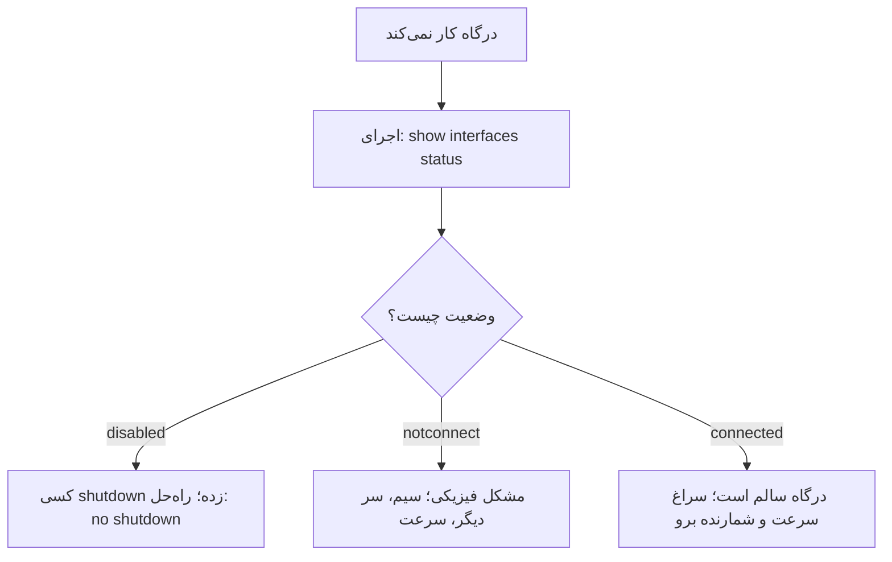

| نشانه | خاموش اداری | کابل وصل نیست |
|---|---|---|
| `show ip interface brief` | administratively down / down | down / down |
| `show interfaces status` | disabled | notconnect |
| نقطه در پکت تریسر | قرمز (اگر سیم هست) | قرمز یا بدون نقطه |
| کار درمان | `no shutdown` | بررسی سیم و سر دیگر |

> فقط **دستور نمایشی** جواب قطعی می‌دهد. رنگ نقطه به‌تنهایی برای تشخیص
> کافی نیست.

### ۷.۶ مترجم خطا

```text
% Incomplete command.     = جمله‌ات ناقصه؛ یه کلمه کم داری
% Invalid input detected  = این کلمه رو نمی‌فهمم؛ جای علامت ^ رو نگاه کن
% Ambiguous command       = کلمه‌ات چند معنی داره؛ کامل‌ترش کن
```

مثال برای «چند معنی»:

```text
SW1#show i
% Ambiguous command:  "show i"
```

```text
ترجمه: «i» هم می‌تواند interfaces باشد هم چیزهای دیگر؛ کامل‌ترش کن.
```

---
## ۸. آماده‌سازی لب

**سناریوی سازمانی (شرکت «آرمان‌داده»، مرحلهٔ اول):** شرکت یک اتاق کوچک فروش
دارد با یک سوییچ و چند رایانه. تو **کارآموز شبکه** هستی و مسئول این هستی که
مطمئن شوی سیم‌کشی و درگاه‌ها درست‌اند و هر درگاه برچسب دارد.

### ۸.۱ شناسنامه آزمایشگاه

| مورد | مقدار |
|---|---|
| سطح لب | ۲ (برای پروژه‌ها تا ۳) |
| نام فایل | `L05-physical-v1.pkt` (سالم) و نسخه‌های بعدی `v2`، `v3` |
| روش بازگشت | باز کردن نسخهٔ `v1`؛ یا `no shutdown`، `no speed`، `no duplex`، `no description` |
| جدول آدرس‌دهی | **ندارد.** این درس بدون آدرس است |
| سرویس فعال | هیچ |

### ۸.۲ جدول دستگاه‌ها

| نام | مدل پیشنهادی | توجیه آموزشی |
|---|---|---|
| SW1 | Catalyst 2960-24TT | سوییچ اصلی؛ درگاه فست‌اترنت و دو جیگابیت |
| R1 | 2911 (یا 1941) | درگاه روتر پیش‌فرض خاموش است؛ برای مشاهده «خاموش اداری» |
| PC1، PC2 | PC | نمایندهٔ رایانه‌ها |
| PC3، R2 | (فقط پروژه‌ها) | دیدن کابل متقاطع و روتر به روتر |

> اگر مدل روتر در نسخهٔ نصب‌شده نیست، مدل دیگری با دو درگاه جیگابیت بگیر.
> **نیازمند راستی‌آزمایی در نسخه نصب‌شده.**

### ۸.۳ جدول اتصال کابل

| ردیف | از | درگاه | نوع کابل در پکت تریسر | به | درگاه |
|---|---|---|---|---|---|
| ۱ | PC1 | FastEthernet0 | Copper Straight-Through | SW1 | Fa0/1 |
| ۲ | PC2 | FastEthernet0 | Copper Straight-Through | SW1 | Fa0/2 |
| ۳ | R1 | Gi0/0 | Copper Straight-Through | SW1 | Gi0/1 |
| ۴ (پروژه) | PC3 | FastEthernet0 | Copper Straight-Through | SW1 | Fa0/3 |
| ۵ (پروژه) | R1 | Gi0/1 | Copper Cross-Over | R2 | Gi0/1 |

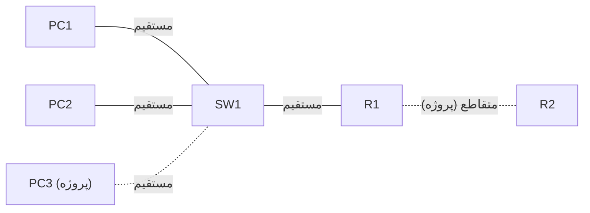

### ۸.۴ برچسب پشتیبانی پکت تریسر

| موضوع | برچسب | توضیح |
|---|---|---|
| کابل مستقیم و متقاطع | کامل | رنگ نقطه نشان می‌دهد |
| تشخیص خودکار نوع کابل | جزئی | رفتار هر مدل **نیازمند راستی‌آزمایی** است |
| فیبر | جزئی | به ماژول مناسب نیاز دارد |
| سرعت و دوطرفه دستی | کامل | گزینه‌ها در هر مدل **نیازمند راستی‌آزمایی** است |
| ناسازگاری دوطرفه | جزئی | اثر کندی و شمارنده معمولاً شبیه‌سازی نمی‌شود |
| برق از کابل | مفهومی/جزئی | فقط مفهوم |
| وضعیت درگاه و رنگ نقطه | کامل | |
| شمارنده‌ها | جزئی | معمولاً صفر |

### ۸.۵ ایمنی تنظیمات (قبل از شروع)

1. نسخه‌ای از فایل را با نام `L05-physical-v1.pkt` ذخیره کن.
2. هر بار قبل از تغییر، وضعیت فعلی را ببین (`show interfaces status`).
3. اثر دستور را بگو، روش برگشت را بدان، و بعد از اجرا دوباره بپرس.
4. **قانون طلایی:** بعد از هر تغییر، ذخیره کن و دوباره بپرس.

---

## ۹. آزمایش گام‌به‌گام با شبیه‌سازی صفحه

نمای کلی صفحه پکت تریسر که انتظار داری ببینی:

```text
+---------------------------------------------------------------+
|  Cisco Packet Tracer — L05-physical-v1.pkt                    |
+---------------------------------------------------------------+
|                                                               |
|   PC1 (Fa0) ●━━━━━━━● (Fa0/1)                                 |
|                          SW1 (Gi0/1) ●━━━━━━● (Gi0/0)  R1     |
|   PC2 (Fa0) ●━━━━━━━● (Fa0/2)                                 |
|                                                               |
|   ● سبز = سالم      ● قرمز = پایین      ● نارنجی = در حال آماده شدن |
+---------------------------------------------------------------+
```

### آزمایش ۱: ساخت لب و خواندن حالت سالم

**هدف:** سیم‌کشی درست و دیدن حالت «بالا/بالا».

1. چهار دستگاه را بگذار: SW1، R1، PC1، PC2.
2. با کابل **مستقیم** سه اتصال جدول ۸.۳ را بزن.
3. نیم دقیقه صبر کن تا نقطه‌های نارنجی سبز شوند.
4. روی SW1 کلیک کن، تب `CLI`، سپس:

```text
Switch>enable
Switch#show interfaces status
```

**انتظار:**

```text
Port      Name               Status       Vlan       Duplex  Speed Type
Fa0/1                        connected    1          a-full  a-100 10/100BaseTX
Fa0/2                        connected    1          a-full  a-100 10/100BaseTX
Fa0/3                        notconnect   1          auto    auto  10/100BaseTX
...
Gi0/1                        connected    1          a-full  a-100 10/100BaseTX
```

> این یک **نمونهٔ آموزشی** از خروجی است. سرعت جیگابیت وقتی به روتر با درگاه
> جیگابیت وصل شود ممکن است `a-1000` باشد؛ این را همان‌طور که نشان می‌دهد
> بخوان. ظاهر دقیق ستون‌ها **نیازمند راستی‌آزمایی در نسخه نصب‌شده** است.

**برگشت:** نیازی نیست؛ فقط نگاه کردی.

### آزمایش ۲: برچسب‌گذاری درگاه‌ها

**اثر دستور:** فقط یک «برچسب» روی درگاه می‌زند؛ هیچ رفتاری عوض نمی‌شود.
**اتاق:** تنظیمات درگاه. **برگشت:** `no description`.

```text
SW1#configure terminal
SW1(config)#interface fastethernet 0/1
SW1(config-if)#description to-PC1
SW1(config-if)#interface fastethernet 0/2
SW1(config-if)#description to-PC2
SW1(config-if)#interface gigabitethernet 0/1
SW1(config-if)#description to-R1
SW1(config-if)#end
SW1#write memory
SW1#show interfaces status
```

**انتظار:** ستون `Name` در سه ردیف پر شده است.

### آزمایش ۳: خاموش اداری در برابر کابل وصل نیست

**اثر دستور:** `shutdown` یک درگاه را با دستور خاموش می‌کند، حتی اگر سیم
سالم باشد.

**مرحلهٔ الف: خاموش اداری**

```text
SW1#configure terminal
SW1(config)#interface fastethernet 0/2
SW1(config-if)#shutdown
SW1(config-if)#end
SW1#show interfaces status
SW1#show ip interface brief
```

**انتظار:** در جدول اول `disabled`، در جدول دوم `administratively down` و
نقطهٔ سمت PC2 قرمز.

**مرحلهٔ ب: برگرداندن**

```text
SW1#configure terminal
SW1(config)#interface fastethernet 0/2
SW1(config-if)#no shutdown
SW1(config-if)#end
SW1#show interfaces status
```

**انتظار:** بعد از چند ثانیه دوباره `connected`.

**مرحلهٔ ج: کابل وصل نیست**

1. سیم PC1 را از سمت PC1 بکش (حذف کابل).
2. `show interfaces status` را بزن. انتظار: `notconnect`.
3. سیم را دوباره بزن و تأیید کن.

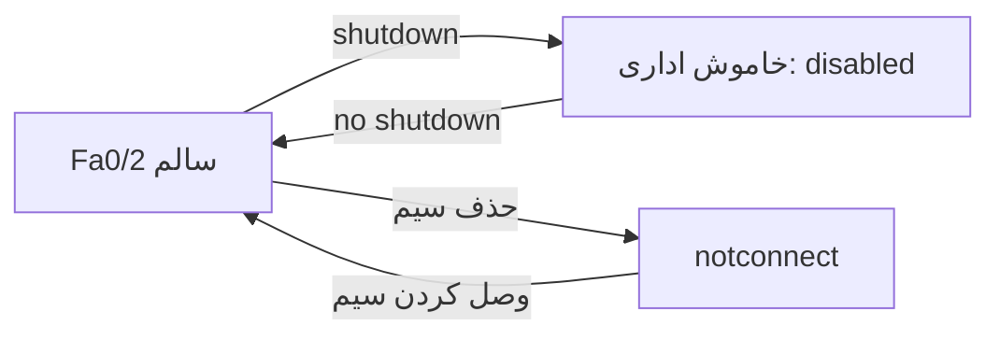

### آزمایش ۴: سرعت و دوطرفه بودن (ناسازگاری)

**اثر دستور:** سرعت و دوطرفه را دستی می‌گذارد؛ مقدار تشخیص خودکار کنار می‌رود.
**برگشت:** `no speed` و `no duplex`.

**مرحلهٔ الف: تنظیم هماهنگ**

```text
SW1#configure terminal
SW1(config)#interface fastethernet 0/1
SW1(config-if)#speed 100
SW1(config-if)#duplex full
SW1(config-if)#end
SW1#show interfaces status
```

**انتظار:** در ردیف `Fa0/1` عبارت `full` و `100` **بدون `a-`**.

**مرحلهٔ ب: ایجاد ناسازگاری (فقط در پکت تریسر)**

1. روی PC1 کلیک کن ← تب `Config` ← `FastEthernet0`.
2. تیک تشخیص خودکار را بردار و روی «۱۰ مگابیت» بگذار.
3. وضعیت نقطه و `show interfaces status` را ببین.

**انتظار (نیازمند راستی‌آزمایی در نسخه نصب‌شده):** چون سرعت دو سر دستی و
متفاوت است، پیوند پایین می‌رود (نقطه قرمز).

**مرحلهٔ ج: رفع**

PC1 را روی تشخیص خودکار برگردان؛ سپس روی سوییچ:

```text
SW1(config)#interface fastethernet 0/1
SW1(config-if)#no speed
SW1(config-if)#no duplex
SW1(config-if)#end
SW1#write memory
```

### آزمایش ۵: کابل اشتباه

1. بین PC1 و PC2 مستقیماً یک کابل **مستقیم** بزن (سوییچ در میان نباشد).
2. **انتظار:** نقطه‌ها قرمز. در پکت تریسر کابل مستقیم بین دو رایانه کار نمی‌کند.
3. کابل را حذف و با **متقاطع** عوض کن. **انتظار:** نقطه‌ها سبز.
4. همین را بین دو سوییچ یا دو روتر امتحان کن؛ نتیجهٔ هر مدل را در دفترچه
   یادداشت کن (**نیازمند راستی‌آزمایی**).

### آزمایش ۶: درگاه روتر

درگاه روتر **به‌صورت پیش‌فرض خاموش** است.

```text
R1>enable
R1#show ip interface brief
```

**انتظار:**

```text
Interface              IP-Address      OK? Method Status                Protocol
GigabitEthernet0/0     unassigned      YES unset  administratively down down
GigabitEthernet0/1     unassigned      YES unset  administratively down down
```

```text
R1#configure terminal
R1(config)#interface gigabitethernet 0/0
R1(config-if)#description to-SW1
R1(config-if)#no shutdown
R1(config-if)#end
R1#show ip interface brief
```

**انتظار:** `GigabitEthernet0/0` ← up / up (در صورت سالم بودن سیم). ستون آدرس
هنوز `unassigned` است؛ در L06 پر می‌کنیم.

### آزمایش ۷: چند درگاه یک‌جا

**هدف:** درگاه‌های خالی را برچسب بزن و خاموش کن.

```text
SW1#configure terminal
SW1(config)#interface range fastethernet 0/4 - 24
SW1(config-if-range)#description unused
SW1(config-if-range)#shutdown
SW1(config-if-range)#end
SW1#show interfaces status
```

**انتظار:** درگاه‌های ۴ تا ۲۴ `disabled` با برچسب `unused`.

**برگشت:**

```text
SW1(config)#interface range fastethernet 0/4 - 24
SW1(config-if-range)#no shutdown
SW1(config-if-range)#no description
```

---

## ۱۰. سه زاویه و نگاه بسته

### دستور `no shutdown` روی درگاه روتر

**الف) من به دستگاه چی می‌گم؟** «این درگاه رو روشن کن.» چون درگاه روتر
پیش‌فرض خاموش است و بدون روشن شدن هیچ سیگنالی نمی‌فرستد.

**ب) دستگاه حرف من رو چطور می‌فهمه؟** در حافظهٔ زنده (تنظیمات زنده) علامت
«خاموش» درگاه پاک می‌شود. سخت‌افزار درگاه فعال می‌شود، شروع به فرستادن
سیگنال و گوش دادن می‌کند و با سر مقابل توافق سرعت می‌کند.

**ج) در نهایت چه اتفاقی می‌افته؟** اگر سر مقابل هم آماده باشد، وضعیت می‌شود
«بالا/بالا» و پیام‌های `%LINK-5-CHANGED` و `%LINEPROTO-5-UPDOWN` چاپ می‌شوند.
اگر نه، «پایین/پایین» می‌ماند.

### دستور `speed` و `duplex`

**الف)** «با این سرعت و این حالت حرف بزن.» چون می‌خواهم تشخیص خودکار را کنار بگذارم.

**ب)** مقدار دستی جایگزین نتیجهٔ توافق می‌شود و دیگر پیشنهاد دیگری به سر مقابل
اعلام نمی‌شود.

**ج)** اگر سر مقابل همین‌ها را داشته باشد، پیوند سالم است. اگر نه، پیوند پایین
می‌رود یا بالا می‌ماند ولی خطا تولید می‌کند.

### نگاه بسته: سیگنال از کجا می‌آید و چه تصمیم‌هایی می‌گیرد؟

چون آدرس‌دهی هنوز نداریم، «بسته» را به شکل **سیگنال** نگاه می‌کنیم.

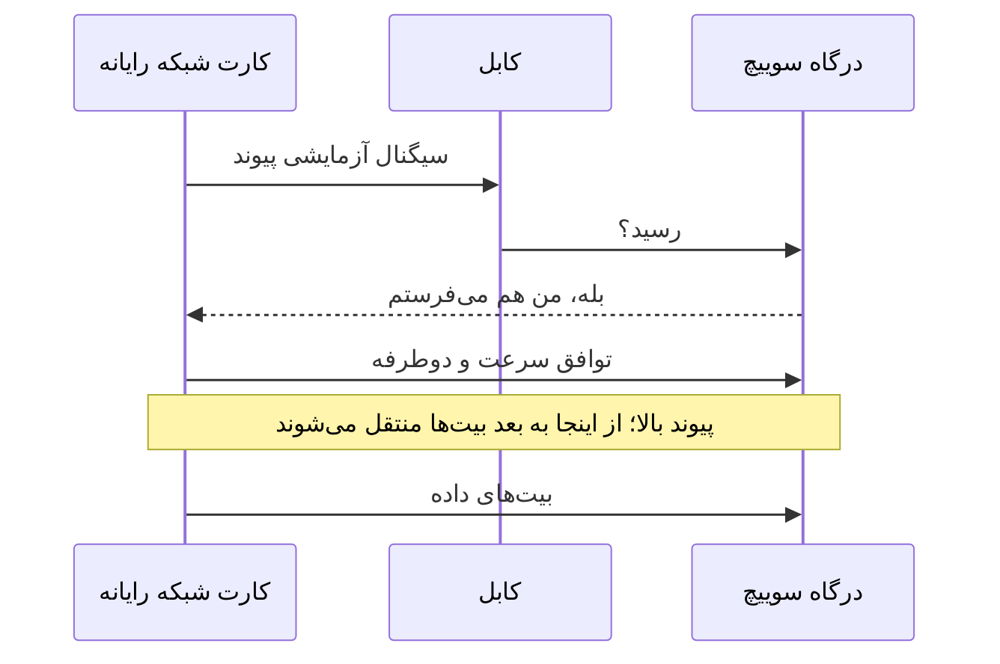

تصمیم‌ها در لایه فیزیکی:

1. سیگنال رسید؟ ← نه: «پایین/پایین».
2. سرعت و دوطرفه به توافق رسیدند؟ ← نه: پایین یا پرخطا.
3. درگاه ادمین‌شده خاموش نیست؟ ← اگر هست: «خاموش اداری».

---

## ۱۱. راستی‌آزمایی

| آنچه می‌خواهم اثبات کنم | دستور | چه چیزی نشان می‌دهد |
|---|---|---|
| همهٔ درگاه‌ها بالا هستند | `show ip interface brief` | ستون‌های Status و Protocol |
| سرعت و دوطرفه چیست و دستی است یا خودکار | `show interfaces status` | ستون‌های Duplex و Speed و پیشوند `a-` |
| برچسب‌ها درست‌اند | `show interfaces status` | ستون Name |
| سیم خراب است یا نه | `show interfaces fastethernet 0/1` | شمارنده‌ها |
| درگاه خاموش اداری شده | `show interfaces status` | `disabled` |
| تنظیمات ذخیره شده | `show startup-config` | مقایسه با تنظیمات زنده |

---

## ۱۲. عیب‌یابی و بازگردانی

### ۱۲.۱ ترتیب بررسی

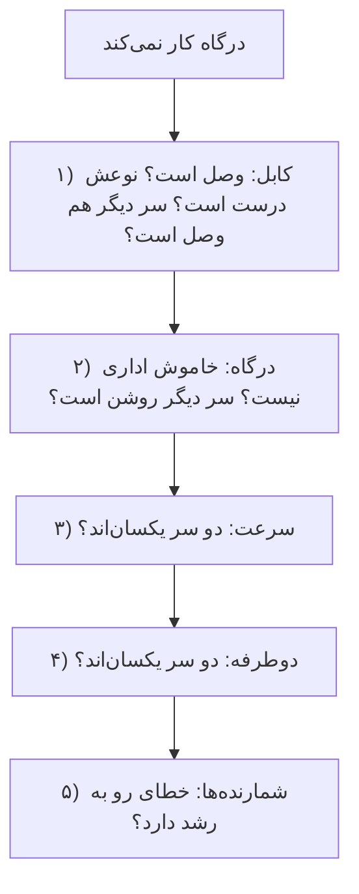

| گام | چه چیزی را می‌پرسم | دستور یا مشاهده | نشانه عیب | اقدام |
|---|---|---|---|---|
| ۱ | کابل وصل و از نوع درست است؟ | نقطه رنگی؛ `show interfaces status` | بدون نقطه؛ قرمز؛ `notconnect` | سیم را بزن یا نوعش را اصلاح کن |
| ۲ | درگاه خاموش اداری نیست؟ | `show ip interface brief` | `administratively down` | `no shutdown` |
| ۳ | سرعت دو سر یکی است؟ | `show interfaces status` | ستون Speed متفاوت یا `notconnect` | هر دو `auto` یا هر دو دستی و یکسان |
| ۴ | دوطرفه بودن دو سر یکی است؟ | `show interfaces status` | یکی `full`، دیگری `half` | هماهنگ کن |
| ۵ | خطا در حال رشد است؟ | `show interfaces ...` | سی‌آر‌سی، برخورد دیرهنگام | سیم، نویز، دوطرفه |

**دو خطای رایج:**

1. **دستور درست در اتاق اشتباه** (مثلاً `speed 100` در اتاق تنظیمات کلی): پیام `Invalid input`.
2. **فراموشی ذخیره‌کردن:** بعد از خاموش و روشن شدن، همه چیز به حالت قبل برمی‌گردد.

### ۱۲.۲ بازگردانی

- برگرداندن هر تنظیم با `no`؛
- بازگشت به فایل `v1`؛
- پاک‌سازی کامل فقط با هشدار و پس از ذخیره نسخهٔ پشتیبان (`erase startup-config`، سپس `reload`) که در L04 دیده‌ای.

---

## ۱۳. نکته امنیتی

این درس هشدار ثابت امنیتی لازم ندارد، چون از حمله صحبت نمی‌کند. ولی یک
اصل ساده دارد: **هر درگاه خالی یک در باز است.** هر کسی که سیمی به آن
وصل کند، وارد شبکه می‌شود.

- درگاه‌های بلااستفاده را با `shutdown` ببند؛
- هر درگاه را با `description` برچسب بزن تا بفهمی چه چیزی به آن وصل است؛
- سیم‌کشی سازمان را در اتاق قفل‌دار نگه‌دار.

**آزمون مجدد:** با `show interfaces status` ببین همهٔ درگاه‌های خالی `disabled`
هستند. محافظت‌های هوشمندتر در L29 می‌آید.

---

## ۱۴. دفترچه آزمایش (قالب)

```text
عنوان آزمایش:
شناسه درس: L05
تاریخ و زمان:
نویسنده:
نقش سازمانی: کارآموز شبکه

1. هدف
2. دستگاه‌ها و نقشه آزمایش
3. جدول آدرس‌دهی (این درس: ندارد)
4. پیش‌نیازها و نسخه پکت تریسر
5. تنظیمات انجام‌شده (به تفکیک دستگاه)
6. روش راستی‌آزمایی (کدام دستور نمایشی، چه چیزی را اثبات می‌کند)
7. شواهد (خروجی‌ها و تصویر صفحه با توضیح)
8. تحلیل و تفسیر شواهد
9. خطاها و روش رفع آن‌ها
10. نتیجه و محدودیت‌ها
11. ریسک یا نکته امنیتی
12. روش آزمون مجدد
13. وضعیت نهایی
14. پیوست‌ها
```

---
## ۱۵. تمرین‌ها (۹ تمرین، با پاسخ)

> **قاعده:** در هر تمرین ابتدا خودت فکر کن و پاسخت را زیر جملهٔ
> «پاسخ و خروجی خودت رو اینجا بنویس» بنویس. بعد پاسخ مدرس را ببین و با
> «چرا»ی هر مورد مقایسه کن. تمرین‌های ۲، ۳، ۷ و ۹ **زبان فرمان** هستند.

---

### تمرین ۱ — انتخاب کابل مسی (سطح: ساده)

**سناریو:** در شرکت «آرمان‌داده» تو کارآموز شبکه‌ای و فهرست اتصال‌های زیر را
باید آماده کنی. برای هر اتصال نوع کابل را بنویس. فرض کن تشخیص خودکار نوع
کابل **فعال نیست**.

| ردیف | دو سر اتصال |
|---|---|
| الف | رایانه فروش ↔ سوییچ اتاق فروش |
| ب | سوییچ اتاق فروش ↔ سوییچ اتاق مالی |
| پ | روتر ↔ سوییچ اتاق فروش |
| ت | روتر مرکزی ↔ روتر شعبه |
| ث | رایانه مدیر ↔ روتر (برای آزمایش مستقیم) |
| ج | دو رایانه کنار هم برای انتقال فایل، بدون سوییچ |
| چ | نقطه دسترسی بی‌سیم ↔ سوییچ اتاق فروش |
| ح | رایانه مدیر شبکه ↔ پورت کنسول سوییچ |

**پاسخ و خروجی خودت رو اینجا بنویس**

#### ✅ پاسخ

| ردیف | کابل | دلیل |
|---|---|---|
| الف | مستقیم | رایانه گروه اول، سوییچ گروه دوم |
| ب | متقاطع | سوییچ با سوییچ، هر دو گروه دوم |
| پ | مستقیم | روتر گروه اول، سوییچ گروه دوم |
| ت | متقاطع | روتر با روتر، هر دو گروه اول |
| ث | متقاطع | رایانه با روتر، هر دو گروه اول |
| ج | متقاطع | رایانه با رایانه |
| چ | مستقیم | نقطه دسترسی مثل رایانه (گروه اول) |
| ح | کنسول (رول‌اور) | کابل مدیریتی، نه داده‌ای |

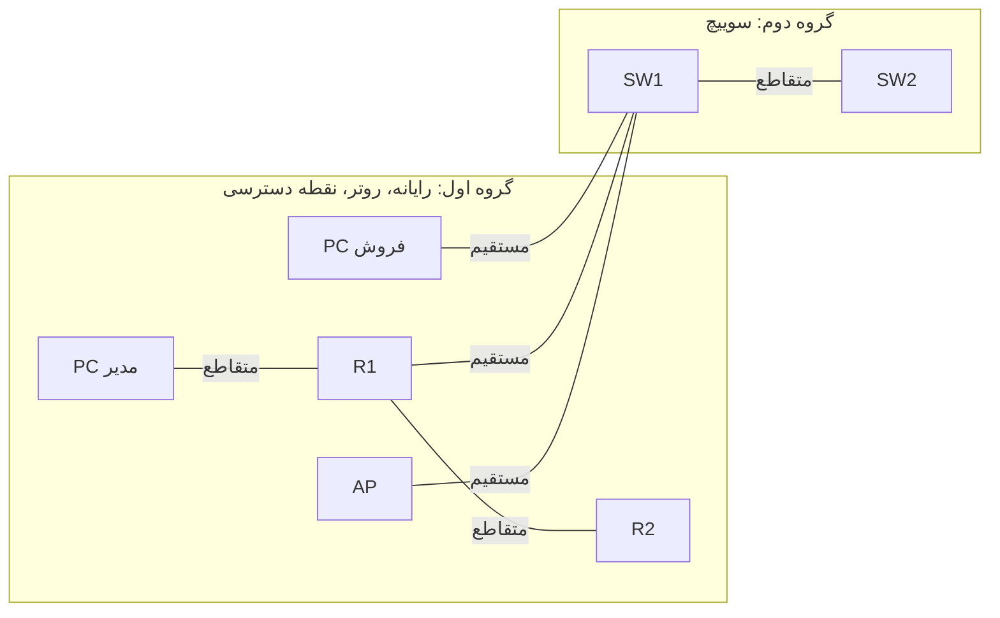

**قانون:** دو گروه مختلف ← مستقیم؛ هم‌گروه ← متقاطع.

---

### تمرین ۲ — دستور را به جمله انسانی ترجمه کن (زبان فرمان)

هر دستور را به یک جمله محاوره‌ای تبدیل کن.

```text
1.  interface range fastethernet 0/5 - 8
2.  speed 10
3.  duplex half
4.  no shutdown
5.  show interfaces status
6.  no speed
```

**پاسخ و خروجی خودت رو اینجا بنویس**

#### ✅ پاسخ

| شماره | جمله انسانی |
|---|---|
| ۱ | «درگاه‌های فست‌اترنت ۵ تا ۸ رو یک‌جا بگیر که هر چی بعدش می‌گم برای هر چهارتا اجرا شه.» |
| ۲ | «سرعت این درگاه رو دستی بذار روی ۱۰ مگابیت.» |
| ۳ | «این درگاه رو یک‌طرفه کن؛ نوبتی حرف بزنه.» |
| ۴ | «برعکسِ خاموش کردن؛ یعنی روشنش کن.» |
| ۵ | «جدول فشرده وضعیت همه درگاه‌ها رو نشونم بده.» |
| ۶ | «برعکس تنظیم سرعت؛ دیگه دستی نباشه، بسپار به تشخیص خودکار.» |

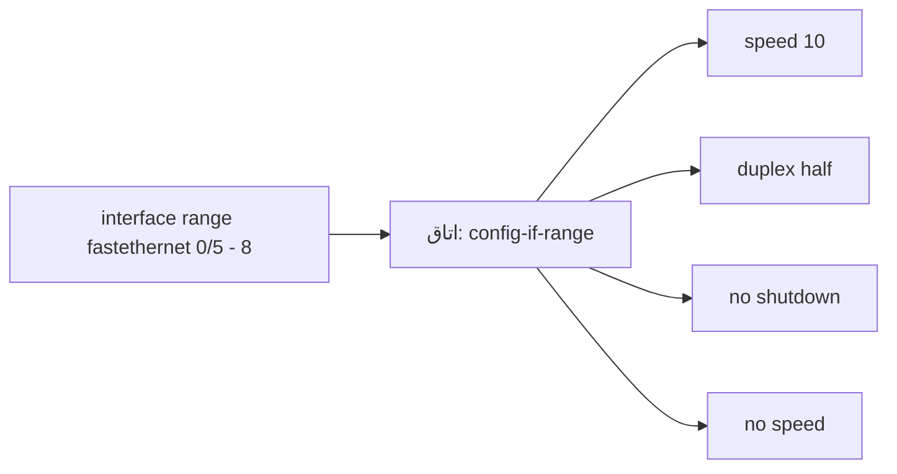

**نکته:** دستورهای ۲ تا ۴ و ۶ فقط داخل اتاق درگاه یا اتاق چند درگاه معنی
دارند. دستور ۵ از اتاق مدیر زده می‌شود (یا با پیشوند `do` از اتاق تنظیمات).

---

### تمرین ۳ — جمله انسانی را به دستور تبدیل کن (زبان فرمان)

برای هر جمله دستور مناسب و اتاقی که باید در آن باشی را بنویس.

1. «درگاه‌های فست‌اترنت ۱۰ تا ۱۳ رو یک‌جا بگیر.»
2. «روی همه‌شون سرعت رو دستی بذار روی ۱۰۰.»
3. «همه‌شون رو دوطرفه کن.»
4. «درگاه ۲۰ رو خاموش کن.»
5. «برای درگاه ۲۱ برچسب `Accounting-PC` بذار.»
6. «از همین‌جا که توی اتاق تنظیمات هستم، جدول وضعیت درگاه‌ها رو نشونم بده.»

**پاسخ و خروجی خودت رو اینجا بنویس**

#### ✅ پاسخ

| شماره | دستور | اتاق پیش از دستور |
|---|---|---|
| ۱ | `interface range fastethernet 0/10 - 13` | `SW1(config)#` |
| ۲ | `speed 100` | `SW1(config-if-range)#` |
| ۳ | `duplex full` | `SW1(config-if-range)#` |
| ۴ | `interface fastethernet 0/20` سپس `shutdown` | از `SW1(config)#` به `SW1(config-if)#` |
| ۵ | `interface fastethernet 0/21` سپس `description Accounting-PC` | `SW1(config-if)#` |
| ۶ | `do show interfaces status` | `SW1(config)#` |

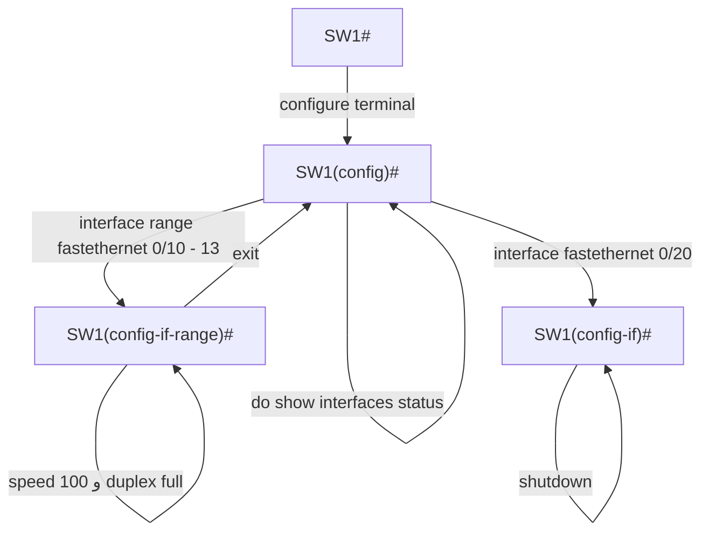

**چرا؟** هر دستور در یک اتاق خاص معنی دارد. اگر `speed 100` را در
`SW1(config)#` بزنی، پیام `Invalid input` می‌گیری.

---

### تمرین ۴ — اتاق‌یاب درگاه: خواندن `show ip interface brief` (سطح: متوسط)

دو خروجی نمونه از اتاق فروش (نمونه آموزشی، نه خروجی واقعی).

```text
SW1#show ip interface brief
Interface              IP-Address      OK? Method Status                Protocol
FastEthernet0/1        unassigned      YES unset  up                    up
FastEthernet0/2        unassigned      YES unset  down                  down
FastEthernet0/3        unassigned      YES unset  administratively down down
FastEthernet0/4        unassigned      YES unset  up                    up
FastEthernet0/5        unassigned      YES unset  up                    down
GigabitEthernet0/1     unassigned      YES unset  up                    up
GigabitEthernet0/2     unassigned      YES unset  down                  down
Vlan1                  unassigned      YES unset  administratively down down
```

```text
R1#show ip interface brief
Interface              IP-Address      OK? Method Status                Protocol
GigabitEthernet0/0     unassigned      YES unset  up                    up
GigabitEthernet0/1     unassigned      YES unset  administratively down down
```

**کار شما:** برای هر ردیف بگو: وضعیت چیست؟ مشکلی هست؟ علت احتمالی؟ دستور بعدی؟
(ستون‌های آدرس و روش را نادیده بگیر. ردیف `Vlan1` هم فعلاً کنار.)
اگر هر دو سر لب مثل جدول اتصال ۸.۳ باشد، `Gi0/1` سوییچ به `Gi0/0` روتر وصل است.

**پاسخ و خروجی خودت رو اینجا بنویس**

#### ✅ پاسخ

| دستگاه و درگاه | وضعیت | مشکل؟ | علت احتمالی | دستور بعدی |
|---|---|---|---|---|
| SW1 Fa0/1 | بالا/بالا | خیر | — | `show interfaces status` برای دیدن سرعت و دوطرفه |
| SW1 Fa0/2 | پایین/پایین | بله | سیم نیست یا سر دیگر خاموش یا سرعت دستی ناسازگار | `show interfaces status` (انتظار `notconnect`)، بررسی سیم |
| SW1 Fa0/3 | خاموش اداری | بله (اگر قرار است استفاده شود) | کسی `shutdown` زده | `interface fastethernet 0/3` سپس `no shutdown` |
| SW1 Fa0/4 | بالا/بالا | خیر ظاهراً | — | بررسی سرعت و دوطرفه، چون این جدول آن‌ها را نشان نمی‌دهد |
| SW1 Fa0/5 | بالا/پایین | بله | سیگنال هست ولی لایه دو مشکل دارد (در اترنت کمیاب) | `show interfaces fastethernet 0/5` و بررسی سر دیگر |
| SW1 Gi0/1 | بالا/بالا | خیر | — | — |
| SW1 Gi0/2 | پایین/پایین | شاید | اگر قرار است خالی بماند طبیعی است | اگر قرار است استفاده شود: سیم |
| SW1 Vlan1 | خاموش اداری | نادیده | مربوط به L12 | — |
| R1 Gi0/0 | بالا/بالا | خیر | — | — |
| R1 Gi0/1 | خاموش اداری | بله (اگر قرار است به R2 وصل باشد) | درگاه روتر پیش‌فرض خاموش است | `no shutdown` |

```mermaid
flowchart TD
    A["یک ردیف را بخوان"] --> B{"ستون Status چیست؟"}
    B -- "administratively down" --> C["ادمین خاموش کرده: no shutdown"]
    B -- "down" --> D["مشکل فیزیکی: سیم، سر دیگر، سرعت"]
    B -- "up" --> E{"ستون Protocol چیست؟"}
    E -- "up" --> F["سالم؛ سرعت و دوطرفه را جداگانه ببین"]
    E -- "down" --> G["مشکل لایه دو؛ show interfaces"]
```

**نکتهٔ مهم:** `show ip interface brief` **نمی‌گوید** سرعت و دوطرفه چیست.
بنابراین «بالا/بالا» بودن همیشه یعنی سالم نیست؛ فقط یعنی «هیچ عیب
بدیهی ندارد». برای سرعت و دوطرفه سراغ `show interfaces status` برو.

---

### تمرین ۵ — مس یا فیبر؟ و برق از کابل (سطح: متوسط)

**الف) انتخاب کابل.** برای هر مورد مس، فیبر چندمد یا فیبر تک‌مد بنویس:

1. رایانه تا سوییچ، همان اتاق، ۲۵ متر.
2. ساختمان اداری تا ساختمان انبار در محوطه، ۳۰۰ متر.
3. شعبه اصلی تا شعبه شهر دیگر، ۱۵ کیلومتر.
4. دو سوییچ در یک طبقه با ۱۳۰ متر فاصله.
5. سالن تولید پر از موتورهای برقی قوی (نویز زیاد)، ۶۰ متر.

**ب) بودجه برق.** سوییچ مجهز به برق از کابل، بودجه کل **۳۷۰ وات** دارد.
چهار نقطه دسترسی ۳۰ واتی و شش تلفن آی‌پی ۱۵٫۴ واتی وصل شده‌اند. آیا بودجه
کافی است؟ چند دوربین ۳۰ واتی دیگر می‌شود وصل کرد؟ و اگر یک رایانه معمولی
به درگاه مجهز به برق وصل شود چه می‌شود؟

**پاسخ و خروجی خودت رو اینجا بنویس**

#### ✅ پاسخ

**الف)**

| مورد | انتخاب | دلیل |
|---|---|---|
| ۱ | مس | کمتر از ۱۰۰ متر، ارزان |
| ۲ | فیبر چندمد | بیش از ۱۰۰ متر ولی چند صد متر |
| ۳ | فیبر تک‌مد | چند کیلومتر |
| ۴ | فیبر چندمد | ۱۳۰ متر از حد مس بیشتر است |
| ۵ | فیبر | در برابر نویز برقی مصون است |

```mermaid
flowchart TD
    Q["فاصله و محیط"] --> A{"کمتر از ۱۰۰ متر و بدون نویز؟"}
    A -- "بله" --> M["مس (مورد ۱)"]
    A -- "نه" --> N{"نویز زیاد یا بیشتر از ۱۰۰ متر؟"}
    N -- "چند صد متر" --> C["چندمد (مورد ۲ و ۴ و ۵)"]
    N -- "چند کیلومتر" --> S["تک‌مد (مورد ۳)"]
```

**ب)**

- نقاط دسترسی: ۴ × ۳۰ = ۱۲۰ وات
- تلفن‌ها: ۶ × ۱۵٫۴ = ۹۲٫۴ وات
- جمع فعلی: ۲۱۲٫۴ وات
- باقی‌مانده: ۳۷۰ − ۲۱۲٫۴ = ۱۵۷٫۶ وات
- دوربین ۳۰ واتی: ۱۵۷٫۶ ÷ ۳۰ ≈ ۵٫۲۵ ← **حداکثر ۵ دوربین**

```mermaid
pie title "تقسیم بودجه ۳۷۰ واتی"
    "نقطه دسترسی" : 120
    "تلفن" : 92.4
    "پنج دوربین" : 150
    "باقی‌مانده" : 7.6
```

بله، بودجه کافی است. رایانه معمولی برق نمی‌گیرد، چون سوییچ ابتدا با یک
ولتاژ کم بررسی می‌کند که آن سر «دستگاه برق‌گیر» هست یا نه؛ اگر نبود برقی
نمی‌فرستد و رایانه سالم می‌ماند.

> این محاسبه بر اساس **بیشترین توان رزروشده** برای هر درگاه است. مصرف
> واقعی ممکن است کمتر باشد. در پکت تریسر کنترل دقیق این بودجه مفهومی و
> **نیازمند راستی‌آزمایی** است.

---

### تمرین ۶ — پیش‌بینی ناسازگاری سرعت و دوطرفه (سطح: متوسط)

برای هر ردیف بگو پیوند چه می‌شود: سالم / بالا ولی پراشکال / پایین.

| ردیف | سر الف | سر ب |
|---|---|---|
| ۱ | خودکار | خودکار |
| ۲ | دستی ۱۰۰ و دوطرفه | دستی ۱۰۰ و دوطرفه |
| ۳ | دستی ۱۰۰ و دوطرفه | خودکار |
| ۴ | دستی ۱۰۰ | دستی ۱۰ |
| ۵ | دستی ۱۰۰ و دوطرفه | دستی ۱۰۰ و یک‌طرفه |
| ۶ | خودکار | دستی ۱۰ و یک‌طرفه |

سپس بگو در ردیف ۳ هر طرف چه شمارنده‌ای را نشان می‌دهد و چطور از روی
`show interfaces status` متوجه می‌شوی.

**پاسخ و خروجی خودت رو اینجا بنویس**

#### ✅ پاسخ

| ردیف | نتیجه | توضیح |
|---|---|---|
| ۱ | سالم | بهترین حالت مشترک |
| ۲ | سالم | دو سر دستی و یکسان |
| ۳ | بالا ولی پراشکال | سر خودکار سرعت را می‌فهمد ولی دوطرفه را یک‌طرفه فرض می‌کند |
| ۴ | پایین | سرعت‌ها نمی‌خوانند |
| ۵ | بالا ولی پراشکال | ناسازگاری دوطرفه |
| ۶ | سالم (ولی کند) | سر خودکار سرعت ۱۰ را حس می‌کند و یک‌طرفه را انتخاب می‌کند؛ هر دو یک‌طرفه‌اند |

```mermaid
flowchart LR
    subgraph L["سر الف: دستی دوطرفه"]
      L1["هر وقت بخواهد می‌فرستد"]
      L2["شمارنده: سی‌آر‌سی و فریم کوتوله"]
    end
    subgraph R["سر ب: خودکار، نتیجه: یک‌طرفه"]
      R1["اگر همزمان دریافت کند، برخورد می‌شمارد"]
      R2["شمارنده: برخورد و برخورد دیرهنگام"]
    end
    L1 --> R1
    R1 --> R2
    L1 --> L2
```

**چطور بفهمیم؟** `show interfaces status` را از هر دو سر بگیر:

```text
سر الف:  Fa0/1  to-SW2  connected  1  full    100
سر ب:    Fa0/7  to-SW1  connected  1  a-half  a-100
```

```text
ترجمه: سر الف دستی و دوطرفه است (بدون a-)، سر ب خودش به «یک‌طرفه» رسیده
(با a-). دو سر ناهمخوان‌اند؛ باید یکی را اصلاح کنی.
```

**اصلاح:** هر دو `auto` (دستور `no speed` و `no duplex`) یا هر دو دستی و
یکسان (`speed 100` و `duplex full`).

---

### تمرین ۷ — مترجم خطا و گفتگوی ناقص (زبان فرمان)

**الف) خطای زیر را بخوان و بگو دستگاه چه چیزی را نفهمیده.**

```text
(1)  SW1(config)#speed 100
                 ^
     % Invalid input detected at '^' marker.

(2)  SW1(config-if)#duplex
     % Incomplete command.

(3)  SW1(config-if)#shutdown now
                             ^
     % Invalid input detected at '^' marker.
```

**ب) گفتگوی ناقص را کامل کن:**

```text
شما:      no shutdown
دستگاه:   «no» یعنی ______ .
          «shutdown» یعنی ______ .
          پس این درگاه رو ______ .
```

```text
شما:      interface range fastethernet 0/4 - 8
دستگاه:   «interface» یعنی درگاه؛ «range» یعنی ______ .
          از فست‌اترنت ۰/۴ تا ______ رو یک‌جا می‌گیرم.
          نشانه جلوی خط می‌شه ______ .
```

**پاسخ و خروجی خودت رو اینجا بنویس**

#### ✅ پاسخ

**الف)**

1. «`speed` رو توی اتاقی که ایستادی نمی‌فهمم.» تو در اتاق تنظیمات کلی هستی؛ باید اول به اتاق درگاه بروی.
2. «جمله‌ات ناقصه.» گفتی «دوطرفه بودن» ولی نگفتی `full` یا `half` یا `auto`.
3. «بعد از `shutdown` کلمه اضافی گفتی.» این دستور هیچ قید دیگری نمی‌گیرد؛ علامت ^ زیر کلمهٔ اضافه است.

**ب)**

```text
شما:      no shutdown
دستگاه:   «no» یعنی برعکسش کن.
          «shutdown» یعنی خاموش کن.
          پس این درگاه رو روشن می‌کنم.
```

```text
شما:      interface range fastethernet 0/4 - 8
دستگاه:   «interface» یعنی درگاه؛ «range» یعنی چندتا پشت هم.
          از فست‌اترنت ۰/۴ تا ۰/۸ رو یک‌جا می‌گیرم.
          نشانه جلوی خط می‌شه SW1(config-if-range)# .
```

```mermaid
flowchart LR
    A["اتاق تنظیمات: SW1(config)#"] -- "interface range fastethernet 0/4 - 8" --> B["اتاق چند درگاه: SW1(config-if-range)#"]
    B -- "no shutdown" --> C["هر پنج درگاه روشن"]
```

---

### تمرین ۸ — ترتیب عیب‌یابی (سطح: متوسط)

سه درگاه از اتاق فروش مشکل دارند. برای هر مورد بگو: عیب در کدام گام «کابل ←
درگاه ← سرعت ← دوطرفه» است، چه دستوری راست‌آزمایی می‌کند و چطور رفع می‌شود.

**مورد A:** نقطهٔ PC3 قرمز است. وضعیت درگاه: `Fa0/3  to-PC3  notconnect`.
جدول اتصال می‌گوید بین PC3 و SW1 کابل **متقاطع** کشیده شده است (در یک لب
بدون تشخیص خودکار).

**مورد B:** چاپگر کار نمی‌کند. وضعیت درگاه: `Fa0/6  to-Printer  disabled`.

**مورد C:** رایانهٔ PC7 کند است. `Fa0/7  to-PC7  connected  1  full  100` و
کارت شبکه PC7 می‌گوید «۱۰۰ مگابیت، یک‌طرفه».

**پاسخ و خروجی خودت رو اینجا بنویس**

#### ✅ پاسخ

| مورد | گام | شاهد | رفع |
|---|---|---|---|
| A | ۱ (کابل) | `notconnect`، قرمز، کابل متقاطع بین رایانه و سوییچ | کابل را با **مستقیم** عوض کن؛ دوباره `show interfaces status` |
| B | ۲ (درگاه) | `disabled` | `interface fastethernet 0/6` سپس `no shutdown`؛ بعد `write memory` |
| C | ۴ (دوطرفه) | سوییچ دستی `full`، رایانه خودکار و رسیده به یک‌طرفه | روی سوییچ `no speed` و `no duplex` (هر دو سر خودکار)، یا رایانه را روی دوطرفه دستی بگذار |

```mermaid
flowchart TD
    A["مورد A: notconnect"] --> S1["گام ۱: کابل"]
    B["مورد B: disabled"] --> S2["گام ۲: درگاه"]
    C["مورد C: full در سوییچ، half در رایانه"] --> S4["گام ۴: دوطرفه"]
    S1 --> F1["تعویض کابل"]
    S2 --> F2["no shutdown"]
    S4 --> F4["no speed و no duplex"]
```

**چرا مورد C به ظاهر سالم است؟** چون درگاه بالا است و هیچ پیام خطایی نیست.
تنها سرنخ، **تفاوت ستون Duplex بین دو سر** است؛ و کندی.

---

### تمرین ۹ — خواندن شمارنده‌ها (زبان فرمان، تحلیل)

دو برش از `show interfaces` برای دو درگاه (نمونه آموزشی).

**درگاه Fa0/6:**

```text
  Full-duplex, 100Mb/s
  22 runts, 0 giants, 0 throttles
  4821 input errors, 4799 CRC, 22 frame, 0 overrun, 0 ignored
  0 output errors, 0 collisions, 3 interface resets
  0 late collision, 0 deferred
```

**درگاه Fa0/9:**

```text
  Half-duplex, 100Mb/s
  0 runts, 0 giants, 0 throttles
  0 input errors, 0 CRC, 0 frame, 0 overrun, 0 ignored
  2914 output errors, 2914 collisions, 0 interface resets
  311 late collision, 0 deferred
```

برای هر درگاه بگو: هر خط یعنی چه؟ مشکل چیست؟ حدس اول تو چیست؟ چه کاری انجام می‌دهی؟

**پاسخ و خروجی خودت رو اینجا بنویس**

#### ✅ پاسخ

**درگاه Fa0/6:**

```text
Full-duplex, 100Mb/s     = دوطرفه و ۱۰۰ مگابیت؛ ظاهراً هماهنگ
4799 CRC                 = ۴۷۹۹ فریم هنگام عبور خراب شد
22 runts                 = ۲۲ فریم کوچک‌تر از حد
0 collisions             = برخورد صفر
3 interface resets       = سه بار درگاه بالا و پایین شد
```

- **مشکل:** خطای سی‌آر‌سی بالا، بدون برخورد.
- **حدس اول:** مشکل فیزیکی: سیم خراب، سر کابل شل، نویز، یا کارت شبکه سمت مقابل.
- **اقدام:** سیم را تعویض کن، طول سیم را بررسی کن، دوباره شمارنده را بخوان و ببین رشد می‌کند یا نه.
- این **ناسازگاری دوطرفه نیست**، چون برخورد دیرهنگام نداریم.

**درگاه Fa0/9:**

```text
Half-duplex, 100Mb/s     = یک‌طرفه و ۱۰۰ مگابیت
2914 collisions          = برخورد زیاد (در یک‌طرفه کمی عادی است)
311 late collision       = برخورد دیرهنگام؛ این عادی نیست
```

- **مشکل:** برخورد دیرهنگام.
- **حدس اول:** ناسازگاری دوطرفه (سر مقابل دستی و دوطرفه) یا سیم بیش از حد بلند.
- **اقدام:** `show interfaces status` را از سر مقابل بگیر و ستون Duplex را مقایسه کن؛ هر دو سر را هماهنگ کن.

```mermaid
flowchart TD
    A["شمارنده را بخوان"] --> B{"برخورد دیرهنگام؟"}
    B -- "بله (Fa0/9)" --> C["ناسازگاری دوطرفه یا سیم بلند"]
    B -- "نه" --> D{"سی‌آر‌سی بالا؟"}
    D -- "بله (Fa0/6)" --> E["سیم، نویز، کارت شبکه"]
    D -- "نه" --> F["بررسی ادامه"]
```

> **یادآوری:** این ارقام نمونه آموزشی هستند. در پکت تریسر معمولاً همهٔ این
> شمارنده‌ها صفر می‌مانند (برچسب: جزئی).

---
## ۱۶. مینی‌پروژه‌ها (۶ پروژه، با پاسخ)

> دو پروژهٔ اول مبتدی، دو پروژهٔ بعدی متوسط و دو پروژهٔ آخر چالشی‌اند.
> پروژه‌های ۴ و ۶ **لب خراب** هستند: تنظیمات معیوب داده می‌شود و تو باید عیب
> را پیدا و رفع کنی. در همه‌جا آدرس‌دهی و وی‌لن ممنوع است.

---

### پروژه ۱ — مبتدی: راه‌اندازی اتاق فروش

**نقش:** کارآموز شبکه. **دستگاه‌ها:** SW1، R1، PC1، PC2، PC3.

**سناریو:** شرکت «آرمان‌داده» اتاق فروش جدیدی باز کرده است. سه رایانه و یک
روتر باید به سوییچ وصل شوند و هر درگاه برچسب داشته باشد.

**مأموریت:**

1. دستگاه‌ها را بچین و با نوع کابل درست وصل کن؛
2. نام دستگاه را `SW1` کن؛
3. به درگاه‌ها برچسب `to-PC1`، `to-PC2`، `to-PC3` و `to-R1` بزن؛
4. درگاه روتر را روشن کن؛
5. نشان بده همه‌چیز بالا است؛
6. ذخیره کن.

**خروجی مورد انتظار:** جدول کابل، تنظیمات و دو خروجی نمایشی.
**معیار موفقیت:** همهٔ اتصال‌ها بالا/بالا و هر درگاه دارای برچسب.

**پاسخ و خروجی خودت رو اینجا بنویس**

#### ✅ پاسخ

**جدول کابل:**

| از | درگاه | کابل | به | درگاه |
|---|---|---|---|---|
| PC1 | FastEthernet0 | مستقیم | SW1 | Fa0/1 |
| PC2 | FastEthernet0 | مستقیم | SW1 | Fa0/2 |
| PC3 | FastEthernet0 | مستقیم | SW1 | Fa0/3 |
| R1 | Gi0/0 | مستقیم | SW1 | Gi0/1 |

```mermaid
flowchart LR
    PC1["PC1"] -- "Fa0 ↔ Fa0/1" --- SW1["SW1"]
    PC2["PC2"] -- "Fa0 ↔ Fa0/2" --- SW1
    PC3["PC3"] -- "Fa0 ↔ Fa0/3" --- SW1
    SW1 -- "Gi0/1 ↔ Gi0/0" --- R1["R1"]
```

**تنظیمات SW1:**

```text
Switch>enable
Switch#configure terminal
Switch(config)#hostname SW1
SW1(config)#interface fastethernet 0/1
SW1(config-if)#description to-PC1
SW1(config-if)#interface fastethernet 0/2
SW1(config-if)#description to-PC2
SW1(config-if)#interface fastethernet 0/3
SW1(config-if)#description to-PC3
SW1(config-if)#interface gigabitethernet 0/1
SW1(config-if)#description to-R1
SW1(config-if)#end
SW1#write memory
```

**تنظیمات R1:**

```text
Router>enable
Router#configure terminal
Router(config)#hostname R1
R1(config)#interface gigabitethernet 0/0
R1(config-if)#description to-SW1
R1(config-if)#no shutdown
R1(config-if)#end
R1#write memory
```

**راستی‌آزمایی (نمونه انتظار، نه خروجی واقعی):**

```text
SW1#show interfaces status
Port      Name               Status       Vlan       Duplex  Speed Type
Fa0/1     to-PC1             connected    1          a-full  a-100 10/100BaseTX
Fa0/2     to-PC2             connected    1          a-full  a-100 10/100BaseTX
Fa0/3     to-PC3             connected    1          a-full  a-100 10/100BaseTX
Gi0/1     to-R1              connected    1          a-full  a-1000 10/100/1000BaseTX
```

```text
R1#show ip interface brief
Interface              IP-Address      OK? Method Status                Protocol
GigabitEthernet0/0     unassigned      YES unset  up                    up
```

**چرا درست است؟** سوییچ با رایانه و روتر از دو گروه مختلف است ← کابل مستقیم؛
درگاه روتر پیش‌فرض خاموش است ← `no shutdown` لازم بود؛ برچسب‌ها با `description`
گذاشته می‌شوند.

---

### پروژه ۲ — مبتدی: بستن درگاه‌های خالی

**نقش:** کارآموز شبکه. **دستگاه‌ها:** SW1 و PC1 تا PC3 از پروژه ۱.

**سناریو:** مدیر امنیت می‌گوید درگاه‌های خالی سوییچ نباید روشن بمانند.

**مأموریت:**

1. درگاه‌های فست‌اترنت ۴ تا ۲۴ را با یک دستور بگیر؛
2. به همه برچسب `unused` بزن؛
3. همه را خاموش اداری کن؛
4. نشان بده درگاه‌های ۱ تا ۳ همچنان سالم‌اند؛
5. فرض کن فردا کارمند جدیدی روی درگاه ۴ می‌آید: آن را دوباره باز کن و برچسب
   `to-PC4` بده؛
6. ذخیره کن.

**معیار موفقیت:** ۲۰ درگاه `disabled` و یک درگاه جدید آماده.

**پاسخ و خروجی خودت رو اینجا بنویس**

#### ✅ پاسخ

**تنظیمات:**

```text
SW1#configure terminal
SW1(config)#interface range fastethernet 0/4 - 24
SW1(config-if-range)#description unused
SW1(config-if-range)#shutdown
SW1(config-if-range)#end
SW1#write memory
```

**راستی‌آزمایی:**

```text
SW1#show interfaces status
```

انتظار: `Fa0/1` تا `Fa0/3` در حالت `connected`، و `Fa0/4` تا `Fa0/24` در
حالت `disabled` با برچسب `unused`.

**باز کردن درگاه ۴ (فردا):**

```text
SW1#configure terminal
SW1(config)#interface fastethernet 0/4
SW1(config-if)#description to-PC4
SW1(config-if)#no shutdown
SW1(config-if)#end
SW1#write memory
```

```mermaid
flowchart TD
    A["درگاه‌های ۴ تا ۲۴: روشن و بی‌صاحب"] -- "interface range ... shutdown" --> B["disabled با برچسب unused"]
    B -- "کارمند جدید: interface fastethernet 0/4" --> C["description to-PC4 و no shutdown"]
    C --> D["connected"]
```

**چرا درست است؟** `interface range` به‌جای ۲۱ بار تکرار، یک بار می‌گیرد؛
`shutdown` درگاه را خاموش اداری می‌کند؛ بعداً برای یک درگاه مشخص `no shutdown`
کافی است. **نکتهٔ امنیتی:** درگاه خالی و روشن در باز است.

---

### پروژه ۳ — متوسط: چاپگر قدیمی با سرعت ثابت

**نقش:** تکنسین شبکه. **دستگاه‌ها:** SW1، PC1، یک چاپگر.

**سناریو:** در بخش مالی یک چاپگر قدیمی فقط روی ۱۰ مگابیت و یک‌طرفه تنظیم شده
و کارت شبکه‌اش را نمی‌شود عوض کرد. درگاه متصل به آن مشکل دارد.

**مأموریت:**

1. چاپگر را به `Fa0/10` وصل کن و NIC چاپگر را روی ۱۰ و یک‌طرفه دستی بگذار؛
2. درگاه سوییچ را روی حالت خودکار بگذار و وضعیت را ببین و یادداشت کن؛
3. درگاه سوییچ را دستی روی `speed 100` و `duplex full` بگذار و وضعیت را ببین؛
4. بگو چرا حالت دوم مشکل می‌سازد؛
5. تنظیم درست را برای سوییچ بنویس و راستی‌آزمایی کن؛
6. ذخیره کن.

**خروجی:** جدول مقایسهٔ سه حالت و تنظیم نهایی.
**معیار موفقیت:** سوییچ و چاپگر هم‌سرعت و هم‌حالت و توضیح علت.

**پاسخ و خروجی خودت رو اینجا بنویس**

#### ✅ پاسخ

| حالت | سوییچ | چاپگر | نتیجهٔ مورد انتظار |
|---|---|---|---|
| ۱ | خودکار | دستی ۱۰ یک‌طرفه | سوییچ سرعت ۱۰ را حس می‌کند و یک‌طرفه را می‌گیرد: ردیف `a-half a-10`؛ **سالم ولی کند** |
| ۲ | دستی ۱۰۰ دوطرفه | دستی ۱۰ یک‌طرفه | سرعت‌ها نمی‌خوانند ← **پایین** (در پکت تریسر **نیازمند راستی‌آزمایی**) |
| ۳ | دستی ۱۰ یک‌طرفه | دستی ۱۰ یک‌طرفه | **سالم** و هماهنگ |

```mermaid
flowchart LR
    A["چاپگر: ۱۰ و یک‌طرفه (ثابت)"] --> B{"سوییچ چه؟"}
    B -- "خودکار" --> C["سالم: a-half a-10"]
    B -- "دستی ۱۰۰ دوطرفه" --> D["پایین: سرعت ناسازگار"]
    B -- "دستی ۱۰ یک‌طرفه" --> E["سالم و هماهنگ"]
```

**تنظیم پیشنهادی (ساده‌ترین، کم‌خطرترین):** سوییچ را روی «خودکار» نگه دار و
فقط برچسب بزن. اگر شرکت بخواهد هر دو سر دستی باشند:

```text
SW1#configure terminal
SW1(config)#interface fastethernet 0/10
SW1(config-if)#description to-Printer
SW1(config-if)#speed 10
SW1(config-if)#duplex half
SW1(config-if)#end
SW1#write memory
SW1#show interfaces status
```

انتظار: ردیف `Fa0/10` با `half` و `10` **بدون `a-`**، وضعیت `connected`.

**چرا؟** سوییچ دستی ۱۰۰ و دوطرفه، چاپگر ۱۰ و یک‌طرفه را نمی‌فهمد؛ سرعت‌ها
نمی‌خوانند. وقتی سوییچ «خودکار» باشد، سرعت را از سیگنال می‌فهمد و دوطرفه را
یک‌طرفه می‌گذارد؛ با چاپگری که یک‌طرفه است، همان درست است.

> **صداقت آزمایشگاهی:** رفتار دقیق «دستی در برابر خودکار» روی دستگاه چاپگر در
> پکت تریسر **نیازمند راستی‌آزمایی در نسخه نصب‌شده** است. نتیجه‌ای را که
> واقعاً دیدی در دفترچه بنویس، نه آنچه این‌جا آمده.

---

### پروژه ۴ — متوسط (لب خراب): چهار عیب در اتاق مالی

**نقش:** تکنسین عیب‌یاب. **دستگاه‌ها:** SW1، R1، PC1، PC2، PC3.

**سناریو:** صبح شنبه سه رایانه و روتر اتاق مالی کار نمی‌کنند. فایل ساخته‌شده
با تنظیمات زیر به تو داده شده است.

```text
SW1:
interface FastEthernet0/1
 description to-PC1
 shutdown
!
interface FastEthernet0/2
 description to-PC2
 speed 10
 duplex half
!
interface FastEthernet0/3
 description to-PC3
!
interface GigabitEthernet0/1
 description to-R1
```

```text
R1:
interface GigabitEthernet0/0
 description to-SW1
 shutdown
```

**اطلاعات لب:**

- PC1 با کابل مستقیم به `Fa0/1` وصل است.
- PC2 با کابل مستقیم به `Fa0/2` وصل است و کارت شبکه‌اش روی خودکار است.
- PC3 با کابل **متقاطع** به `Fa0/3` وصل است.
- R1 با کابل مستقیم به `Gi0/1` وصل است.

**مأموریت:** فهرست عیب‌ها را با ترتیب «کابل ← درگاه ← سرعت ← دوطرفه»
پیدا کن، رفع کن و ثابت کن همه بالا هستند.

**پاسخ و خروجی خودت رو اینجا بنویس**

#### ✅ پاسخ

| # | گام | درگاه | عیب | رفع |
|---|---|---|---|---|
| ۱ | کابل | Fa0/3 (PC3) | کابل متقاطع بین رایانه و سوییچ | تعویض با مستقیم |
| ۲ | درگاه | Fa0/1 (PC1) | `shutdown` | `no shutdown` |
| ۳ | درگاه | R1 Gi0/0 | `shutdown` | `no shutdown` |
| ۴ | سرعت / دوطرفه | Fa0/2 (PC2) | سوییچ دستی ۱۰ و یک‌طرفه در حالی که رایانه خودکار است؛ هم‌خوانی ضعیف | `no speed` و `no duplex` یا هماهنگ کردن دو سر |

```mermaid
flowchart TD
    S["لب خراب"] --> A["گام ۱ کابل: Fa0/3 کراس‌اور اشتباه"]
    S --> B["گام ۲ درگاه: Fa0/1 و R1 Gi0/0 خاموش اداری"]
    S --> C["گام ۳ و ۴ سرعت و دوطرفه: Fa0/2 دستی ۱۰ یک‌طرفه"]
    A --> FA["مستقیم بگذار"]
    B --> FB["no shutdown"]
    C --> FC["no speed و no duplex"]
```

**دستورهای رفع:**

```text
SW1#configure terminal
SW1(config)#interface fastethernet 0/1
SW1(config-if)#no shutdown
SW1(config-if)#interface fastethernet 0/2
SW1(config-if)#no speed
SW1(config-if)#no duplex
SW1(config-if)#end
SW1#write memory
```

```text
R1#configure terminal
R1(config)#interface gigabitethernet 0/0
R1(config-if)#no shutdown
R1(config-if)#end
R1#write memory
```

در لب، کابل PC3 را به کابل **مستقیم** تعویض کن.

**راستی‌آزمایی (نمونهٔ انتظار):**

```text
SW1#show interfaces status
Fa0/1   to-PC1   connected  1  a-full  a-100
Fa0/2   to-PC2   connected  1  a-full  a-100
Fa0/3   to-PC3   connected  1  a-full  a-100
Gi0/1   to-R1    connected  1  a-full  a-1000
```

```text
R1#show ip interface brief
GigabitEthernet0/0     unassigned      YES unset  up                    up
```

**استدلال:** از کابل شروع کردیم چون ارزان‌ترین و بدیهی‌ترین بررسی است. سپس
درگاه‌های خاموش، و در آخر سرعت و دوطرفه.

---

### پروژه ۵ — چالشی: اتصال دو روتر و سوییچ

**نقش:** مهندس شبکه. **دستگاه‌ها:** SW1، R1، R2، PC1، PC2.

**سناریو:** «آرمان‌داده» شعبهٔ دوم باز کرده است. R2 در شعبه است و باید با R1
وصل شود. هر روتر به یک سوییچ یا رایانه دارد.

**مأموریت:**

1. جدول اتصال کامل (دستگاه، درگاه، نوع کابل) را طراحی کن؛
2. نام دستگاه‌ها و برچسب درگاه‌ها را بده؛
3. درگاه‌های لازم روتر را روشن کن؛
4. نشان بده همه پیوندها بالا/بالا هستند؛
5. سرعت پیوند بین دو روتر را به‌صورت دستی روی ۱۰۰ و دوطرفه بگذار و دو سر را
   هماهنگ کن (در درگاه‌هایی که پشتیبانی می‌کنند)؛
6. گزارش دفترچه آزمایش بنویس.

**معیار موفقیت:** همه پیوندها بالا/بالا، پیوند بین روترها دستی و هماهنگ.

**پاسخ و خروجی خودت رو اینجا بنویس**

#### ✅ پاسخ

**جدول اتصال:**

| از | درگاه | کابل | به | درگاه |
|---|---|---|---|---|
| PC1 | FastEthernet0 | مستقیم | SW1 | Fa0/1 |
| PC2 | FastEthernet0 | مستقیم | SW1 | Fa0/2 |
| SW1 | Gi0/1 | مستقیم | R1 | Gi0/0 |
| R1 | Gi0/1 | **متقاطع** | R2 | Gi0/1 |

```mermaid
flowchart LR
    PC1["PC1"] -- "مستقیم" --- SW1["SW1"]
    PC2["PC2"] -- "مستقیم" --- SW1
    SW1 -- "مستقیم" --- R1["R1"]
    R1 -- "متقاطع" --- R2["R2"]
```

**تنظیمات R1:**

```text
R1#configure terminal
R1(config)#interface gigabitethernet 0/0
R1(config-if)#description to-SW1
R1(config-if)#no shutdown
R1(config-if)#interface gigabitethernet 0/1
R1(config-if)#description to-R2
R1(config-if)#speed 100
R1(config-if)#duplex full
R1(config-if)#no shutdown
R1(config-if)#end
R1#write memory
```

**تنظیمات R2:**

```text
R2#configure terminal
R2(config)#interface gigabitethernet 0/1
R2(config-if)#description to-R1
R2(config-if)#speed 100
R2(config-if)#duplex full
R2(config-if)#no shutdown
R2(config-if)#end
R2#write memory
```

**تنظیمات SW1:**

```text
SW1#configure terminal
SW1(config)#interface fastethernet 0/1
SW1(config-if)#description to-PC1
SW1(config-if)#interface fastethernet 0/2
SW1(config-if)#description to-PC2
SW1(config-if)#interface gigabitethernet 0/1
SW1(config-if)#description to-R1
SW1(config-if)#end
SW1#write memory
```

**راستی‌آزمایی (نمونه انتظار):**

```text
R1#show ip interface brief
GigabitEthernet0/0     unassigned      YES unset  up                    up
GigabitEthernet0/1     unassigned      YES unset  up                    up
```

```text
R2#show ip interface brief
GigabitEthernet0/1     unassigned      YES unset  up                    up
```

**نکات استدلال:**

- پیوند روتر به روتر از یک گروه است ← کابل متقاطع.
- اگر یک سر را دستی بگذاری و سر دیگر را فراموش کنی، پیوند ناسازگار می‌شود؛ پس **هر دو سر** تنظیم شد.
- اگر در درگاه‌های جیگابیت روی نسخه شما `speed 100` قابل قبول نبود، هماهنگی را روی `auto` بگذار. این **نیازمند راستی‌آزمایی در نسخه نصب‌شده** است.
- بدون آدرس‌دهی هنوز بین شعبه‌ها پیام نمی‌رود؛ آن بحث L06 است.

---

### پروژه ۶ — چالشی (لب خراب): عیب‌های پنهان

**نقش:** مهندس شبکه. **دستگاه‌ها:** SW1، R1، R2، PC1 تا PC3.

**سناریو:** کارمند قبلی لب را ترک کرده و فقط جدول زیر از او باقی مانده است.
هر ردیف باید طبق جدول «درست» باشد. پنج عیب پنهان وجود دارد؛ بعضی فقط با مقایسهٔ
**جدول مورد انتظار** و **خروجی‌ها** پیدا می‌شوند.

| درگاه | مورد انتظار |
|---|---|
| SW1 Fa0/1 | برچسب `to-PC1`، سالم، خودکار |
| SW1 Fa0/2 | برچسب `to-PC2`، سالم، خودکار |
| SW1 Fa0/3 | برچسب `to-PC3`، سالم، خودکار |
| SW1 Gi0/1 | برچسب `to-R1`، سالم |
| R1 Gi0/1 ↔ R2 Gi0/1 | سالم، هر دو سر خودکار |

**خروجی‌های فعلی:**

```text
SW1#show interfaces status
Port      Name               Status       Vlan       Duplex  Speed Type
Fa0/1     to-PC1             connected    1          a-full  a-100 10/100BaseTX
Fa0/2     to-PC3             connected    1          a-full  a-100 10/100BaseTX
Fa0/3     to-PC3             connected    1          half    10    10/100BaseTX
Gi0/1     to-R1              connected    1          a-full  a-1000 10/100/1000BaseTX
```

```text
R1#show ip interface brief
GigabitEthernet0/0     unassigned      YES unset  up                    up
GigabitEthernet0/1     unassigned      YES unset  administratively down down
```

```text
R2#show ip interface brief
GigabitEthernet0/1     unassigned      YES unset  administratively down down
```

اطلاع اضافه: کابل بین R1 و R2 از نوع **مستقیم** است (لب بدون تشخیص
خودکار). توجه کن که حتی با رفع خاموش اداری، تا کابل درست نشود پیوند بالا نمی‌آید. در `SW1` دستور `speed 10` و `duplex half` روی `Fa0/3` به‌صورت
دستی داده شده است.

**مأموریت:** پنج عیب را پیدا کن، دلیل و رفع هر کدام را بنویس، و آزمون مجدد
بزن.

**پاسخ و خروجی خودت رو اینجا بنویس**

#### ✅ پاسخ

| # | عیب | شاهد | گام | رفع |
|---|---|---|---|---|
| ۱ | برچسب `Fa0/2` اشتباه است (نوشته `to-PC3`) | ستون Name در ردیف `Fa0/2` | مستندسازی | `interface fastethernet 0/2` سپس `description to-PC2` |
| ۲ | سرعت و دوطرفه دستی روی `Fa0/3` (`half 10` بدون `a-`) | ستون Duplex و Speed بدون `a-` | سرعت و دوطرفه | `no speed` و `no duplex` |
| ۳ | `R1 Gi0/1` خاموش اداری | `administratively down` | درگاه | `no shutdown` |
| ۴ | کابل مستقیم بین دو روتر | R2 پایین/پایین و کابل از نوع مستقیم | کابل | تعویض با متقاطع |
| ۵ | `R2 Gi0/1` هم خاموش اداری است | R2 `administratively down` | درگاه | `no shutdown` روی R2 |

```mermaid
flowchart TD
    A["مقایسه جدول مورد انتظار و خروجی"] --> B["کابل: R1 و R2 با کابل مستقیم؟"]
    A --> C["درگاه: R1 Gi0/1 خاموش اداری؟"]
    A --> D["سرعت و دوطرفه: Fa0/3 دستی؟"]
    A --> E["برچسب: Fa0/2 اشتباه؟"]
    B --> B1["تعویض با متقاطع"]
    C --> C1["no shutdown"]
    D --> D1["no speed و no duplex"]
    E --> E1["description to-PC2"]
```

**تنظیمات رفع:**

```text
SW1#configure terminal
SW1(config)#interface fastethernet 0/2
SW1(config-if)#description to-PC2
SW1(config-if)#interface fastethernet 0/3
SW1(config-if)#no speed
SW1(config-if)#no duplex
SW1(config-if)#end
SW1#write memory
```

```text
R1#configure terminal
R1(config)#interface gigabitethernet 0/1
R1(config-if)#no shutdown
R1(config-if)#end
R1#write memory
```

```text
R2#configure terminal
R2(config)#interface gigabitethernet 0/1
R2(config-if)#no shutdown
R2(config-if)#end
R2#write memory
```

و کابل بین R1 و R2 را در لب با **متقاطع** عوض کن.

**آزمون مجدد (نمونهٔ انتظار):**

```text
SW1#show interfaces status
Fa0/1   to-PC1   connected  1  a-full  a-100
Fa0/2   to-PC2   connected  1  a-full  a-100
Fa0/3   to-PC3   connected  1  a-full  a-100
Gi0/1   to-R1    connected  1  a-full  a-1000
```

```text
R1#show ip interface brief
GigabitEthernet0/1     unassigned      YES unset  up                    up
R2#show ip interface brief
GigabitEthernet0/1     unassigned      YES unset  up                    up
```

**درس این پروژه:** یکی از عیب‌ها (برچسب) فقط با **مقایسهٔ جدول مورد انتظار**
پیدا می‌شود؛ دستگاه هیچ پیامی نمی‌دهد. عیب دیگر (دستی بودن `Fa0/3`) هم چراغ
قرمز ندارد و فقط حرف `a-` که غایب است سرنخ می‌دهد.

---
## ۱۷. آزمون (۵ سؤال، با پاسخ)

---

### سؤال ۱ — مفهومی

چرا کابل **مستقیم** بین رایانه و سوییچ کار می‌کند ولی بین دو رایانه کار نمی‌کند؟
تشخیص خودکار نوع کابل چه تغییری ایجاد می‌کند؟ و در یک سؤال آزمون که به آن
اشاره‌ای نشده، چه فرضی می‌کنی؟

**پاسخ و خروجی خودت رو اینجا بنویس**

#### ✅ پاسخ

رایانه روی پایه‌های ۱ و ۲ **ارسال** و روی ۳ و ۶ **دریافت** می‌کند؛ سوییچ
برعکس است. در کابل مستقیم هر پایه به همان شمارهٔ سر دیگر می‌رسد: ارسال رایانه
به دریافت سوییچ می‌رسد. اما بین دو رایانه، ارسالِ هر دو روی ۱ و ۲ است و کابل
مستقیم «ارسال به ارسال» وصل می‌کند؛ هیچ‌کس گوش نمی‌دهد. کابل متقاطع جفت‌ها را
جابه‌جا می‌کند: ۱ و ۲ یک سر به ۳ و ۶ سر دیگر.

```mermaid
flowchart LR
    subgraph A["رایانه ← سوییچ، مستقیم"]
      direction LR
      PA["ارسال: ۱ و ۲"] --> SA["دریافت: ۱ و ۲"]
      SB["ارسال: ۳ و ۶"] --> PB["دریافت: ۳ و ۶"]
    end
    subgraph B["رایانه ← رایانه، مستقیم (خراب)"]
      direction LR
      X1["ارسال: ۱ و ۲"] -. "ارسال به ارسال" .-> X2["ارسال: ۱ و ۲"]
    end
    subgraph C["رایانه ← رایانه، متقاطع (درست)"]
      direction LR
      Y1["ارسال: ۱ و ۲"] --> Y2["دریافت: ۳ و ۶"]
    end
```

**تشخیص خودکار:** درگاه خودش سیگنال را می‌سنجد و در صورت لزوم ارسال و دریافت
را **داخل خودش** جابه‌جا می‌کند؛ پس مستقیم یا متقاطع فرقی نمی‌کند.

**فرض آزمون:** اگر سؤال نگفته «تشخیص خودکار فعال است»، آن را غیرفعال فرض
می‌کنیم و از **قانون طلایی** استفاده می‌کنیم: هم‌گروه ← متقاطع، گروه مختلف ← مستقیم.

---

### سؤال ۲ — پیش‌بینی خروجی دستور نمایشی

تنظیمات زیر روی SW1 اجرا شده است. کارت شبکهٔ PC1 و PC3 روی **خودکار**
است. چاپگر روی ۱۰ و یک‌طرفه دستی است. درگاه `Fa0/5` خالی است و هیچ تنظیمی
ندارد.

```text
interface FastEthernet0/1
 description to-PC1
 speed 100
 duplex full
!
interface FastEthernet0/2
 description to-PC2
 shutdown
!
interface FastEthernet0/3
 description to-PC3
!
interface FastEthernet0/4
 description to-Printer
 speed 10
 duplex half
```

ستون‌های Name، Status، Duplex و Speed را برای `Fa0/1` تا `Fa0/5` در خروجی
`show interfaces status` پیش‌بینی کن. بگو کدام ردیف **یک خطر پنهان** دارد.

**پاسخ و خروجی خودت رو اینجا بنویس**

#### ✅ پاسخ

| درگاه | Name | Status | Duplex | Speed |
|---|---|---|---|---|
| Fa0/1 | to-PC1 | connected | full | 100 |
| Fa0/2 | to-PC2 | disabled | auto | auto |
| Fa0/3 | to-PC3 | connected | a-full | a-100 |
| Fa0/4 | to-Printer | connected | half | 10 |
| Fa0/5 | (خالی) | notconnect | auto | auto |

```text
Port      Name               Status       Vlan       Duplex  Speed Type
Fa0/1     to-PC1             connected    1          full    100   10/100BaseTX
Fa0/2     to-PC2             disabled     1          auto    auto  10/100BaseTX
Fa0/3     to-PC3             connected    1          a-full  a-100 10/100BaseTX
Fa0/4     to-Printer         connected    1          half    10    10/100BaseTX
Fa0/5                        notconnect   1          auto    auto  10/100BaseTX
```

> این یک پیش‌بینی منطقی است، نه خروجی واقعی که در پکت تریسر اجرا شده باشد.

**خطر پنهان:** `Fa0/1`. سوییچ دستی «۱۰۰ و دوطرفه» است ولی کارت شبکه PC1 خودکار
است. کارت شبکه سرعت را می‌فهمد ولی دوطرفه را **یک‌طرفه** فرض می‌کند؛ ناسازگاری
دوطرفه. خود ردیف سوییچ سالم به نظر می‌رسد (`connected`)؛ فقط با دیدن ستون
دوطرفه در سمت رایانه یا شمارنده‌ها پیدا می‌شود.

**چرا بقیه؟** `Fa0/2` خاموش اداری است ← `disabled`؛ `Fa0/3` خودکار است ← با `a-`؛
`Fa0/4` دستی و هماهنگ با چاپگر است ← بدون `a-`؛ `Fa0/5` سیم ندارد ← `notconnect`.

```mermaid
flowchart LR
    A["Fa0/1: سوییچ دستی full 100"] --- B["PC1: خودکار"]
    B --> C["PC1 فرض می‌کند یک‌طرفه"]
    C --> D["ناسازگاری دوطرفه: خطر پنهان"]
```

---

### سؤال ۳ — پیدا کردن اشتباه در تنظیمات

**هدف:** درگاه `Fa0/5` باید روی ۱۰۰ و دوطرفه **ثابت** باشد و روشن شود (قبلاً
خاموش اداری بوده است). تنظیمات زیر داده شده:

```text
SW1(config)#interface fastethernet 0/5
SW1(config-if)#speed 1000
SW1(config-if)#exit
SW1(config)#duplex full
SW1(config)#interface fastethernet 0/5
SW1(config-if)#shutdown
```

سه عیب را پیدا کن و تنظیم درست را بنویس.

**پاسخ و خروجی خودت رو اینجا بنویس**

#### ✅ پاسخ

| # | عیب | چرا |
|---|---|---|
| ۱ | `speed 1000` | درگاه فست‌اترنت حداکثر ۱۰۰ را پشتیبانی می‌کند؛ مقدار درست `100` |
| ۲ | `duplex full` بعد از `exit` | در اتاق تنظیمات کلی زده شده؛ دستور `duplex` فقط در اتاق درگاه معنی دارد |
| ۳ | `shutdown` | معنی‌اش «خاموش کن» است؛ هدف روشن شدن است ← `no shutdown` |

**تنظیم درست:**

```text
SW1(config)#interface fastethernet 0/5
SW1(config-if)#speed 100
SW1(config-if)#duplex full
SW1(config-if)#no shutdown
SW1(config-if)#end
SW1#write memory
SW1#show interfaces status
```

```mermaid
flowchart TD
    A["SW1(config)#"] -- "interface fastethernet 0/5" --> B["SW1(config-if)#"]
    B -- "speed 100" --> B
    B -- "duplex full" --> B
    B -- "no shutdown" --> B
    B -- "end" --> C["SW1#"]
    C -- "write memory و show interfaces status" --> C
```

**انتظار:** ردیف `Fa0/5` با `full` و `100` بدون `a-`. اگر سیم هم وصل و
سر دیگر هم هم‌تنظیم باشد: `connected`.

**نکته:** یادت باشد سر دیگر هم باید دستی و هم‌مقدار باشد، وگرنه ناسازگاری.

---

### سؤال ۴ — تحلیل خروجی‌ها از دو سر پیوند

فروش و مالی ناگهان از اینترنت قطع شده‌اند. دو خروجی از دو سر یک پیوند و
اطلاع لب را ببین (کابل بین دو دستگاه **مستقیم** و سالم است).

```text
SW1#show interfaces status
Port      Name               Status       Vlan       Duplex  Speed Type
Fa0/1     to-PC1             connected    1          a-full  a-100 10/100BaseTX
Gi0/1     to-R1              disabled     1          auto    auto  10/100/1000BaseTX
```

```text
R1#show ip interface brief
Interface              IP-Address      OK? Method Status                Protocol
GigabitEthernet0/0     unassigned      YES unset  down                  down
```

بگو: عیب واقعی روی کدام دستگاه است؟ چرا `R1` پایین/پایین است؟ چه دستوری
می‌زنی؟ بعد از رفع، هر دو خروجی چه می‌شوند؟

**پاسخ و خروجی خودت رو اینجا بنویس**

#### ✅ پاسخ

- **عیب واقعی:** روی **SW1**. درگاه `Gi0/1` وضعیت `disabled` دارد؛ یعنی کسی
  `shutdown` زده است.
- **چرا R1 پایین/پایین است؟** چون SW1 سیگنال نمی‌فرستد، R1 سیگنالی دریافت
  نمی‌کند. پایین/پایین بودن R1 **نشانه** است، نه **علت**.
- **چه نباید کرد؟** سراغ سیم یا تنظیم R1 نرو؛ سیم سالم و درگاه R1 خاموش اداری نیست.

```mermaid
flowchart LR
    A["SW1 Gi0/1: disabled (علت)"] -- "سیگنال نمی‌فرستد" --> B["R1 Gi0/0: down/down (نشانه)"]
```

**دستور:**

```text
SW1#configure terminal
SW1(config)#interface gigabitethernet 0/1
SW1(config-if)#no shutdown
SW1(config-if)#end
SW1#write memory
```

**بعد از رفع (نمونه انتظار):**

```text
SW1#show interfaces status
Gi0/1     to-R1              connected    1          a-full  a-1000 10/100/1000BaseTX
```

```text
R1#show ip interface brief
GigabitEthernet0/0     unassigned      YES unset  up                    up
```

**درس:** هر دو سر پیوند را نگاه کن. سر «پایین/پایین» همیشه سر خراب نیست.

---

### سؤال ۵ — سناریوی سازمانی در لب

**نقش:** مهندس شبکه کارآموز. شرکت «آرمان‌داده» اتاق مالی جدیدی ساخته است.

**نیازها:**

- سه رایانه (`PC1` تا `PC3`) به `Fa0/1` تا `Fa0/3`؛ NICها روی خودکار؛
- یک چاپگر قدیمی که فقط ۱۰ و یک‌طرفه است، به `Fa0/4`؛
- یک روتر `R1` به `Gi0/1` سوییچ (`Gi0/0` روتر)؛
- سیاست شرکت: «برای دستگاهی که سرعتش ثابت است، دو سر دستی و یکسان»؛
- درگاه‌های خالی بسته و برچسب‌دار؛
- هر درگاه فعال برچسب دارد؛
- ذخیره کن و راستی‌آزمایی کن؛
- گزارش یک‌صفحه‌ای تحویل بده.

**پاسخ و خروجی خودت رو اینجا بنویس**

#### ✅ پاسخ

**جدول کابل:**

| از | درگاه | کابل | به | درگاه |
|---|---|---|---|---|
| PC1 | FastEthernet0 | مستقیم | SW1 | Fa0/1 |
| PC2 | FastEthernet0 | مستقیم | SW1 | Fa0/2 |
| PC3 | FastEthernet0 | مستقیم | SW1 | Fa0/3 |
| Printer | FastEthernet0 | مستقیم | SW1 | Fa0/4 |
| SW1 | Gi0/1 | مستقیم | R1 | Gi0/0 |

```mermaid
flowchart LR
    PC1["PC1"] --- SW1["SW1"]
    PC2["PC2"] --- SW1
    PC3["PC3"] --- SW1
    PR["Printer"] -- "۱۰ و یک‌طرفه، دستی" --- SW1
    SW1 --- R1["R1"]
    SW1 -. "Fa0/5 تا Fa0/24: بسته" .- X["خالی"]
```

**SW1:**

```text
Switch>enable
Switch#configure terminal
Switch(config)#hostname SW1
SW1(config)#interface fastethernet 0/1
SW1(config-if)#description to-PC1
SW1(config-if)#interface fastethernet 0/2
SW1(config-if)#description to-PC2
SW1(config-if)#interface fastethernet 0/3
SW1(config-if)#description to-PC3
SW1(config-if)#interface fastethernet 0/4
SW1(config-if)#description to-Printer
SW1(config-if)#speed 10
SW1(config-if)#duplex half
SW1(config-if)#interface gigabitethernet 0/1
SW1(config-if)#description to-R1
SW1(config-if)#exit
SW1(config)#interface range fastethernet 0/5 - 24
SW1(config-if-range)#description unused
SW1(config-if-range)#shutdown
SW1(config-if-range)#end
SW1#write memory
```

**R1:**

```text
Router>enable
Router#configure terminal
Router(config)#hostname R1
R1(config)#interface gigabitethernet 0/0
R1(config-if)#description to-SW1
R1(config-if)#no shutdown
R1(config-if)#end
R1#write memory
```

**چاپگر:** کارت شبکه‌اش را روی ۱۰ و یک‌طرفه دستی بگذار تا با سوییچ هماهنگ باشد.

**راستی‌آزمایی (نمونهٔ انتظار):**

```text
SW1#show interfaces status
Fa0/1     to-PC1       connected  1  a-full  a-100
Fa0/2     to-PC2       connected  1  a-full  a-100
Fa0/3     to-PC3       connected  1  a-full  a-100
Fa0/4     to-Printer   connected  1  half    10
Fa0/5     unused       disabled   1  auto    auto
...
Fa0/24    unused       disabled   1  auto    auto
Gi0/1     to-R1        connected  1  a-full  a-1000
```

```text
R1#show ip interface brief
GigabitEthernet0/0     unassigned      YES unset  up                    up
```

**گزارش یک‌صفحه‌ای (چکیده):**

| بخش | محتوا |
|---|---|
| هدف | آماده‌سازی اتاق مالی با سیم‌کشی و برچسب‌گذاری درست |
| تنظیمات | بالا |
| راستی‌آزمایی | `show interfaces status` و `show ip interface brief` |
| تحلیل | چاپگر دستی و هماهنگ (بدون `a-`)، رایانه‌ها خودکار (با `a-`)، درگاه‌های خالی `disabled` |
| ریسک | هیچ درگاه خالی باز نمانده |
| آزمون مجدد | بعد از خاموش و روشن شدن، همان خروجی باید برگردد (چون ذخیره شده) |
| محدودیت | رفتار چاپگر در پکت تریسر **نیازمند راستی‌آزمایی** |

---

## ۱۸. نکات آزمون رسمی این موضوع

> این‌ها نکتهٔ مفهومی‌اند، نه سؤال آزمون رسمی. سؤال‌های این درس همه
> اورجینال هستند.

1. **مستقیم یا متقاطع:** سؤال‌های آزمون اغلب چند دستگاه می‌دهند و نوع کابل را می‌پرسند. قانون طلایی را بلد باش.
2. **ناسازگاری دوطرفه:** نشانه‌اش برخورد دیرهنگام و خطای سی‌آر‌سی است؛ وضعیت درگاه همچنان «بالا/بالا» است.
3. **وضعیت‌ها:** تفاوت `administratively down` با `down/down` را بدان و بدان هر کدام چه درمانی دارد.
4. **پیشوند `a-`:** در `show interfaces status` یعنی نتیجه تشخیص خودکار است.
5. **فیبر:** تک‌مد = فاصله بسیار زیاد با لیزر؛ چندمد = فاصله کوتاه‌تر با منبع نور ارزان‌تر.
6. **حد کابل مسی:** ۱۰۰ متر.
7. **برق از کابل:** شماره استانداردها و توان تقریبی آن‌ها را به یاد بسپار (۸۰۲٫۳af، ۸۰۲٫۳at، ۸۰۲٫۳bt).
8. **تشخیص خودکار:** اگر یک سر دستی و سر دیگر خودکار باشد، سرعت قابل تشخیص است ولی دوطرفه یک‌طرفه فرض می‌شود.

---

## ۱۹. جمع‌بندی

```mermaid
flowchart TD
    A["لایه فیزیکی"] --> B["کابل: مستقیم یا متقاطع، مس یا فیبر"]
    A --> C["درگاه: سرعت و دوطرفه"]
    A --> D["وضعیت: بالا/بالا، بالا/پایین، پایین/پایین، خاموش اداری"]
    D --> E["ابزار: show ip interface brief، show interfaces status، show interfaces"]
    E --> F["عیب‌یابی: کابل ← درگاه ← سرعت ← دوطرفه"]
```

در یک دقیقه:

1. هم‌گروه ← متقاطع، گروه مختلف ← مستقیم؛ تشخیص خودکار این را داخل درگاه حل می‌کند.
2. مس تا ۱۰۰ متر؛ بیشتر یا نویزی ← فیبر؛ چند کیلومتر ← تک‌مد.
3. یا هر دو سر خودکار، یا هر دو سر دستی و یکسان.
4. «خاموش اداری» را آدمی کرده؛ «پایین/پایین» را دنیای فیزیکی.
5. سرِ پایین/پایین همیشه سرِ خراب نیست؛ هر دو سر را نگاه کن.
6. حرف `a-` را در ستون سرعت و دوطرفه فراموش نکن.

---

## ۲۰. معیار آمادگی برای درس بعد (L06)

برای رفتن به درس آی‌پی نسخه ۴ باید بتوانی، **بدون نگاه به جزوه**:

- [ ] از خروجی `show ip interface brief` بگویی هر درگاه کجا مشکل دارد (و چه کار باید کرد)؛
- [ ] از خروجی `show interfaces status` سرعت و دوطرفه را بخوانی و پیشوند `a-` را توضیح بدهی؛
- [ ] برای هر اتصال نوع کابل را انتخاب کنی؛
- [ ] درگاه را خاموش اداری و دوباره روشن کنی و ذخیره کنی؛
- [ ] سه خطا را با ترتیب «کابل ← درگاه ← سرعت ← دوطرفه» پیدا کنی؛
- [ ] ناسازگاری دوطرفه را با یک جدول پیش‌بینی کنی.

اگر هر مورد را نتوانستی، پیش از L06 دوباره سراغ تمرین مربوطه برو.

---

## ۲۱. گزارش کنترل کیفیت

| مورد | وضعیت |
|---|---|
| شناسه و عنوان | L05 — لایه فیزیکی، کابل‌ها و وضعیت درگاه‌ها |
| حوزه آزمون | حوزه ۱ (اصول شبکه) |
| تعداد تمرین | ۹ (چهار تمرین زبان فرمان: ۲، ۳، ۷، ۹) |
| تعداد پروژه | ۶ (۲ مبتدی، ۲ متوسط، ۲ چالشی)؛ دو پروژهٔ لب خراب: ۴ و ۶ |
| تعداد سؤال آزمون | ۵ (مفهومی، پیش‌بینی خروجی، پیدا کردن اشتباه، تحلیل خروجی، سناریوی لب) |
| وضعیت پیش‌نیازها | L03 و L04 فرض شده «تأییدشده» (فرم وضعیت نیامده)؛ مرور پنج‌دقیقه‌ای گذاشته شد |
| سطح لب | ۲ (تا ۳ در پروژه‌ها)؛ ۴ تا ۵ دستگاه |
| برچسب پشتیبانی | کامل برای هستهٔ درس؛ جزئی/مفهومی برای فیبر، برق از کابل، شمارنده‌ها (جدول بخش ۸) |
| مفاهیم ممنوع | آدرس‌دهی و وی‌لن وارد نشده؛ ستون‌های مربوط فقط «نادیده» علامت خورده‌اند |
| پاسخ در فایل | **هست، به درخواست مدرس.** این فایل نسخهٔ مدرس است، نه نسخهٔ هنرجو |
| راهنمایی‌های پله‌ای (۳ راهنما برای هر تمرین) | درج نشده؛ در صورت نیاز جداگانه ساخته می‌شود |
| فایل پکت تریسر | ساخته نشده (مدل نمی‌تواند)؛ دستورالعمل ساخت لب در بخش ۸ و ۹ آمده |
| اعتبارسنجی | **دستورها در پکت تریسر اجرا نشده‌اند؛ فقط از نظر منطقی بررسی شده‌اند.** همهٔ خروجی‌ها «نمونه آموزشی» یا «پیش‌بینی» هستند |
| موارد «نیازمند راستی‌آزمایی در نسخه نصب‌شده» | تشخیص خودکار نوع کابل در هر مدل؛ فیبر و ماژول‌ها؛ مدل روتر و تعداد درگاه جیگابیت؛ گزینه‌های `speed` و `duplex` در درگاه جیگابیت؛ رفتار ناسازگاری دوطرفه و سرعت؛ برق از کابل؛ شمارنده‌ها؛ سوییچ با چهار درگاه جیگابیت |
| قانون زبان | متن فارسی بدون کلمه انگلیسی نوشته شده؛ در برخی جدول‌ها دستور به‌صورت کد درون‌خطی کنار متن فارسی آمده (در صورت سخت‌گیری کامل باید جدا شود) |
| نتیجه | **قبول مشروط:** محتوا کامل است؛ پیش از تدریس باید موارد «نیازمند راستی‌آزمایی» در پکت تریسر واقعی تأیید شود |
